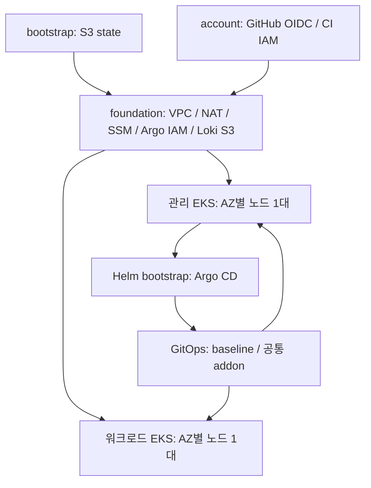

# Charlie Infra

예선 `iris-infra`에서 Terraform 파이프라인과 AWS/Kubernetes 기반만 선별한 본선용 시작 구성입니다. **AWS 서울 리전의 공유 VPC + 관리용 private EKS + 워크로드용 private EKS**를 유지합니다. 제품 앱, CodeBuild, 서비스 ECR, RDS, 콘솔, ALB 로그 수집기, GCP, 온프레미스 기능은 포함하지 않습니다.

현재 위치는 `iris-infra/charlie-infra/`입니다. 이 디렉터리 **안의 내용 전체(숨김 파일 포함)를 새 저장소 루트로 옮겨 사용**하세요. 하위 `.github/workflows/`는 현재 iris 저장소에서 실행되지 않습니다. 경로는 모두 새 저장소 루트를 기준으로 합니다. 이 추출 작업에서는 클라우드 배포나 workflow 실행을 하지 않았습니다.

## 구조와 소유권



- Terraform: S3 state, VPC/SG/IAM, EKS/노드, VPC CNI/CoreDNS/kube-proxy/Pod Identity/EBS CSI. 관리·워크로드 stack은 foundation state만 참조하며 서로의 state는 읽지 않습니다.
- Helm bootstrap: Argo CD 자체. 클러스터 등록 Secret, private 저장소 credential, root Application은 운영자가 준비합니다.
- Argo CD: Namespace/gp3/Quota/LimitRange/NetworkPolicy, AWS LBC, metrics-server, Prometheus/Grafana/Alertmanager, Loki, Sealed Secrets, Argo Rollouts. OTel은 준비 후 활성화합니다. Terraform managed addon을 중복 설치하지 않습니다.
- 애플리케이션 코드·차트·DB·서비스 이미지 배포는 본선 요구에 맞게 별도로 추가합니다.

기본값은 `project=charlie`, `environment=dev`, 클러스터 `charlie-dev-management`/`charlie-dev-workload`입니다. VPC `10.40.0.0/16`, AZ `ap-northeast-2a/c`, AZ별 NAT, 클러스터당 기본 노드 2대입니다. 두 클러스터의 서비스 CIDR은 각각 `172.20.0.0/16`, `172.21.0.0/16`입니다. 기존 네트워크/VPN과 겹치면 배포 전에 CIDR·SG·OTel 허용 범위를 함께 조정하세요.

## 원본에서 정리한 항목

- 프로젝트 이름·라벨·context를 `charlie`로 변경하고 예선 때문에 늘린 관리 노드 1대를 제거했습니다. 고정 도구/provider/chart/image 버전은 유지했습니다.
- 예선 DB/빌드/API·Worker·콘솔 IAM 및 Pod Identity, 기존 DNS zone import와 인증서, 서비스 ECR/온프레미스/GCP 연결을 제거했습니다. 실제 계정/도메인/NLB DNS·인증서 ARN은 복사하지 않았습니다.
- GitHub OIDC provider는 기존 ARN을 참조하거나 없는 계정에서 생성하도록 분리했습니다. 임시 AdministratorAccess는 포함하지 않습니다.
- 기존 main push 자동 apply를 **main 수동 실행 + apply=true**로 변경했습니다. account stack은 CI 적용 대상이 아닙니다.
- 외부 ALB는 기본 비활성화입니다. 새 도메인/ACM 인증서와 필요한 애플리케이션 Ingress·정책을 준비한 뒤 baseline의 `externalAlb`을 켭니다. DNS/ACM 자동 생성은 이번 추출에 포함하지 않습니다.
- OTel의 예선 `svc-*` 수집과 전용 라벨·주소를 제거했습니다. 기본 수집 namespace는 `charlie-apps`, 선택 라벨은 `charlie/release-id`입니다.
- `.retired`, 실제 tfvars/backend 설정/state/plan/kubeconfig, 비밀값, provider·chart 캐시는 가져오지 않았습니다.

## 검증

필요 도구는 `.terraform-version`의 Terraform **1.16.4**, Helm **3.19.1**, Python 3(권장 3.12), PyYAML **6.0.3**, Bash, make입니다. 운영에는 AWS CLI v2, kubectl 1.35, SSM session-manager-plugin이 추가로 필요합니다. provider와 공식 chart 다운로드에 네트워크가 필요합니다.

```bash
python3 -m venv /tmp/charlie-check-venv
/tmp/charlie-check-venv/bin/python -m pip install PyYAML==6.0.3
make check PYTHON=/tmp/charlie-check-venv/bin/python
```

| 명령 | 확인 범위 |
| --- | --- |
| `make tf-check` | fmt + 임시 TF_DATA_DIR에서 backend 없는 init/validate. state/AWS 연결 없음 |
| `make tf-test` | 로컬 state/tfvars/override를 제외한 임시 복사본에서 provider mock test |
| `make ci-test PYTHON=...` | fake AWS/Terraform 실행 순서·계정·state key·삭제 guard·실패 처리, workflow 수동 배포 조건, shell 구문 |
| `make helm-check PYTHON=...` | 임시 chart dependency, bootstrap/GitOps/두 baseline 및 고정 외부 addon lint/render, AppProject/namespace·이미지 digest 검사 |
| `make inventory-check` | README 파일 목록 누락과 Terraform의 상대 module/file 참조 검사 |

이 검증은 실제 IAM 충분성, 네트워크 연결, 리소스 수용량, 이미지 pull, DNS/TLS 또는 배포 성공을 보장하지 않습니다. Helm 검사는 합성 target fixture를 쓰며 운영 Secret/NLB를 요구하지 않습니다. 기본 GitOps values의 빈 `targets`는 의도적이며 실제 출력 또는 CI fixture를 넣어야 schema 검사를 통과합니다.

### 추출본 검증 결과 (2026-11-01)

- Terraform bootstrap/account/foundation/management/workload 및 EKS 모듈 6개: fmt와 backend 없는 init/validate 통과.
- Terraform mock test: account 5개, foundation 13개, EKS 모듈 8개, management/workload 각 1개로 총 28개 통과.
- fake CLI 15개와 workflow gate 1개, Bash 구문 검사 통과.
- Argo bootstrap, 단계별 GitOps, 양쪽 baseline과 공통 addon의 lint/render·AppProject 허용 범위 및 공개 이미지 17개 digest 검사 통과.
- 117개 파일의 README 목록과 로컬 Terraform 참조 검사 통과. 원본 작업 트리는 보존했으며 실제 AWS/Kubernetes 배포는 수행하지 않았습니다.

## 처음 사용할 때: 입력과 state

아래는 **운영자가 이후 별도로 실행하는 배포 안내**입니다. 예제 값은 그대로 배포하지 마세요. 이 문서의 `apply`, migration, Helm/kubectl 적용은 실제 외부 변경입니다.

1. 새 저장소를 준비하고 `YOUR_OWNER`를 저장소 소유자로 바꿉니다. 기존 iris state나 backend 설정은 가져오지 않습니다. 모든 stack에서 실제 계정/리전/project/environment와 클러스터 이름을 일치시킵니다.
2. 각 root에서 `terraform.tfvars.example`을 `terraform.tfvars`로, `backend.hcl.example`을 `backend.hcl`로 복사하고 실제 값을 채웁니다. state 버킷은 새 `charlie-tfstate-<계정>-ap-northeast-2`, key는 예제의 stack별 경로를 사용합니다. account key는 `account/aws/terraform.tfstate`이며 CI 역할에 접근 권한을 주지 않습니다.
3. 같은 AWS 계정의 GitHub OIDC provider 존재 여부를 관리자로 확인합니다.

```bash
aws sts get-caller-identity
aws iam list-open-id-connect-providers
# 조회한 ARN으로 URL·audience가 GitHub token.actions.githubusercontent.com / sts.amazonaws.com인지 확인
aws iam get-open-id-connect-provider --open-id-connect-provider-arn <조회한_ARN>
```

기존 provider가 있으면 account의 `github_oidc_provider_arn`에 그 ARN을 넣고 **기존 state 소유를 유지**합니다. 새 charlie state로 중복 import하지 않습니다. provider가 없는 계정에서만 빈 문자열로 생성합니다. `github_oidc_subject_prefix`는 실제 저장소 OIDC sub prefix에 맞춥니다. 보통 `repo:OWNER/REPO`이며 조직의 subject customization을 사용하는 경우 실제 `@ID` 포함 prefix를 사용합니다. main 브랜치만 신뢰합니다.

### S3 state 최초 생성

최초 S3 버킷이 없으므로 bootstrap을 임시 로컬 backend로 실행한 뒤 **그 새 bootstrap state만** 새 S3로 이전합니다. 기존 iris state를 이동하는 작업이 아닙니다.

```bash
umask 077
mkdir -p .generated/bootstrap-local
# backend.tf를 제외한 bootstrap 정의와 lock, 준비한 로컬 입력만 복사
cp terraform/bootstrap/aws/main.tf terraform/bootstrap/aws/variables.tf \
   terraform/bootstrap/aws/outputs.tf terraform/bootstrap/aws/providers.tf \
   terraform/bootstrap/aws/versions.tf terraform/bootstrap/aws/.terraform.lock.hcl \
   terraform/bootstrap/aws/terraform.tfvars .generated/bootstrap-local/
terraform -chdir=.generated/bootstrap-local init -lockfile=readonly
terraform -chdir=.generated/bootstrap-local plan
terraform -chdir=.generated/bootstrap-local apply
# 버킷 생성 후 같은 작업 디렉터리에서 backend를 추가하고 local state를 이전
cp terraform/bootstrap/aws/backend.tf .generated/bootstrap-local/
terraform -chdir=.generated/bootstrap-local init -migrate-state \
  -backend-config=../../terraform/bootstrap/aws/backend.hcl
# 정식 root도 같은 새 bucket/key로 연결
make tf-init STACK=bootstrap/aws
```

S3 버전 관리·암호화·공개 차단·잠금과 `prevent_destroy`가 적용됩니다. migration 완료 및 원격 state 리소스 목록을 확인하기 전 로컬 state/백업을 삭제하지 마세요. 버킷 이름을 바꾸려면 bootstrap 이름 규칙·account IAM·backend·CI 설정·remote state 참조를 함께 변경해야 합니다.

### 적용 순서

1. 관리자: bootstrap 생성/이전 → `account/aws` init/plan/apply. OIDC provider 및 CI 역할은 관리자 영역입니다. 기존 계정 전역 EKS 서비스 연결 역할은 필요 시 그대로 사용합니다.
2. foundation → management → workload 순서로 init/plan/apply. 두 EKS는 private API이며 운영자 기존 IAM role/user ARN이 필수입니다.

```bash
export AWS_ACCOUNT_ID=<실제12자리계정>
make tf-init STACK=account/aws
make tf-plan STACK=account/aws
make tf-apply STACK=account/aws
# 이후 STACK=aws/dev/foundation, aws/dev/management, aws/dev/workload 순서로 반복
```

실제 `terraform.tfvars`는 로컬 명령에만 사용합니다. CI는 checked-in 기본값과 아래 repository variables를 사용하므로 기본 project/environment/네트워크를 바꾸면 CI 입력도 명시적으로 맞춰야 합니다. `tf-ci.sh plan`은 stack 간 미생성 출력을 예측하지 않으므로 최초 구축의 전체 일괄 dry-run이 아닙니다. 최초 생성은 위 의존 순서로 진행합니다.

## GitHub Actions 파이프라인

- push/PR: `make check`만 실행하며 AWS 자격 증명을 받지 않습니다.
- 수동 실행: main에서 `apply=true`를 선택하고 check가 성공한 경우에만 OIDC 인증 후 bootstrap → foundation → management → workload를 순차 적용합니다. account는 제외합니다. apply는 저장된 plan을 사용하며 foundation의 VPC/subnet/NAT/EIP/Loki 삭제·교체를 사전 차단합니다.
- `apply=false`가 기본값이며 main push만으로 배포하지 않습니다. repo root에 옮겨야 실행됩니다. workflow는 직접 실행하지 않았습니다.

| Repository variable | 설정 값 |
| --- | --- |
| `AWS_ACCOUNT_ID` | 실제 12자리 계정 |
| `AWS_REGION` | 기본 `ap-northeast-2` |
| `TF_STATE_BUCKET` | `charlie-tfstate-<계정>-<리전>` |
| `TERRAFORM_APPLY_ROLE_ARN` | account 출력 `terraform_apply_role_arn` |
| `EKS_OPERATOR_PRINCIPAL_ARN` | 기존 운영자 IAM role/user ARN |
| `EKS_ADDITIONAL_OPERATOR_PRINCIPAL_ARNS` | 추가 운영자 ARN JSON 배열, 기본 `[]` |

동일 apply concurrency group은 취소하지 않고 직렬 실행합니다. IAM은 추출한 태그·이름 범위로 제한하지만, 이 CI 역할은 두 클러스터와 해당 runtime IAM을 관리하므로 권한이 큽니다. branch 보호/저장소 접근 권한은 운영 정책으로 별도 관리하세요.

## Private EKS 접근과 Argo CD 설치

관리자/운영자 인증으로 foundation의 bridge ID와 각 EKS의 `target` 출력을 확인합니다. 이 값은 전체 state나 자격 증명 대신 연결 메타데이터만 제공합니다. 다음 절차는 클러스터별로 수행합니다.

1. `aws eks update-kubeconfig --name <클러스터명> --region ap-northeast-2 --alias <context>`로 로컬 kubeconfig를 준비합니다. IAM Access Entry에 등록한 운영자 인증을 사용합니다.
2. SSM bridge가 Online인지 확인하고 각 EKS endpoint의 hostname을 대상으로 터널을 엽니다. management는 10443, workload는 11443을 사용하면 두 터널을 병행할 수 있습니다.

```bash
aws ssm start-session --target <ssm_bridge_instance_id> \
  --document-name AWS-StartPortForwardingSessionToRemoteHost \
  --parameters '{"host":["<EKS_endpoint_hostname>"],"portNumber":["443"],"localPortNumber":["10443"]}'
```

별도 터미널에서 로컬 kubeconfig의 cluster server를 `https://127.0.0.1:10443`으로 바꾸고 `tls-server-name`은 **원래 EKS endpoint hostname**으로 설정합니다. workload는 11443을 씁니다. `certificate-authority-data`는 EKS의 실제 CA를 유지하고 insecure-skip-tls-verify는 사용하지 않습니다. 이 로컬 server/포트는 Argo target에 넣지 않습니다. `kubectl --context <context> get nodes`와 managed addon 상태를 확인합니다. 운영자에게는 SSM 시작 권한이 별도로 필요합니다.

3. 관리 클러스터에 bootstrap을 설치합니다.

```bash
helm repo add argo https://argoproj.github.io/argo-helm
helm dependency build helm/bootstrap
helm upgrade --install argocd helm/bootstrap --namespace argocd --create-namespace \
  --kube-context charlie-dev-management --wait
```

4. private GitHub 저장소의 read-only credential을 `argocd` namespace의 repository Secret으로 준비합니다. label은 `argocd.argoproj.io/secret-type: repository`, `stringData`는 `type: git`, `url: <새 저장소 HTTPS URL>`, `username`, `password`(토큰)입니다. 토큰은 stdin/보호된 로컬 파일로 전달하고 values/Git에는 넣지 않습니다.
5. 두 EKS를 Argo cluster Secret으로 등록합니다. label은 `argocd.argoproj.io/secret-type: cluster`, `stringData.name`은 실제 클러스터명, `server`는 실제 EKS endpoint, `config`는 아래 구조입니다. 값은 해당 stack의 `target` 출력에서 가져옵니다. 이 예시는 저장 형식 설명이며 인증 정보는 포함하지 않습니다.

```json
{
  "awsAuthConfig": {"clusterName": "<target.name>", "roleARN": "<target.argocd_role_arn>"},
  "tlsClientConfig": {"insecure": false, "caData": "<target.ca_data>"}
}
```

관리 Argo SA 3개는 Terraform Pod Identity로 foundation management role을 사용하고, 각 deploy role을 assume하여 두 EKS에 접근합니다. Terraform과 Argo 사이 SG/Access Entry가 이 연결을 허용합니다. 등록 Secret을 Git에 커밋하거나 운영 kubeconfig를 chart에 넣지 않습니다.
6. management의 Loki values 안 `REPLACE_AWS_ACCOUNT_ID` 버킷을 foundation 출력 `loki_bucket_name`으로 교체합니다. 새 저장소에 이 비밀값이 아닌 설정을 커밋합니다.
7. `helm/root-application.yaml.example`을 보호된 로컬 `.generated/root-application.yaml`로 복사하고 `YOUR_OWNER`, 두 target endpoint/name/region/VPC ID를 실제 출력으로 채웁니다. chart/values의 repoURL도 새 저장소로 맞춥니다. root를 관리 context에 적용하면 공통 애드온을 동기화합니다. 합성 `helm/gitops/ci/targets-values.yaml`은 배포하지 않습니다.

```bash
kubectl --context charlie-dev-management apply -f .generated/root-application.yaml
kubectl --context charlie-dev-management -n argocd get applications,appprojects
```

기본 addon 목록은 `helm/gitops/values.yaml`입니다. root 예제의 `valuesObject`는 targets/저장소를 override하며, 운영 addon 목록은 해당 기본값을 사용합니다. root/addon 모두 prune=false이므로 목록에서 제거하는 것만으로 실제 자원이 철거되지는 않습니다. Kubernetes 삭제/ALB·PVC 처리와 Terraform destroy는 별도 계획이 필요합니다.

## OTel 연결: 준비 후 활성화

1. 두 클러스터에 `observability` namespace를 준비합니다. 동일한 write 암호로 양쪽 `otel-write-auth` Secret을 만들고 `WRITE_PASSWORD` 키를 설정합니다. 현재 고정 collector 구성은 gateway inline 평문 htpasswd를 사용하므로 양쪽에 같은 암호를 설정합니다. collector 버전을 변경할 때는 인증 형식과 실제 401/200 응답을 재확인합니다. Secret은 Git·values에 저장하지 않습니다.
2. management OTel values에서 `loadBalancerSourceRanges`를 실제 workload private subnet CIDR에 맞춥니다. 기본은 `10.40.32.0/20`, `10.40.48.0/20`입니다. management addons 목록에 `opentelemetry-collector`를 추가하여 동기화합니다.
3. 관리 클러스터에서 내부 NLB 주소를 조회합니다.

```bash
kubectl --context charlie-dev-management -n observability get svc opentelemetry-collector
```

4. workload OTel values의 `extraEnvs.OTEL_GATEWAY_ENDPOINT`에 `http://<새_NLB_DNS>:4318`을 입력합니다. `REPLACE_MANAGEMENT_NLB_DNS`는 실제 동작 주소가 아닙니다.
5. 수집 namespace 변경 시 `config.receivers.filelog.include`(Pod 로그 경로)와 `extraEnvs.COLLECT_NAMESPACE_PATTERN`(메트릭 필터)을 함께 변경합니다. 선택 라벨 추출은 `config.processors.k8sattributes.extract.labels`, Loki 인덱스 라벨은 management Loki values의 `otlp_config`입니다. 기본은 `charlie/release-id` → `charlie.release_id`입니다. 필요 없으면 둘 다 제거합니다.
6. 새 endpoint/필터를 저장한 후 workload addons 목록에도 `opentelemetry-collector`를 추가하고 동기화합니다. collector auth 오류·Loki 로그·Prometheus 메트릭을 실제로 확인합니다. 내부 NLB와 private API 경로는 별개입니다.

## 영향과 복구

배포하면 EKS 2개, 기본 노드 4대, NAT 2개, bridge EC2, S3/EBS 및 OTel 활성화 시 내부 NLB 비용이 발생합니다. NAT single 모드는 비용/장애 범위가 달라집니다. Argo와 지정 운영자의 EKS 권한은 기존 구조의 cluster-admin을 유지합니다. Prometheus/Grafana/Alertmanager/Loki와 Argo는 단일 replica·일부 AZ 종속 EBS이므로 전체 서비스 HA를 보장하지 않습니다. 원본의 고정 Kubernetes/addon/node image 버전 지원 여부와 계정 quota는 실제 배포 직전에 확인하세요.

추출본 자체를 되돌리는 것은 새 `charlie-infra/` 제거로 가능합니다. 실제 배포 뒤에는 해당 작업만으로 복구되지 않습니다. GitOps는 검토한 이전 commit SHA로 고정하여 되돌리고, state는 S3 versioning으로 보호합니다. state 삭제나 기존 iris state 재사용으로 롤백하지 않습니다. foundation guard가 막는 삭제·교체는 별도 검토 후 명시적인 운영 변경으로 처리합니다. Sealed Secrets를 운영에서 사용하기 전 private key 백업·복구 절차를 별도로 준비하세요.

## 파일별 역할과 출처

아래는 **추출본에 포함된 모든 파일**의 역할입니다. 원본 경로는 추출 당시 `iris-infra/` 루트 기준이며, 새 저장소에서는 원본 파일에 의존하지 않습니다. `조정`은 이름·입력·권한·검증 범위를 재사용 목적에 맞게 정리한 파일, `동일`은 그대로 복사한 파일, `신규`는 추출본 사용을 위해 추가한 파일입니다.

| 파일 | 역할 | 원본 경로 | 처리 |
| --- | --- | --- | --- |
| [.github/workflows/terraform-check.yml](.github/workflows/terraform-check.yml) | PR/push 검증과 main의 명시적 수동 Terraform 배포 | `.github/workflows/terraform-check.yml` | 조정 |
| [.gitignore](.gitignore) | 로컬 비밀값·state·plan·kubeconfig·다운로드 산출물의 Git 추적 방지 | `.gitignore` | 동일 |
| [.terraform-version](.terraform-version) | Terraform CLI 버전 고정 | `.terraform-version` | 동일 |
| [Makefile](Makefile) | 추출본의 검증·로컬 Terraform 명령 진입점 | `Makefile` | 조정 |
| [README.md](README.md) | 아키텍처·초기 설정·운영 순서·파일별 역할과 출처 안내 | — | 신규 |
| [clusters/aws-dev-management/cluster.yaml](clusters/aws-dev-management/cluster.yaml) | 클러스터 ID·목적·Terraform 경로·로컬 kube context 메타데이터; Kubernetes manifest 아님 | `clusters/aws-dev-management/cluster.yaml` | 조정 |
| [clusters/aws-dev-management/values/aws-load-balancer-controller.yaml](clusters/aws-dev-management/values/aws-load-balancer-controller.yaml) | LBC 복제/이미지 pin·Pod Identity SA 설정 | `clusters/aws-dev-management/values/aws-load-balancer-controller.yaml` | 동일 |
| [clusters/aws-dev-management/values/baseline.yaml](clusters/aws-dev-management/values/baseline.yaml) | 클러스터별 namespace·quota·ALB 비활성화 설정 | `clusters/aws-dev-management/values/baseline.yaml` | 조정 |
| [clusters/aws-dev-management/values/kube-prometheus-stack.yaml](clusters/aws-dev-management/values/kube-prometheus-stack.yaml) | Prometheus/Grafana/Alertmanager·PVC/retention·고정 이미지 | `clusters/aws-dev-management/values/kube-prometheus-stack.yaml` | 동일 |
| [clusters/aws-dev-management/values/loki.yaml](clusters/aws-dev-management/values/loki.yaml) | 관리 Loki single-binary·S3 버킷 입력·보관 기간·이미지 | `clusters/aws-dev-management/values/loki.yaml` | 조정 |
| [clusters/aws-dev-management/values/metrics-server.yaml](clusters/aws-dev-management/values/metrics-server.yaml) | 메트릭 서버 replica·자원·고정 이미지 | `clusters/aws-dev-management/values/metrics-server.yaml` | 동일 |
| [clusters/aws-dev-management/values/opentelemetry-collector.yaml](clusters/aws-dev-management/values/opentelemetry-collector.yaml) | 관리 수집 gateway 또는 workload agent·인증 Secret 참조·수집 범위 | `clusters/aws-dev-management/values/opentelemetry-collector.yaml` | 조정 |
| [clusters/aws-dev-management/values/sealed-secrets.yaml](clusters/aws-dev-management/values/sealed-secrets.yaml) | Sealed Secrets controller 설정·고정 이미지 | `clusters/aws-dev-management/values/sealed-secrets.yaml` | 동일 |
| [clusters/aws-dev-workload/cluster.yaml](clusters/aws-dev-workload/cluster.yaml) | 클러스터 ID·목적·Terraform 경로·로컬 kube context 메타데이터; Kubernetes manifest 아님 | `clusters/aws-dev-workload/cluster.yaml` | 조정 |
| [clusters/aws-dev-workload/values/argo-rollouts.yaml](clusters/aws-dev-workload/values/argo-rollouts.yaml) | 워크로드 progressive delivery controller 설정·고정 이미지 | `clusters/aws-dev-workload/values/argo-rollouts.yaml` | 동일 |
| [clusters/aws-dev-workload/values/aws-load-balancer-controller.yaml](clusters/aws-dev-workload/values/aws-load-balancer-controller.yaml) | LBC 복제/이미지 pin·Pod Identity SA 설정 | `clusters/aws-dev-workload/values/aws-load-balancer-controller.yaml` | 동일 |
| [clusters/aws-dev-workload/values/baseline.yaml](clusters/aws-dev-workload/values/baseline.yaml) | 클러스터별 namespace·quota·ALB 비활성화 설정 | `clusters/aws-dev-workload/values/baseline.yaml` | 조정 |
| [clusters/aws-dev-workload/values/kube-prometheus-stack.yaml](clusters/aws-dev-workload/values/kube-prometheus-stack.yaml) | Prometheus/Grafana/Alertmanager·PVC/retention·고정 이미지 | `clusters/aws-dev-workload/values/kube-prometheus-stack.yaml` | 동일 |
| [clusters/aws-dev-workload/values/metrics-server.yaml](clusters/aws-dev-workload/values/metrics-server.yaml) | 메트릭 서버 replica·자원·고정 이미지 | `clusters/aws-dev-workload/values/metrics-server.yaml` | 동일 |
| [clusters/aws-dev-workload/values/opentelemetry-collector.yaml](clusters/aws-dev-workload/values/opentelemetry-collector.yaml) | 관리 수집 gateway 또는 workload agent·인증 Secret 참조·수집 범위 | `clusters/aws-dev-workload/values/opentelemetry-collector.yaml` | 조정 |
| [clusters/aws-dev-workload/values/sealed-secrets.yaml](clusters/aws-dev-workload/values/sealed-secrets.yaml) | Sealed Secrets controller 설정·고정 이미지 | `clusters/aws-dev-workload/values/sealed-secrets.yaml` | 동일 |
| [helm/bootstrap/Chart.lock](helm/bootstrap/Chart.lock) | Argo CD dependency 버전과 잠금 digest | `helm/bootstrap/Chart.lock` | 동일 |
| [helm/bootstrap/Chart.yaml](helm/bootstrap/Chart.yaml) | 고정 argo-cd chart dependency를 선언하는 bootstrap wrapper | `helm/bootstrap/Chart.yaml` | 조정 |
| [helm/bootstrap/values.yaml](helm/bootstrap/values.yaml) | Argo CD replica·SA·자원·ClusterIP·이미지 digest·하위 Application health 설정 | `helm/bootstrap/values.yaml` | 동일 |
| [helm/charts/cluster-baseline/Chart.yaml](helm/charts/cluster-baseline/Chart.yaml) | 클러스터 공통 baseline chart 메타데이터 | `helm/charts/cluster-baseline/Chart.yaml` | 동일 |
| [helm/charts/cluster-baseline/templates/baseline.yaml](helm/charts/cluster-baseline/templates/baseline.yaml) | Namespace·StorageClass·ResourceQuota·LimitRange·NetworkPolicy·선택적 ALB 앵커 | `helm/charts/cluster-baseline/templates/baseline.yaml` | 조정 |
| [helm/charts/cluster-baseline/values.schema.json](helm/charts/cluster-baseline/values.schema.json) | baseline 입력·선택적 ALB 인증서/그룹 검증 | `helm/charts/cluster-baseline/values.schema.json` | 조정 |
| [helm/charts/cluster-baseline/values.yaml](helm/charts/cluster-baseline/values.yaml) | namespace·gp3·quota·NetworkPolicy·선택적 ALB 기본값 | `helm/charts/cluster-baseline/values.yaml` | 조정 |
| [helm/gitops/Chart.yaml](helm/gitops/Chart.yaml) | 공통 AWS addon GitOps chart 메타데이터 | `helm/gitops/Chart.yaml` | 조정 |
| [helm/gitops/ci/targets-values.yaml](helm/gitops/ci/targets-values.yaml) | Helm 정적 검사용 합성 두 EKS target; 운영 배포 금지 | — | 신규 |
| [helm/gitops/templates/applications.yaml](helm/gitops/templates/applications.yaml) | baseline과 upstream 공통 addon의 Argo Application 생성 | `helm/gitops/templates/applications.yaml` | 조정 |
| [helm/gitops/templates/projects.yaml](helm/gitops/templates/projects.yaml) | 두 클러스터 공통 addon의 저장소·namespace·cluster resource 허용 범위 | `helm/gitops/templates/projects.yaml` | 조정 |
| [helm/gitops/values.schema.json](helm/gitops/values.schema.json) | GitOps target·저장소·addon 목록 입력 검증 | `helm/gitops/values.schema.json` | 조정 |
| [helm/gitops/values.yaml](helm/gitops/values.yaml) | 새 저장소·revision·실제 targets·단계별 addon 선택 기본값 | `helm/gitops/values.yaml` | 조정 |
| [helm/images.lock.json](helm/images.lock.json) | 추출된 공통 chart의 공개 이미지 digest 목록 | `helm/images.lock.json` | 조정 |
| [helm/root-application.yaml.example](helm/root-application.yaml.example) | 새 저장소·실제 target을 채워 설치하는 GitOps root AppProject/Application 예제 | — | 신규 |
| [helm/versions.json](helm/versions.json) | Helm·Kubernetes·공통 upstream chart 버전·repository 목록 | `helm/versions.json` | 동일 |
| [scripts/check-foundation-plan.py](scripts/check-foundation-plan.py) | foundation VPC/subnet/NAT/EIP/Loki 삭제·교체 차단 | `scripts/check-foundation-plan.py` | 조정 |
| [scripts/check-helm.py](scripts/check-helm.py) | 공식 chart lint/render와 이미지 pin·AppProject·namespace 계약 검사 | `scripts/check-helm.py` | 조정 |
| [scripts/check-inventory.py](scripts/check-inventory.py) | README 파일 목록 및 Terraform 로컬 module/file 참조 확인 | — | 신규 |
| [scripts/common.sh](scripts/common.sh) | 공통 오류 처리·도구 확인·허용 AWS stack 경로 변환 | `scripts/common.sh` | 조정 |
| [scripts/helm-check.sh](scripts/helm-check.sh) | 선택한 Python 환경으로 Helm 검사 실행 | `scripts/helm-check.sh` | 조정 |
| [scripts/terraform-check.sh](scripts/terraform-check.sh) | 임시 Terraform data directory의 backend 없는 init/validate | `scripts/terraform-check.sh` | 조정 |
| [scripts/terraform-test.sh](scripts/terraform-test.sh) | 실제 state·tfvars를 제외한 임시 복사본의 Terraform mock test | `scripts/terraform-test.sh` | 조정 |
| [scripts/tests/test-tf-ci.py](scripts/tests/test-tf-ci.py) | fake CLI로 순서·state key·계정·실패·삭제 guard·임시 plan 정리 검증 | `scripts/tests/test-tf-ci.py` | 조정 |
| [scripts/tests/test-workflow.py](scripts/tests/test-workflow.py) | 이벤트/브랜치/apply 입력 조합별 CI 배포 gate 검증 | — | 신규 |
| [scripts/tf-ci.sh](scripts/tf-ci.sh) | CI의 stack 순서·state 분리·saved plan apply·삭제 guard 실행 | `scripts/tf-ci.sh` | 조정 |
| [scripts/tf-stack.sh](scripts/tf-stack.sh) | 계정 확인을 포함한 로컬 init/plan/apply; apply 대화형 승인 유지 | `scripts/tf-stack.sh` | 조정 |
| [terraform/account/aws/.terraform.lock.hcl](terraform/account/aws/.terraform.lock.hcl) | 고정 provider 버전과 플랫폼별 package checksum | `terraform/account/aws/.terraform.lock.hcl` | 동일 |
| [terraform/account/aws/backend.hcl.example](terraform/account/aws/backend.hcl.example) | 새 S3 bucket·stack 전용 state key·계정 제한 입력 예제 | `terraform/account/aws/backend.hcl.example` | 조정 |
| [terraform/account/aws/backend.tf](terraform/account/aws/backend.tf) | 부분 S3 backend 선언; 실제 bucket/key는 로컬 설정 또는 CI 입력 | `terraform/account/aws/backend.tf` | 동일 |
| [terraform/account/aws/ci-access.tf](terraform/account/aws/ci-access.tf) | 태그 제한 compute 권한 및 SSM bridge 실행 권한 | `terraform/account/aws/ci-access.tf` | 동일 |
| [terraform/account/aws/ci-eks.tf](terraform/account/aws/ci-eks.tf) | CI의 EKS·runtime IAM·PassRole·서비스 연결 역할 관리 범위 | `terraform/account/aws/ci-eks.tf` | 조정 |
| [terraform/account/aws/ci-foundation.tf](terraform/account/aws/ci-foundation.tf) | CI의 Loki 저장 버킷 관리 권한; 예선 빌드 권한 제외 | `terraform/account/aws/ci-foundation.tf` | 조정 |
| [terraform/account/aws/ci-network.tf](terraform/account/aws/ci-network.tf) | 태그·리전 제한이 있는 CI 네트워크 관리 권한 | `terraform/account/aws/ci-network.tf` | 동일 |
| [terraform/account/aws/main.tf](terraform/account/aws/main.tf) | 선택적 GitHub OIDC 생성/기존 ARN 참조, main trust, CI 역할과 state 권한 | `terraform/account/aws/main.tf` | 조정 |
| [terraform/account/aws/outputs.tf](terraform/account/aws/outputs.tf) | 후속 stack 또는 운영자에게 전달하는 비밀값 없는 리소스/target 출력 | `terraform/account/aws/outputs.tf` | 동일 |
| [terraform/account/aws/providers.tf](terraform/account/aws/providers.tf) | 리전·허용 계정·공통 리소스 태그 | `terraform/account/aws/providers.tf` | 동일 |
| [terraform/account/aws/terraform.tfvars.example](terraform/account/aws/terraform.tfvars.example) | 새 환경에 맞게 복사·수정할 비밀값 없는 입력 예제 | `terraform/account/aws/terraform.tfvars.example` | 조정 |
| [terraform/account/aws/tests/eks-ci.tftest.hcl](terraform/account/aws/tests/eks-ci.tftest.hcl) | CI 세션·runtime IAM·EKS cluster 생성 보안 경계 mock 검사 | `terraform/account/aws/tests/eks-ci.tftest.hcl` | 조정 |
| [terraform/account/aws/tests/github-ci.tftest.hcl](terraform/account/aws/tests/github-ci.tftest.hcl) | 신규/기존 OIDC 두 경로·main trust·state/Loki 권한·잘못된 계정 거부 mock 검사 | `terraform/account/aws/tests/github-ci.tftest.hcl` | 조정 |
| [terraform/account/aws/tests/network-ci.tftest.hcl](terraform/account/aws/tests/network-ci.tftest.hcl) | CI의 태그·리전·네트워크 IAM 경계 mock 검사 | `terraform/account/aws/tests/network-ci.tftest.hcl` | 조정 |
| [terraform/account/aws/variables.tf](terraform/account/aws/variables.tf) | stack/module 입력값·기본값·유효성 검사 | `terraform/account/aws/variables.tf` | 조정 |
| [terraform/account/aws/versions.tf](terraform/account/aws/versions.tf) | Terraform 및 provider 버전 조건 | `terraform/account/aws/versions.tf` | 동일 |
| [terraform/bootstrap/aws/.terraform.lock.hcl](terraform/bootstrap/aws/.terraform.lock.hcl) | 고정 provider 버전과 플랫폼별 package checksum | `terraform/bootstrap/aws/.terraform.lock.hcl` | 동일 |
| [terraform/bootstrap/aws/backend.hcl.example](terraform/bootstrap/aws/backend.hcl.example) | 새 S3 bucket·stack 전용 state key·계정 제한 입력 예제 | `terraform/bootstrap/aws/backend.hcl.example` | 조정 |
| [terraform/bootstrap/aws/backend.tf](terraform/bootstrap/aws/backend.tf) | 부분 S3 backend 선언; 실제 bucket/key는 로컬 설정 또는 CI 입력 | `terraform/bootstrap/aws/backend.tf` | 동일 |
| [terraform/bootstrap/aws/main.tf](terraform/bootstrap/aws/main.tf) | state S3 버킷·versioning·암호화·공개 차단·전송 보안·삭제 보호 | `terraform/bootstrap/aws/main.tf` | 동일 |
| [terraform/bootstrap/aws/outputs.tf](terraform/bootstrap/aws/outputs.tf) | 후속 stack 또는 운영자에게 전달하는 비밀값 없는 리소스/target 출력 | `terraform/bootstrap/aws/outputs.tf` | 동일 |
| [terraform/bootstrap/aws/providers.tf](terraform/bootstrap/aws/providers.tf) | 리전·허용 계정·공통 리소스 태그 | `terraform/bootstrap/aws/providers.tf` | 동일 |
| [terraform/bootstrap/aws/terraform.tfvars.example](terraform/bootstrap/aws/terraform.tfvars.example) | 새 환경에 맞게 복사·수정할 비밀값 없는 입력 예제 | `terraform/bootstrap/aws/terraform.tfvars.example` | 조정 |
| [terraform/bootstrap/aws/variables.tf](terraform/bootstrap/aws/variables.tf) | stack/module 입력값·기본값·유효성 검사 | `terraform/bootstrap/aws/variables.tf` | 조정 |
| [terraform/bootstrap/aws/versions.tf](terraform/bootstrap/aws/versions.tf) | Terraform 및 provider 버전 조건 | `terraform/bootstrap/aws/versions.tf` | 동일 |
| [terraform/config/aws-load-balancer-controller-policy.json](terraform/config/aws-load-balancer-controller-policy.json) | EKS 모듈이 읽는 AWS Load Balancer Controller IAM 정책 문서 | `terraform/config/aws-load-balancer-controller-policy.json` | 동일 |
| [terraform/environments/aws/dev/foundation/.terraform.lock.hcl](terraform/environments/aws/dev/foundation/.terraform.lock.hcl) | 고정 provider 버전과 플랫폼별 package checksum | `terraform/environments/aws/dev/foundation/.terraform.lock.hcl` | 동일 |
| [terraform/environments/aws/dev/foundation/access.tf](terraform/environments/aws/dev/foundation/access.tf) | 공인 IP/인바운드 없는 SSM bridge EC2·IAM·SG | `terraform/environments/aws/dev/foundation/access.tf` | 동일 |
| [terraform/environments/aws/dev/foundation/argocd.tf](terraform/environments/aws/dev/foundation/argocd.tf) | 관리 Argo Pod Identity 역할과 두 EKS deploy 역할·assume 관계 | `terraform/environments/aws/dev/foundation/argocd.tf` | 동일 |
| [terraform/environments/aws/dev/foundation/backend.hcl.example](terraform/environments/aws/dev/foundation/backend.hcl.example) | 새 S3 bucket·stack 전용 state key·계정 제한 입력 예제 | `terraform/environments/aws/dev/foundation/backend.hcl.example` | 조정 |
| [terraform/environments/aws/dev/foundation/backend.tf](terraform/environments/aws/dev/foundation/backend.tf) | 부분 S3 backend 선언; 실제 bucket/key는 로컬 설정 또는 CI 입력 | `terraform/environments/aws/dev/foundation/backend.tf` | 동일 |
| [terraform/environments/aws/dev/foundation/main.tf](terraform/environments/aws/dev/foundation/main.tf) | 공유 인프라 기능별 파일 안내 | `terraform/environments/aws/dev/foundation/main.tf` | 조정 |
| [terraform/environments/aws/dev/foundation/network.tf](terraform/environments/aws/dev/foundation/network.tf) | 공유 VPC·public/private subnet·IGW·NAT·route·관리→workload API SG | `terraform/environments/aws/dev/foundation/network.tf` | 동일 |
| [terraform/environments/aws/dev/foundation/observability.tf](terraform/environments/aws/dev/foundation/observability.tf) | Loki S3·암호화·버킷 정책·Loki Pod Identity IAM | `terraform/environments/aws/dev/foundation/observability.tf` | 동일 |
| [terraform/environments/aws/dev/foundation/outputs.tf](terraform/environments/aws/dev/foundation/outputs.tf) | 후속 stack 또는 운영자에게 전달하는 비밀값 없는 리소스/target 출력 | `terraform/environments/aws/dev/foundation/outputs.tf` | 조정 |
| [terraform/environments/aws/dev/foundation/providers.tf](terraform/environments/aws/dev/foundation/providers.tf) | 리전·허용 계정·공통 리소스 태그 | `terraform/environments/aws/dev/foundation/providers.tf` | 동일 |
| [terraform/environments/aws/dev/foundation/terraform.tfvars.example](terraform/environments/aws/dev/foundation/terraform.tfvars.example) | 새 환경에 맞게 복사·수정할 비밀값 없는 입력 예제 | `terraform/environments/aws/dev/foundation/terraform.tfvars.example` | 조정 |
| [terraform/environments/aws/dev/foundation/tests/access.tftest.hcl](terraform/environments/aws/dev/foundation/tests/access.tftest.hcl) | private SSM bridge와 Argo assume-role 경계 mock 검사 | `terraform/environments/aws/dev/foundation/tests/access.tftest.hcl` | 조정 |
| [terraform/environments/aws/dev/foundation/tests/network.tftest.hcl](terraform/environments/aws/dev/foundation/tests/network.tftest.hcl) | 공유 subnet/AZ/CIDR/NAT·잘못된 네트워크 입력 mock 검사 | `terraform/environments/aws/dev/foundation/tests/network.tftest.hcl` | 조정 |
| [terraform/environments/aws/dev/foundation/tests/observability.tftest.hcl](terraform/environments/aws/dev/foundation/tests/observability.tftest.hcl) | Loki 버킷 이름/삭제 보호·SA trust·S3 범위 mock 검사 | `terraform/environments/aws/dev/foundation/tests/observability.tftest.hcl` | 조정 |
| [terraform/environments/aws/dev/foundation/variables.tf](terraform/environments/aws/dev/foundation/variables.tf) | stack/module 입력값·기본값·유효성 검사 | `terraform/environments/aws/dev/foundation/variables.tf` | 조정 |
| [terraform/environments/aws/dev/foundation/versions.tf](terraform/environments/aws/dev/foundation/versions.tf) | Terraform 및 provider 버전 조건 | `terraform/environments/aws/dev/foundation/versions.tf` | 동일 |
| [terraform/environments/aws/dev/management/.terraform.lock.hcl](terraform/environments/aws/dev/management/.terraform.lock.hcl) | 고정 provider 버전과 플랫폼별 package checksum | `terraform/environments/aws/dev/management/.terraform.lock.hcl` | 동일 |
| [terraform/environments/aws/dev/management/backend.hcl.example](terraform/environments/aws/dev/management/backend.hcl.example) | 새 S3 bucket·stack 전용 state key·계정 제한 입력 예제 | `terraform/environments/aws/dev/management/backend.hcl.example` | 조정 |
| [terraform/environments/aws/dev/management/backend.tf](terraform/environments/aws/dev/management/backend.tf) | 부분 S3 backend 선언; 실제 bucket/key는 로컬 설정 또는 CI 입력 | `terraform/environments/aws/dev/management/backend.tf` | 동일 |
| [terraform/environments/aws/dev/management/identity.tf](terraform/environments/aws/dev/management/identity.tf) | 관리 Argo SA 3개와 Loki SA의 Pod Identity 연결 | `terraform/environments/aws/dev/management/identity.tf` | 조정 |
| [terraform/environments/aws/dev/management/main.tf](terraform/environments/aws/dev/management/main.tf) | foundation remote state를 읽고 관리 EKS 모듈 연결 | `terraform/environments/aws/dev/management/main.tf` | 조정 |
| [terraform/environments/aws/dev/management/outputs.tf](terraform/environments/aws/dev/management/outputs.tf) | 후속 stack 또는 운영자에게 전달하는 비밀값 없는 리소스/target 출력 | `terraform/environments/aws/dev/management/outputs.tf` | 조정 |
| [terraform/environments/aws/dev/management/providers.tf](terraform/environments/aws/dev/management/providers.tf) | 리전·허용 계정·공통 리소스 태그 | `terraform/environments/aws/dev/management/providers.tf` | 동일 |
| [terraform/environments/aws/dev/management/terraform.tfvars.example](terraform/environments/aws/dev/management/terraform.tfvars.example) | 새 환경에 맞게 복사·수정할 비밀값 없는 입력 예제 | `terraform/environments/aws/dev/management/terraform.tfvars.example` | 조정 |
| [terraform/environments/aws/dev/management/tests/eks.tftest.hcl](terraform/environments/aws/dev/management/tests/eks.tftest.hcl) | foundation 출력만 소비하는 해당 EKS target 계약 mock 검사 | `terraform/environments/aws/dev/management/tests/eks.tftest.hcl` | 조정 |
| [terraform/environments/aws/dev/management/variables.tf](terraform/environments/aws/dev/management/variables.tf) | stack/module 입력값·기본값·유효성 검사 | `terraform/environments/aws/dev/management/variables.tf` | 조정 |
| [terraform/environments/aws/dev/management/versions.tf](terraform/environments/aws/dev/management/versions.tf) | Terraform 및 provider 버전 조건 | `terraform/environments/aws/dev/management/versions.tf` | 동일 |
| [terraform/environments/aws/dev/workload/.terraform.lock.hcl](terraform/environments/aws/dev/workload/.terraform.lock.hcl) | 고정 provider 버전과 플랫폼별 package checksum | `terraform/environments/aws/dev/workload/.terraform.lock.hcl` | 동일 |
| [terraform/environments/aws/dev/workload/backend.hcl.example](terraform/environments/aws/dev/workload/backend.hcl.example) | 새 S3 bucket·stack 전용 state key·계정 제한 입력 예제 | `terraform/environments/aws/dev/workload/backend.hcl.example` | 조정 |
| [terraform/environments/aws/dev/workload/backend.tf](terraform/environments/aws/dev/workload/backend.tf) | 부분 S3 backend 선언; 실제 bucket/key는 로컬 설정 또는 CI 입력 | `terraform/environments/aws/dev/workload/backend.tf` | 동일 |
| [terraform/environments/aws/dev/workload/main.tf](terraform/environments/aws/dev/workload/main.tf) | foundation remote state를 읽고 워크로드 EKS 모듈 연결 | `terraform/environments/aws/dev/workload/main.tf` | 조정 |
| [terraform/environments/aws/dev/workload/outputs.tf](terraform/environments/aws/dev/workload/outputs.tf) | 후속 stack 또는 운영자에게 전달하는 비밀값 없는 리소스/target 출력 | `terraform/environments/aws/dev/workload/outputs.tf` | 조정 |
| [terraform/environments/aws/dev/workload/providers.tf](terraform/environments/aws/dev/workload/providers.tf) | 리전·허용 계정·공통 리소스 태그 | `terraform/environments/aws/dev/workload/providers.tf` | 동일 |
| [terraform/environments/aws/dev/workload/terraform.tfvars.example](terraform/environments/aws/dev/workload/terraform.tfvars.example) | 새 환경에 맞게 복사·수정할 비밀값 없는 입력 예제 | `terraform/environments/aws/dev/workload/terraform.tfvars.example` | 조정 |
| [terraform/environments/aws/dev/workload/tests/eks.tftest.hcl](terraform/environments/aws/dev/workload/tests/eks.tftest.hcl) | foundation 출력만 소비하는 해당 EKS target 계약 mock 검사 | `terraform/environments/aws/dev/workload/tests/eks.tftest.hcl` | 조정 |
| [terraform/environments/aws/dev/workload/variables.tf](terraform/environments/aws/dev/workload/variables.tf) | stack/module 입력값·기본값·유효성 검사 | `terraform/environments/aws/dev/workload/variables.tf` | 조정 |
| [terraform/environments/aws/dev/workload/versions.tf](terraform/environments/aws/dev/workload/versions.tf) | Terraform 및 provider 버전 조건 | `terraform/environments/aws/dev/workload/versions.tf` | 동일 |
| [terraform/modules/eks/.terraform.lock.hcl](terraform/modules/eks/.terraform.lock.hcl) | 고정 provider 버전과 플랫폼별 package checksum | `terraform/modules/eks/.terraform.lock.hcl` | 동일 |
| [terraform/modules/eks/main.tf](terraform/modules/eks/main.tf) | private EKS·AZ별 노드·SG·IAM·CNI/CSI/addon·Access Entry 생성 | `terraform/modules/eks/main.tf` | 조정 |
| [terraform/modules/eks/outputs.tf](terraform/modules/eks/outputs.tf) | 후속 stack 또는 운영자에게 전달하는 비밀값 없는 리소스/target 출력 | `terraform/modules/eks/outputs.tf` | 조정 |
| [terraform/modules/eks/tests/eks.tftest.hcl](terraform/modules/eks/tests/eks.tftest.hcl) | EKS 모듈 private API·노드·addon·운영자 경계 mock 검사 | `terraform/modules/eks/tests/eks.tftest.hcl` | 조정 |
| [terraform/modules/eks/variables.tf](terraform/modules/eks/variables.tf) | stack/module 입력값·기본값·유효성 검사 | `terraform/modules/eks/variables.tf` | 조정 |
| [terraform/modules/eks/versions.tf](terraform/modules/eks/versions.tf) | Terraform 및 provider 버전 조건 | `terraform/modules/eks/versions.tf` | 동일 |
