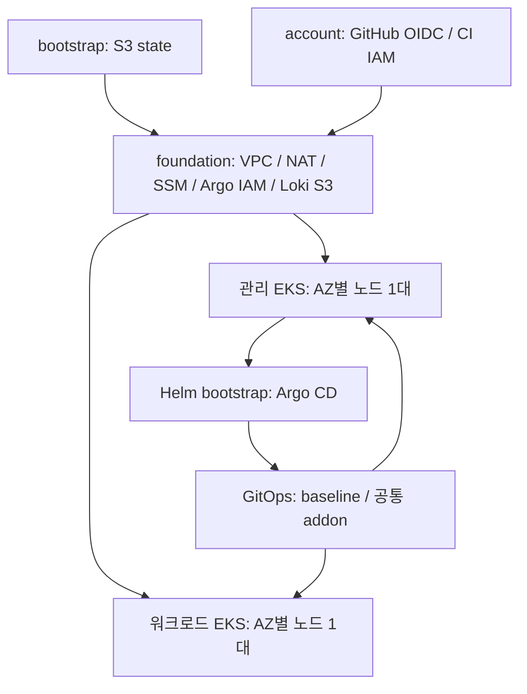

# Charlie Infra

## 팀 공용 Headlamp (배포 준비)

`https://headlamp.hopcharlie.dev`에서 개인 Cognito 로그인으로 두 EKS를 읽기 전용 조회하는 구성입니다.
실제 배포는 별도 승인과 라이브 검증이 필요하며 GitOps의 `headlamp.enabled`는 기본 false입니다.

| 파일 | 설명 |
| --- | --- |
| [docs/headlamp-team.md](docs/headlamp-team.md) | 배포·검증·팀원 등록·비용·정리 절차 |
| [docs/adr/0017-team-headlamp-with-cognito.md](docs/adr/0017-team-headlamp-with-cognito.md) | 인증·권한·배포 구성 제안 |
| [helm/charts/headlamp-team/Chart.yaml](helm/charts/headlamp-team/Chart.yaml) | Headlamp 팀 차트 |
| [helm/charts/headlamp-team/values.yaml](helm/charts/headlamp-team/values.yaml) | 고정 이미지와 기본값 |
| [helm/charts/headlamp-team/templates/web.yaml](helm/charts/headlamp-team/templates/web.yaml) | OIDC 웹 앱·클러스터 설정·HTTPS Ingress |
| [helm/charts/headlamp-team/templates/rbac.yaml](helm/charts/headlamp-team/templates/rbac.yaml) | Secret을 제외한 조회 권한 |
| [helm/charts/headlamp-team/templates/network.yaml](helm/charts/headlamp-team/templates/network.yaml) | Headlamp 네트워크 정책 |
| [clusters/aws-dev-management/values/headlamp-team.yaml](clusters/aws-dev-management/values/headlamp-team.yaml) | 관리 EKS 설정 초안 |
| [clusters/aws-dev-workload/values/headlamp-team.yaml](clusters/aws-dev-workload/values/headlamp-team.yaml) | 워크로드 EKS 조회 권한 설정 |
| [terraform/platform/aws/headlamp/main.tf](terraform/platform/aws/headlamp/main.tf) | Cognito·EKS OIDC·DNS·API 네트워크 |
| [terraform/platform/aws/headlamp/.terraform.lock.hcl](terraform/platform/aws/headlamp/.terraform.lock.hcl) | provider 버전 고정 |
| [terraform/platform/aws/headlamp/tests/main.tftest.hcl](terraform/platform/aws/headlamp/tests/main.tftest.hcl) | 클라우드 연결 없는 Terraform mock 검사 |
| [scripts/prepare-headlamp.py](scripts/prepare-headlamp.py) | 공개 values 생성 및 승인 후 Secret 등록 |
| [scripts/tests/test-headlamp.py](scripts/tests/test-headlamp.py) | 인증 경계·RBAC·GitOps 로컬 렌더링 검사 |
| [docs/headlamp-gke.md](docs/headlamp-gke.md) | 기존 AWS 로그인을 유지하는 GKE 개인 인증 연결 절차와 승인 경계 |
| [docs/adr/0020-add-gke-to-team-headlamp.md](docs/adr/0020-add-gke-to-team-headlamp.md) | GKE 개인 Google 인증 분리 제안 |
| [scripts/register-headlamp-gke.py](scripts/register-headlamp-gke.py) | 오프라인 GKE 연결 미리보기와 승인 후 기존 Secret 갱신 |
| [scripts/tests/test-headlamp-gke.py](scripts/tests/test-headlamp-gke.py) | AWS 설정 보존·무자격 GKE context·적용 경계 회귀 검사 |

2026 SoftBank Hackathon Charlie 프로젝트의 AWS 인프라 저장소입니다. Terraform으로 **AWS 서울 리전의 공유 VPC, 관리용 private EKS, 워크로드용 private EKS**를 구성하고, Helm과 Argo CD로 클러스터 공통 구성과 관측 도구를 관리합니다.

저장소: [2026-Softbank-Hackathon-Charlie/infra](https://github.com/2026-Softbank-Hackathon-Charlie/infra). 아래 명령과 경로는 모두 이 저장소 루트를 기준으로 합니다.

## Agent 지침과 의사결정 기록

| 파일 | 설명 |
| --- | --- |
| [AGENTS.md](AGENTS.md) | 주요 의사결정을 ADR로 기록하는 Agent 지침 |
| [docs/adr/template.md](docs/adr/template.md) | 배경·대안·결정 이유·영향을 기록하는 ADR 템플릿 |
| [docs/adr/0001-record-decisions-as-adrs.md](docs/adr/0001-record-decisions-as-adrs.md) | Agent의 주요 의사결정을 ADR로 기록하기로 한 결정 |
| [docs/adr/0002-require-approval-for-privileged-operations.md](docs/adr/0002-require-approval-for-privileged-operations.md) | 권한이 필요한 감사·변경 작업의 사전 승인 정책 |
| [docs/plans/argocd-workload-target.md](docs/plans/argocd-workload-target.md) | 실제 조회 결과와 Argo CD workload 등록·private 저장소 접근 점검 계획 |
| [docs/plans/argocd-root-bootstrap.md](docs/plans/argocd-root-bootstrap.md) | Argo CD 수동 Application 등록 계획·실행 결과와 sync 승인 경계 |
| [docs/adr/0017-adopt-existing-helm-resources-in-argocd.md](docs/adr/0017-adopt-existing-helm-resources-in-argocd.md) | 기존 Helm 리소스를 보존하는 단계적 Argo CD 연결 결정 |
| [docs/plans/metrics-and-management-monitoring.md](docs/plans/metrics-and-management-monitoring.md) | metrics-server 양쪽과 관리 Prometheus 스택의 한정 설치 계획·실행 결과 |
| [docs/adr/0018-stage-minimal-management-monitoring.md](docs/adr/0018-stage-minimal-management-monitoring.md) | HyperDX 선택을 유지하는 기본 모니터링 단계적 도입 결정 |
| [docs/adr/0019-use-chart-managed-prometheus-scrape-token.md](docs/adr/0019-use-chart-managed-prometheus-scrape-token.md) | Prometheus scrape용 장기 ServiceAccount 토큰의 추가 승인 경계 |

## 구조와 소유권



- Terraform: S3 state, VPC/SG/IAM, EKS/노드, VPC CNI/CoreDNS/kube-proxy/Pod Identity/EBS CSI. 관리·워크로드 stack은 foundation state만 참조하며 서로의 state는 읽지 않습니다.
- Helm bootstrap: Argo CD 자체. 클러스터 등록 Secret, private 저장소 credential, root Application은 운영자가 준비합니다.
- Argo CD: Namespace/gp3/Quota/LimitRange/NetworkPolicy, AWS LBC, metrics-server, Prometheus/Grafana/Alertmanager, Loki, Sealed Secrets, Argo Rollouts. OTel은 준비 후 활성화합니다. Terraform managed addon을 중복 설치하지 않습니다.
- 애플리케이션 코드·차트·DB·서비스 이미지 배포는 프로젝트 요구에 맞게 별도로 추가합니다.

기본값은 `project=charlie`, `environment=dev`, 클러스터 `charlie-dev-management`/`charlie-dev-workload`입니다. VPC `10.40.0.0/16`, AZ `ap-northeast-2a/c`, AZ별 NAT, 클러스터당 기본 노드 2대입니다. 두 클러스터의 서비스 CIDR은 각각 `172.20.0.0/16`, `172.21.0.0/16`입니다. 기존 네트워크/VPN과 겹치면 배포 전에 CIDR·SG·OTel 허용 범위를 함께 조정하세요.

## 구성 범위

- AWS 기반: Terraform state용 S3, GitHub OIDC와 CI IAM, 공유 VPC·NAT·SSM bridge, 관리·워크로드 EKS와 AZ별 노드를 구성합니다.
- 클러스터 운영: Argo CD, baseline 정책, 공통 애드온, Prometheus/Grafana/Alertmanager, Loki를 관리합니다. OTel은 인증 Secret과 수집 endpoint를 준비한 뒤 활성화합니다.
- 외부 ALB는 기본 비활성화입니다. 도메인·ACM 인증서와 애플리케이션 Ingress·정책을 준비한 뒤 baseline의 `externalAlb`을 켭니다. DNS/ACM 자동 생성은 포함하지 않습니다.
- 애플리케이션, 빌드 파이프라인, 서비스 ECR, RDS는 별도로 구성합니다.
- 실제 tfvars·backend 설정·state·plan·kubeconfig와 비밀값은 Git에 저장하지 않습니다.

## GCP 이전 대상 인프라

GCP 대상 GKE1개·GCS state·GitHub WIF·전용 baseline/workflow를 제공합니다. [GCP 구축·배포 절차](docs/gcp-deployment.md)를 먼저 읽으세요. 코드 검사와 실제 배포·연결 검증을 구분합니다. 기존 AWS 경로와 분리하며 CNPG·cross-cloud 연결은 후속 작업입니다.

## 검증

필요 도구는 `.terraform-version`의 Terraform **1.16.4**, Helm **3.19.1**, Python 3(권장 3.12), PyYAML **6.0.3**, Bash, make입니다. 운영에는 AWS CLI v2, kubectl 1.35, SSM session-manager-plugin이 추가로 필요합니다. provider와 공식 chart 다운로드에 네트워크가 필요합니다.

```bash
python3 -m venv /tmp/charlie-check-venv
/tmp/charlie-check-venv/bin/python -m pip install PyYAML==6.0.3
make check PYTHON=/tmp/charlie-check-venv/bin/python
```

| 명령 | 확인 범위 |
| --- | --- |
| `make tf-check` | fmt + 정제 임시 복사본에서 backend 없는 init/validate. state/AWS 연결 없음 |
| `make tf-verify` | root당 init 한 번 후 validate/mock 실행; CI matrix도 같은 runner 사용 |
| `make config-check` | 공유 프로젝트 JSON의 스키마·명명·네트워크 입력 검사 |
| `make tf-test` | 로컬 state/tfvars/override를 제외한 임시 복사본에서 provider mock test |
| `make ci-test PYTHON=...` | fake AWS/Terraform 실행 순서·계정·state key·삭제 guard·실패 처리, workflow 수동 배포 조건, shell 구문 |
| `make helm-check PYTHON=...` | 임시 chart dependency, bootstrap/GitOps/두 baseline 및 고정 외부 addon lint/render, AppProject/namespace·이미지 digest 검사 |
| `make inventory-check` | README 파일 목록 누락과 Terraform의 상대 module/file 참조 검사 |

이 검증은 실제 IAM 충분성, 네트워크 연결, 리소스 수용량, 이미지 pull, DNS/TLS 또는 배포 성공을 보장하지 않습니다. Helm 검사는 합성 target fixture를 쓰며 운영 Secret/NLB를 요구하지 않습니다. 기본 GitOps values의 빈 `targets`는 의도적이며 실제 출력 또는 CI fixture를 넣어야 schema 검사를 통과합니다.

## 처음 사용할 때: 입력과 state

아래는 **운영자가 이후 별도로 실행하는 배포 안내**입니다. 예제 값은 그대로 배포하지 마세요. 이 문서의 `apply`, migration, Helm/kubectl 적용은 실제 외부 변경입니다.

1. [config/project.json](config/project.json)을 공유 입력의 기준으로 사용합니다. 현재 `charlie/dev`, 서울, 기존 클러스터명과 state key를 유지합니다. CIDR·AZ·NAT 변경은 이 파일에서 하고 로컬/CI가 함께 사용합니다. 다른 환경·프로젝트로 이름을 바꾸려면 별도 migration 검토가 필요합니다.
2. 계정별 입력은 다음처럼 준비합니다. 이 파일에는 access key·secret·토큰을 넣지 않습니다. 추가 운영자가 없다면 빈 배열을 유지합니다. 초기 bootstrap/account만 실행한다면 `operator_principal_arn`은 생략할 수 있지만 EKS 적용 전에 기존 운영자 IAM role/user ARN을 반드시 넣습니다.

```bash
umask 077
cp config/account.local.json.example config/account.local.json
# account.local.json의 실제 계정 ID와 기존 운영자 ARN 등을 편집
python3 scripts/project-config.py check
```

3. AWS 인증 후 `aws sts get-caller-identity`로 계정을 확인하고 관리자로 기존 GitHub OIDC provider를 조회합니다. provider가 있으면 `github_oidc_provider_arn`에 기존 ARN을 넣어 소유권을 유지합니다. 없는 경우에만 빈 문자열로 신규 생성합니다.

```bash
aws sts get-caller-identity
aws iam list-open-id-connect-providers
aws iam get-open-id-connect-provider --open-id-connect-provider-arn <조회한_ARN>
```

4. GitHub의 실제 subject prefix를 조회합니다. `OWNER/REPO`를 [config/project.json](config/project.json)의 `github_repository`로 바꿉니다.

```bash
gh api repos/OWNER/REPO/actions/oidc/customization/sub --jq .sub_claim_prefix
```

반환된 값을 Git에서 제외한 `config/account.local.json`의 `github_oidc_subject_prefix`에 그대로 넣습니다. 예제의 `repo:OWNER/REPO`는 반드시 교체할 placeholder입니다. `account/aws` 입력 생성은 이 값이 없으면 중단하며 저장소 이름으로 추측하지 않습니다. `use_default=true`여도 prefix에 불변 ID(`@ID`)가 포함될 수 있으므로 위 API의 실제 값을 사용합니다. API가 반환한 기존 `repo:OWNER/REPO` 형식과 `repo:OWNER@ID/REPO@ID` 형식을 모두 지원합니다. `:ref:refs/heads/main`은 입력하지 않습니다. Terraform이 이 suffix를 붙여 main 브랜치만 신뢰합니다. bootstrap/foundation에는 이 입력이 필요하지 않습니다.

현재 이 저장소에서 확인한 prefix는 `repo:2026-Softbank-Hackathon-Charlie@350278309/infra@1442353250`입니다. 예제 placeholder를 그대로 쓰지 말고 API에서 재확인한 값으로 로컬 계정 입력을 설정합니다.

코드 merge만으로 실제 IAM trust는 바뀌지 않습니다. 기존 역할의 trust를 콘솔에서 변경했다면 같은 prefix를 로컬 JSON에 반영하고, **해당 역할을 이미 관리하는 기존 account state와 backend**로 변경 계획을 확인해야 합니다. 새 state로 역할을 다시 만들거나 기존 state를 삭제하지 마세요. 실제 IAM 변경은 별도 승인된 `account/aws` apply로 수행합니다.

기존 `terraform.tfvars`, `terraform.tfvars.json`, `*.auto.tfvars*`, override 및 `backend.hcl`은 wrapper가 거부합니다. 기존 값을 검토해 공유 값은 project.json, 계정 값은 account.local.json으로 수동 이관한 후 해당 입력 파일을 안전하게 별도 보관합니다. state나 `.terraform`를 지워서 충돌을 우회하지 마세요. wrapper는 기존 backend 메타데이터의 bucket/key/region/account/잠금/암호화를 확인하고 다르거나 판독 불가하면 중단합니다. 기본 workspace만 지원하며 외부 `TF_VAR_*`, `TF_CLI_ARGS*`, `TF_DATA_DIR`, `TF_CLI_CONFIG_FILE`도 거부합니다. 자동 state migration/reconfigure는 하지 않습니다.

### S3 state 최초 생성

최초 S3 버킷이 없으므로 bootstrap을 임시 로컬 backend로 실행한 뒤 **생성한 bootstrap state만** 프로젝트의 S3로 이전합니다.

```bash
umask 077
mkdir -p .generated/bootstrap-local .generated/bootstrap-inputs
# 정식 root에 legacy 입력이나 초기화 충돌이 없을 때 공통 입력 생성
python3 scripts/project-config.py prepare --stack bootstrap/aws \
  --output-dir .generated/bootstrap-inputs
# backend.tf 없이 로컬 backend로 최초 생성
cp terraform/bootstrap/aws/main.tf terraform/bootstrap/aws/variables.tf \
   terraform/bootstrap/aws/outputs.tf terraform/bootstrap/aws/providers.tf \
   terraform/bootstrap/aws/versions.tf terraform/bootstrap/aws/.terraform.lock.hcl \
   .generated/bootstrap-local/
terraform -chdir=.generated/bootstrap-local init -lockfile=readonly
terraform -chdir=.generated/bootstrap-local plan \
  -var-file=../bootstrap-inputs/inputs.tfvars.json
terraform -chdir=.generated/bootstrap-local apply \
  -var-file=../bootstrap-inputs/inputs.tfvars.json
# 생성한 bootstrap state만 새 S3로 이전: 별도 승인 후 수동 실행
cp terraform/bootstrap/aws/backend.tf .generated/bootstrap-local/
terraform -chdir=.generated/bootstrap-local init -migrate-state \
  -backend-config=../bootstrap-inputs/backend.json
# 이전 및 원격 리소스 목록 확인 후 정식 root 연결
make tf-init STACK=bootstrap/aws
```

S3 버전 관리·암호화·공개 차단·잠금과 `prevent_destroy`가 적용됩니다. migration 완료 및 원격 state 리소스 목록을 확인하기 전 로컬 state/백업을 삭제하지 마세요. 버킷 이름을 바꾸려면 bootstrap 이름 규칙·account IAM·backend·CI 설정·remote state 참조를 함께 변경해야 합니다.

### 적용 순서

1. 관리자: bootstrap 생성/이전 → `account/aws` init/plan/apply. OIDC provider 및 CI 역할은 관리자 영역입니다. 기존 계정 전역 EKS 서비스 연결 역할은 필요 시 그대로 사용합니다.
2. foundation → management → workload 순서로 init/plan/apply. 두 EKS는 private API이며 운영자 기존 IAM role/user ARN이 필수입니다.

```bash
export AWS_ACCOUNT_ID=<실제12자리계정>
make tf-init STACK=account/aws
make tf-plan STACK=account/aws
make tf-apply STACK=account/aws
# 이후 STACK=aws/dev/foundation, aws/dev/management, aws/dev/workload 순서로 반복
```

로컬과 CI는 같은 `config/project.json` 및 `scripts/project-config.py`로 입력을 생성합니다. 계정 JSON과 GitHub 변수는 계정별 값만 제공합니다. 공통 설정과 AWS_REGION·TF_STATE_BUCKET·역할 ARN이 어긋나면 중단합니다. backend JSON과 변수 파일은 임시 생성 후 정리합니다. `bash scripts/tf-ci.sh`의 기본 동작은 `plan bootstrap`입니다. 전체 검토는 `bash scripts/tf-ci.sh plan all-runtime`으로 명시해야 하며, 미생성 foundation 출력을 예측하지 않으므로 최초 구축의 전체 일괄 dry-run이 아닙니다. 최초 생성은 위 의존 순서로 진행합니다.

## GitHub Actions 파이프라인

- push/PR: Terraform 6개 root의 validate/mock을 matrix(최대 동시 3개)로 실행하고 Helm·스크립트 검사를 병렬 실행합니다. 모든 검사에 AWS 인증을 부여하지 않습니다. fork PR도 공통 설정 검증을 수행합니다.
- `check`는 모든 검증의 성공만 허용하는 집계 job이며 실패·skip·취소 시 배포하지 않습니다. 기존 필수 검사 이름을 유지합니다. Terraform은 정제된 임시 복사본에서 root당 init 한 번(총 6회)을 수행합니다. OS/아키텍처/CLI/root/lock별 provider 전용 캐시를 사용하고 state·plan·tfvars·전체 `.terraform`는 캐시하지 않습니다. runner별 캐시는 독립적입니다.
- 각 Terraform root의 경과 시간을 로그에 출력합니다. cold/warm 실행 비교는 실제 GitHub 실행 후 확인해야 하며 특정 속도 향상을 보장하지 않습니다. 병렬 runner 사용 분이 증가할 수 있습니다.
- 수동 실행: main에서 `action=plan|apply`, `stack=bootstrap|foundation|management|workload|all-runtime`을 선택합니다. 기본값은 **`plan + bootstrap`**이며 리소스를 적용하지 않습니다. 기존 `apply` boolean 입력은 이 두 choice 입력으로 대체했습니다.
- check 성공 후에만 OIDC로 인증하고 선택한 stack을 실행합니다. 개별 선택은 의존 stack을 자동 생성하지 않습니다. `all-runtime`을 명시한 경우에만 bootstrap → foundation → management → workload를 순차 실행하며 account는 관리자 로컬 전용입니다. apply는 저장한 plan을 사용하고 foundation의 VPC/subnet/NAT/EIP/Loki 삭제·교체 guard를 유지합니다.
- `bootstrap`은 state S3와 보호 설정만 관리합니다. `foundation` apply는 VPC·NAT·SSM bridge·IAM·Loki S3를, `management`/`workload` apply는 각 EKS를 포함합니다. `all-runtime + apply`는 두 EKS까지 포함합니다.
- main push만으로 AWS 작업을 실행하지 않습니다. 수동 plan도 S3 backend·CI 역할이 필요하며 state 잠금 파일을 일시 생성할 수 있습니다. workflow는 `.github/workflows/terraform-check.yml`에 정의되어 있습니다.

| Repository variable | 설정 값 |
| --- | --- |
| `AWS_ACCOUNT_ID` | 실제 12자리 계정 |
| `AWS_REGION` | 선택 사항. 설정 시 project.json의 리전과 같아야 함 |
| `TF_STATE_BUCKET` | 선택 사항. 설정 시 공통 설정에서 계산한 버킷명과 같아야 함 |
| `TERRAFORM_APPLY_ROLE_ARN` | account 출력 `terraform_apply_role_arn` |
| `EKS_OPERATOR_PRINCIPAL_ARN` | 기존 운영자 IAM role/user ARN |
| `EKS_ADDITIONAL_OPERATOR_PRINCIPAL_ARNS` | 추가 운영자 ARN JSON 배열, 기본 `[]` |

배포 인증 전 실행 저장소/브랜치가 공통 설정과 일치하는지도 확인합니다. OIDC subject는 account의 명시 입력이며 맞춤 subject 설정은 관리자 책임입니다.

동일 apply concurrency group은 취소하지 않고 직렬 실행합니다. CI 역할에는 AWS 관리형 `AdministratorAccess`를 연결합니다. 기존 태그·이름 범위 정책도 남아 있지만 실제 권한의 상한이 아니며 account state·자체 역할·OIDC·다른 프로젝트를 포함한 계정 전체에 관리 권한을 가집니다. OIDC 신뢰는 이 저장소의 main 브랜치와 `sts.amazonaws.com` audience로 유지합니다. branch 보호/저장소 접근 권한은 운영 정책으로 별도 관리하세요.

### 최소 구축과 첫 파이프라인 실행 순서

1. 관리자 로컬 인증으로 S3 bootstrap을 생성하고 그 bootstrap state만 S3로 이전합니다. 위 최초 생성 절차를 사용합니다.
2. 로컬에서 `account/aws` plan을 검토하고 별도 승인 후 apply하여 CI 역할을 생성합니다. 기존 GitHub OIDC provider는 config의 ARN으로 참조합니다.
3. Repository variables를 설정하고 이 workflow 변경을 main에 반영합니다. 코드가 로컬에만 있으면 GitHub의 기존 workflow 동작은 바뀌지 않습니다.
4. Run workflow에서 `action=plan`, `stack=bootstrap`으로 실행해 OIDC·state 연결을 확인합니다. 이 단계에서 EKS는 생성하지 않습니다.
5. 이후 필요할 때만 foundation과 EKS를 각각 검토·적용합니다. EKS에는 운영자 IAM ARN과 선행 foundation state가 필요합니다.

## Private EKS 접근과 Argo CD 설치

이미 설치한 Argo CD에 접속할 때는 아래 두 명령만 실행합니다. 저장소 루트에서 각각 별도 터미널을 사용합니다.

```bash
# 터미널 A: 관리 EKS API 터널. Session이 시작되면 계속 켜 둡니다.
make aws-tunnel

# 터미널 B: Argo CD 포트포워딩. 이 터미널도 계속 켜 둡니다.
make argo-port-forward
```

브라우저에서 **https://localhost:8080**으로 접속합니다. 기본 Argo CD 자체 서명 인증서를 사용하는 경우 브라우저에 인증서 경고가 표시될 수 있습니다. 각 명령은 foreground로 실행하며 `Ctrl+C`로 해당 프로세스를 종료합니다. Argo 포트포워딩을 종료한 뒤 터널도 종료합니다. 이미 수동으로 열어 둔 터널/포트포워딩이 있으면 해당 터미널에서 먼저 종료하거나 아래처럼 다른 포트를 선택합니다. 명령은 다른 프로세스를 종료하지 않습니다.

준비 사항:

- Python 3, GNU Make, AWS CLI v2, `kubectl`, AWS `session-manager-plugin`이 PATH에 있어야 합니다. macOS의 plugin 설치 예시는 `brew install --cask session-manager-plugin`입니다.
- `config/account.local.json`의 계정과 일치하는 로그인된 AWS 프로필이 필요합니다. 기본값은 `charlie-admin`이며 로그인·토큰 발급은 자동으로 수행하지 않습니다.
- 운영자에게 STS 계정 확인, EKS DescribeCluster, EC2 DescribeInstances, SSM DescribeInstanceInformation 및 지정 bridge/document의 StartSession 권한이 필요합니다. EKS Access Entry 인증과 Kubernetes 서비스/Pod 조회 및 Pod port-forward 권한도 필요합니다. 이 명령은 IAM·클러스터 권한을 추가하지 않습니다.
- 클러스터와 같은 VPC에서 `Project`, `Environment`, `Component=access` 태그를 가진 running bridge가 정확히 하나이고 SSM Online이어야 합니다. 접근 대상은 공유 프로젝트 설정으로 결정합니다.

옵션 예시:

```bash
# 다른 AWS 프로필로 터널 생성
make aws-tunnel AWS_PROFILE=my-operator

# 워크로드 EKS는 기본 11443. 관리 터널(10443)과 별도 터미널에서 병행 가능
make aws-tunnel CLUSTER=workload

# 포트 충돌 시 변경: Argo는 kubeconfig에 저장된 API 포트를 자동 사용
make aws-tunnel EKS_LOCAL_PORT=12443
make argo-port-forward ARGO_LOCAL_PORT=9090

# 터널을 유지한 상태에서 관리 클러스터 확인
kubectl --kubeconfig .generated/access/management.kubeconfig \
  --context charlie-dev-management get nodes
```

포트는 1024~65535만 허용하며 Argo 포트포워딩은 management 전용입니다. 프로필은 `AWS_PROFILE` 환경 변수 또는 Make 인자로 지정할 수 있습니다. 모든 AWS 호출에 `config/project.json`의 region을 명시하며 다른 `AWS_REGION`/`AWS_DEFAULT_REGION` 값은 안내 후 무시합니다. Argo 인증은 **터널 생성 시 저장한 프로필**을 사용합니다. Argo 실행 터미널에 다른 `AWS_PROFILE`이 설정되어 있으면 오류가 나므로, 원하는 프로필로 터널을 다시 생성하거나 해당 환경 변수를 해제합니다.

전용 kubeconfig는 `.generated/access/management.kubeconfig`, `.generated/access/workload.kubeconfig`에 권한 `0600`으로 저장합니다. 기존 `~/.kube/config`, 글로벌 current-context, `KUBECONFIG` 및 수동 생성한 `.generated/charlie.kubeconfig`는 변경하지 않습니다. 이후 Helm/kubectl 명령에는 해당 `--kubeconfig`를 명시하세요. 터널의 server는 loopback 주소로 바꾸고 EKS의 실제 CA와 원래 endpoint의 `tls-server-name`을 유지합니다. `insecure-skip-tls-verify`는 사용하지 않습니다. 이 로컬 주소/포트는 Argo target 등록에 넣지 않습니다.

계정 불일치·bridge 미발견/복수·Offline·포트 충돌은 세션 시작 전에 중단합니다. Argo 명령은 관리 API `/readyz` 확인 후 포트포워딩을 실행하며 인증·RBAC 오류는 그대로 출력합니다. 자격 증명이 만료되면 로그인 후 다시 실행하세요. 자동 재시도나 백그라운드 실행은 하지 않습니다. 실제 클라우드 연결은 명령을 실행할 때 시작됩니다.

아래는 **아직 Argo CD를 설치하지 않은 환경**의 최초 설치·GitOps 연결 절차입니다. 이미 설치했다면 재설치는 필요하지 않습니다.

1. 관리 터널을 켠 상태에서 bootstrap을 설치합니다.

```bash
helm repo add argo https://argoproj.github.io/argo-helm
helm dependency build helm/bootstrap
helm upgrade --install argocd helm/bootstrap --namespace argocd --create-namespace \
  --kubeconfig .generated/access/management.kubeconfig \
  --kube-context charlie-dev-management --wait
```

2. private GitHub 저장소의 read-only credential을 `argocd` namespace의 repository Secret으로 준비합니다. label은 `argocd.argoproj.io/secret-type: repository`, `stringData`는 `type: git`, `url: https://github.com/2026-Softbank-Hackathon-Charlie/infra.git`, `username`, `password`(토큰)입니다. 토큰은 stdin/보호된 로컬 파일로 전달하고 values/Git에는 넣지 않습니다.
3. 두 EKS를 Argo cluster Secret으로 등록합니다. label은 `argocd.argoproj.io/secret-type: cluster`, `stringData.name`은 실제 클러스터명, `server`는 실제 EKS endpoint, `config`는 아래 구조입니다. 값은 해당 stack의 `target` 출력에서 가져옵니다. 이 예시는 저장 형식 설명이며 인증 정보는 포함하지 않습니다.

```json
{
  "awsAuthConfig": {"clusterName": "<target.name>", "roleARN": "<target.argocd_role_arn>"},
  "tlsClientConfig": {"insecure": false, "caData": "<target.ca_data>"}
}
```

관리 Argo SA 3개는 Terraform Pod Identity로 foundation management role을 사용하고, 각 deploy role을 assume하여 두 EKS에 접근합니다. Terraform과 Argo 사이 SG/Access Entry가 이 연결을 허용합니다. 등록 Secret을 Git에 커밋하거나 운영 kubeconfig를 chart에 넣지 않습니다.
4. management의 Loki values 안 `REPLACE_AWS_ACCOUNT_ID` 버킷을 foundation 출력 `loki_bucket_name`으로 교체합니다. 이 비밀값이 아닌 설정을 저장소에 커밋합니다.
5. `helm/root-application.yaml.example`을 보호된 로컬 `.generated/root-application.yaml`로 복사하고 두 target endpoint/name/region/VPC ID를 실제 출력으로 채웁니다. 예제의 `sourceRepos`와 root·GitOps의 `repoURL`은 모두 `https://github.com/2026-Softbank-Hackathon-Charlie/infra.git`으로 설정합니다. root를 관리 context에 적용하면 공통 애드온을 동기화합니다. 합성 `helm/gitops/ci/targets-values.yaml`은 배포하지 않습니다.

```bash
kubectl --kubeconfig .generated/access/management.kubeconfig --context charlie-dev-management apply -f .generated/root-application.yaml
kubectl --kubeconfig .generated/access/management.kubeconfig --context charlie-dev-management -n argocd get applications,appprojects
```

기본 addon 목록은 `helm/gitops/values.yaml`입니다. root 예제의 `valuesObject`는 targets/저장소를 override하며, 운영 addon 목록은 해당 기본값을 사용합니다. root/addon 모두 prune=false이므로 목록에서 제거하는 것만으로 실제 자원이 철거되지는 않습니다. Kubernetes 삭제/ALB·PVC 처리와 Terraform destroy는 별도 계획이 필요합니다.

## OTel 연결: 준비 후 활성화

1. 두 클러스터에 `observability` namespace를 준비합니다. 동일한 write 암호로 양쪽 `otel-write-auth` Secret을 만들고 `WRITE_PASSWORD` 키를 설정합니다. 현재 고정 collector 구성은 gateway inline 평문 htpasswd를 사용하므로 양쪽에 같은 암호를 설정합니다. collector 버전을 변경할 때는 인증 형식과 실제 401/200 응답을 재확인합니다. Secret은 Git·values에 저장하지 않습니다.
2. management OTel values에서 `loadBalancerSourceRanges`를 실제 workload private subnet CIDR에 맞춥니다. 기본은 `10.40.32.0/20`, `10.40.48.0/20`입니다. management addons 목록에 `opentelemetry-collector`를 추가하여 동기화합니다.
3. 관리 클러스터에서 내부 NLB 주소를 조회합니다.

```bash
kubectl --context charlie-dev-management -n observability get svc opentelemetry-collector
```

4. workload OTel values의 `extraEnvs.OTEL_GATEWAY_ENDPOINT`에 `http://<새_NLB_DNS>:4318`을 입력합니다. `REPLACE_MANAGEMENT_NLB_DNS`는 실제 동작 주소가 아닙니다.
5. 수집 namespace 변경 시 `config.receivers.filelog.include`(Pod 로그 경로)와 `extraEnvs.COLLECT_NAMESPACE_PATTERN`(메트릭 필터)을 함께 변경합니다. 선택 라벨 추출은 `config.processors.k8sattributes.extract.labels`, Loki 인덱스 라벨은 management Loki values의 `otlp_config`입니다. 기본은 `charlie/release-id` → `charlie.release_id`입니다. 필요 없으면 둘 다 제거합니다.
6. 새 endpoint/필터를 저장한 후 workload addons 목록에도 `opentelemetry-collector`를 추가하고 동기화합니다. collector auth 오류·Loki 로그·Prometheus 메트릭을 실제로 확인합니다. 내부 NLB와 private API 경로는 별개입니다.

## 영향과 복구

배포하면 EKS 2개, 기본 노드 4대, NAT 2개, bridge EC2, S3/EBS 및 OTel 활성화 시 내부 NLB 비용이 발생합니다. NAT single 모드는 비용/장애 범위가 달라집니다. Argo와 지정 운영자의 EKS 권한은 cluster-admin입니다. Prometheus/Grafana/Alertmanager/Loki와 Argo는 단일 replica·일부 AZ 종속 EBS이므로 전체 서비스 HA를 보장하지 않습니다. 저장소에 고정한 Kubernetes/addon/node image 버전 지원 여부와 계정 quota는 실제 배포 직전에 확인하세요.

GitOps는 검토한 이전 commit SHA로 고정하여 되돌리고, state는 S3 versioning으로 보호합니다. state 삭제나 다른 프로젝트의 state 재사용으로 롤백하지 않습니다. foundation guard가 막는 삭제·교체는 별도 검토 후 명시적인 운영 변경으로 처리합니다. Sealed Secrets를 운영에서 사용하기 전 private key 백업·복구 절차를 별도로 준비하세요.

## 파일별 역할

저장소에 포함된 파일과 각 파일의 역할입니다.

| 파일 | 역할 |
| --- | --- |
| [.github/workflows/terraform-check.yml](.github/workflows/terraform-check.yml) | PR/push 검증과 main의 명시적 수동 Terraform 배포 |
| [.gitignore](.gitignore) | 로컬 비밀값·state·plan·kubeconfig·다운로드 산출물의 Git 추적 방지 |
| [.terraform-version](.terraform-version) | Terraform CLI 버전 고정 |
| [Makefile](Makefile) | 인프라 검증·로컬 Terraform·SSM 터널·Argo CD 접속 명령 진입점 |
| [README.md](README.md) | 아키텍처·초기 설정·운영 순서·파일별 역할 안내 |
| [clusters/aws-dev-management/cluster.yaml](clusters/aws-dev-management/cluster.yaml) | 클러스터 ID·목적·Terraform 경로·로컬 kube context 메타데이터; Kubernetes manifest 아님 |
| [clusters/aws-dev-management/values/aws-load-balancer-controller.yaml](clusters/aws-dev-management/values/aws-load-balancer-controller.yaml) | LBC 복제/이미지 pin·Pod Identity SA 설정 |
| [clusters/aws-dev-management/values/baseline.yaml](clusters/aws-dev-management/values/baseline.yaml) | 관리 클러스터 namespace·quota, 플랫폼용 공유 ALB와 `*.hopcharlie.dev` 인증서 |
| [clusters/aws-dev-management/values/kube-prometheus-stack.yaml](clusters/aws-dev-management/values/kube-prometheus-stack.yaml) | Prometheus/Grafana/Alertmanager·PVC/retention·고정 이미지 |
| [clusters/aws-dev-management/values/loki.yaml](clusters/aws-dev-management/values/loki.yaml) | 관리 Loki single-binary·S3 버킷 입력·보관 기간·이미지 |
| [clusters/aws-dev-management/values/metrics-server.yaml](clusters/aws-dev-management/values/metrics-server.yaml) | 메트릭 서버 replica·자원·고정 이미지 |
| [clusters/aws-dev-management/values/opentelemetry-collector.yaml](clusters/aws-dev-management/values/opentelemetry-collector.yaml) | 관리 수집 gateway 또는 workload agent·인증 Secret 참조·수집 범위 |
| [clusters/aws-dev-management/values/sealed-secrets.yaml](clusters/aws-dev-management/values/sealed-secrets.yaml) | Sealed Secrets controller 설정·고정 이미지 |
| [clusters/aws-dev-workload/cluster.yaml](clusters/aws-dev-workload/cluster.yaml) | 클러스터 ID·목적·Terraform 경로·로컬 kube context 메타데이터; Kubernetes manifest 아님 |
| [clusters/aws-dev-workload/values/argo-rollouts.yaml](clusters/aws-dev-workload/values/argo-rollouts.yaml) | 워크로드 progressive delivery controller 설정·고정 이미지 |
| [clusters/aws-dev-workload/values/aws-load-balancer-controller.yaml](clusters/aws-dev-workload/values/aws-load-balancer-controller.yaml) | LBC 복제/이미지 pin·Pod Identity SA 설정 |
| [clusters/aws-dev-workload/values/baseline.yaml](clusters/aws-dev-workload/values/baseline.yaml) | 클러스터별 namespace·quota·ALB 비활성화 설정 |
| [clusters/aws-dev-workload/values/kube-prometheus-stack.yaml](clusters/aws-dev-workload/values/kube-prometheus-stack.yaml) | Prometheus/Grafana/Alertmanager·PVC/retention·고정 이미지 |
| [clusters/aws-dev-workload/values/metrics-server.yaml](clusters/aws-dev-workload/values/metrics-server.yaml) | 메트릭 서버 replica·자원·고정 이미지 |
| [clusters/aws-dev-workload/values/opentelemetry-collector.yaml](clusters/aws-dev-workload/values/opentelemetry-collector.yaml) | 관리 수집 gateway 또는 workload agent·인증 Secret 참조·수집 범위 |
| [clusters/aws-dev-workload/values/sealed-secrets.yaml](clusters/aws-dev-workload/values/sealed-secrets.yaml) | Sealed Secrets controller 설정·고정 이미지 |
| [helm/bootstrap/Chart.lock](helm/bootstrap/Chart.lock) | Argo CD dependency 버전과 잠금 digest |
| [helm/bootstrap/Chart.yaml](helm/bootstrap/Chart.yaml) | 고정 argo-cd chart dependency를 선언하는 bootstrap wrapper |
| [helm/bootstrap/values.yaml](helm/bootstrap/values.yaml) | Argo CD replica·SA·자원·ClusterIP·이미지 digest·하위 Application health 설정 |
| [helm/charts/cluster-baseline/Chart.yaml](helm/charts/cluster-baseline/Chart.yaml) | 클러스터 공통 baseline chart 메타데이터 |
| [helm/charts/cluster-baseline/templates/baseline.yaml](helm/charts/cluster-baseline/templates/baseline.yaml) | Namespace·StorageClass·ResourceQuota·LimitRange·NetworkPolicy·선택적 ALB 앵커 |
| [helm/charts/cluster-baseline/values.schema.json](helm/charts/cluster-baseline/values.schema.json) | baseline 입력·선택적 ALB 인증서/그룹 검증 |
| [helm/charts/cluster-baseline/values.yaml](helm/charts/cluster-baseline/values.yaml) | namespace·gp3·quota·NetworkPolicy·선택적 ALB 기본값 |
| [helm/gitops/Chart.yaml](helm/gitops/Chart.yaml) | 공통 AWS addon GitOps chart 메타데이터 |
| [helm/gitops/ci/targets-values.yaml](helm/gitops/ci/targets-values.yaml) | Helm 정적 검사용 합성 두 EKS target; 운영 배포 금지 |
| [helm/gitops/templates/applications.yaml](helm/gitops/templates/applications.yaml) | baseline과 upstream 공통 addon의 Argo Application 생성 |
| [helm/gitops/templates/projects.yaml](helm/gitops/templates/projects.yaml) | 두 클러스터 공통 addon의 저장소·namespace·cluster resource 허용 범위 |
| [helm/gitops/values.schema.json](helm/gitops/values.schema.json) | GitOps target·저장소·addon 목록 입력 검증 |
| [helm/gitops/values.yaml](helm/gitops/values.yaml) | 새 저장소·revision·실제 targets·단계별 addon 선택 기본값 |
| [helm/images.lock.json](helm/images.lock.json) | 공통 chart의 공개 이미지 digest 목록 |
| [helm/root-application.yaml.example](helm/root-application.yaml.example) | 새 저장소·실제 target을 채워 설치하는 GitOps root AppProject/Application 예제 |
| [helm/versions.json](helm/versions.json) | Helm·Kubernetes·공통 upstream chart 버전·repository 목록 |
| [scripts/check-foundation-plan.py](scripts/check-foundation-plan.py) | foundation VPC/subnet/NAT/EIP/Loki 삭제·교체 차단 |
| [scripts/check-helm.py](scripts/check-helm.py) | 공식 chart lint/render와 이미지 pin·AppProject·namespace 계약 검사 |
| [scripts/check-inventory.py](scripts/check-inventory.py) | README 파일 목록 및 Terraform 로컬 module/file 참조 확인 |
| [scripts/common.sh](scripts/common.sh) | 공통 오류 처리·도구 확인·허용 AWS stack 경로 변환 |
| [scripts/eks-access.py](scripts/eks-access.py) | 전용 kubeconfig와 SSM 터널·관리 Argo CD 포트포워딩 |
| [scripts/tests/test-eks-access.py](scripts/tests/test-eks-access.py) | fake CLI로 접속 명령·계정·TLS·프로필·실패 처리 검증 |
| [docs/adr/0014-local-eks-access-commands.md](docs/adr/0014-local-eks-access-commands.md) | foreground Make 명령과 전용 kubeconfig 운영 결정 |
| [scripts/helm-check.sh](scripts/helm-check.sh) | 선택한 Python 환경으로 Helm 검사 실행 |
| [scripts/terraform-check.sh](scripts/terraform-check.sh) | 정제 임시 복사본에서 backend 없는 init/validate |
| [scripts/terraform-test.sh](scripts/terraform-test.sh) | 실제 state·tfvars를 제외한 임시 복사본의 Terraform mock test |
| [scripts/tests/test-tf-ci.py](scripts/tests/test-tf-ci.py) | fake CLI로 순서·state key·계정·실패·삭제 guard·임시 plan 정리 검증 |
| [scripts/tests/test-workflow.py](scripts/tests/test-workflow.py) | 이벤트/브랜치/apply 입력 조합별 CI 배포 gate 검증 |
| [scripts/tf-ci.sh](scripts/tf-ci.sh) | CI의 stack 순서·state 분리·saved plan apply·삭제 guard 실행 |
| [scripts/tf-stack.sh](scripts/tf-stack.sh) | 계정 확인을 포함한 로컬 init/plan/apply; apply 대화형 승인 유지 |
| [terraform/account/aws/.terraform.lock.hcl](terraform/account/aws/.terraform.lock.hcl) | 고정 provider 버전과 플랫폼별 package checksum |
| [terraform/account/aws/backend.hcl.example](terraform/account/aws/backend.hcl.example) | 공통 JSON backend 입력으로 이관하는 안내 |
| [terraform/account/aws/backend.tf](terraform/account/aws/backend.tf) | 부분 S3 backend 선언; 실제 bucket/key는 로컬 설정 또는 CI 입력 |
| [terraform/account/aws/ci-access.tf](terraform/account/aws/ci-access.tf) | 태그 제한 compute 권한 및 SSM bridge 실행 권한 |
| [terraform/account/aws/ci-eks.tf](terraform/account/aws/ci-eks.tf) | CI의 EKS·runtime IAM·PassRole·서비스 연결 역할 관리 범위 |
| [terraform/account/aws/ci-foundation.tf](terraform/account/aws/ci-foundation.tf) | CI의 Loki 저장 버킷 관리 권한 |
| [terraform/account/aws/ci-network.tf](terraform/account/aws/ci-network.tf) | 태그·리전 제한이 있는 CI 네트워크 관리 권한 |
| [terraform/account/aws/main.tf](terraform/account/aws/main.tf) | 선택적 GitHub OIDC 생성/기존 ARN 참조, main trust, CI 역할과 state 권한 |
| [terraform/account/aws/outputs.tf](terraform/account/aws/outputs.tf) | 후속 stack 또는 운영자에게 전달하는 비밀값 없는 리소스/target 출력 |
| [terraform/account/aws/providers.tf](terraform/account/aws/providers.tf) | 리전·허용 계정·공통 리소스 태그 |
| [terraform/account/aws/terraform.tfvars.example](terraform/account/aws/terraform.tfvars.example) | 공통 프로젝트/계정 JSON 입력으로 이관하는 안내 |
| [terraform/account/aws/tests/eks-ci.tftest.hcl](terraform/account/aws/tests/eks-ci.tftest.hcl) | CI 세션·runtime IAM·EKS cluster 생성 보안 경계 mock 검사 |
| [terraform/account/aws/tests/github-ci.tftest.hcl](terraform/account/aws/tests/github-ci.tftest.hcl) | 신규/기존 OIDC 두 경로·main trust·state/Loki 권한·잘못된 계정 거부 mock 검사 |
| [terraform/account/aws/tests/network-ci.tftest.hcl](terraform/account/aws/tests/network-ci.tftest.hcl) | CI의 태그·리전·네트워크 IAM 경계 mock 검사 |
| [terraform/account/aws/variables.tf](terraform/account/aws/variables.tf) | stack/module 입력값·기본값·유효성 검사 |
| [terraform/account/aws/versions.tf](terraform/account/aws/versions.tf) | Terraform 및 provider 버전 조건 |
| [terraform/bootstrap/aws/.terraform.lock.hcl](terraform/bootstrap/aws/.terraform.lock.hcl) | 고정 provider 버전과 플랫폼별 package checksum |
| [terraform/bootstrap/aws/backend.hcl.example](terraform/bootstrap/aws/backend.hcl.example) | 공통 JSON backend 입력으로 이관하는 안내 |
| [terraform/bootstrap/aws/backend.tf](terraform/bootstrap/aws/backend.tf) | 부분 S3 backend 선언; 실제 bucket/key는 로컬 설정 또는 CI 입력 |
| [terraform/bootstrap/aws/main.tf](terraform/bootstrap/aws/main.tf) | state S3 버킷·versioning·암호화·공개 차단·전송 보안·삭제 보호 |
| [terraform/bootstrap/aws/outputs.tf](terraform/bootstrap/aws/outputs.tf) | 후속 stack 또는 운영자에게 전달하는 비밀값 없는 리소스/target 출력 |
| [terraform/bootstrap/aws/providers.tf](terraform/bootstrap/aws/providers.tf) | 리전·허용 계정·공통 리소스 태그 |
| [terraform/bootstrap/aws/terraform.tfvars.example](terraform/bootstrap/aws/terraform.tfvars.example) | 공통 프로젝트/계정 JSON 입력으로 이관하는 안내 |
| [terraform/bootstrap/aws/variables.tf](terraform/bootstrap/aws/variables.tf) | stack/module 입력값·기본값·유효성 검사 |
| [terraform/bootstrap/aws/versions.tf](terraform/bootstrap/aws/versions.tf) | Terraform 및 provider 버전 조건 |
| [terraform/config/aws-load-balancer-controller-policy.json](terraform/config/aws-load-balancer-controller-policy.json) | EKS 모듈이 읽는 AWS Load Balancer Controller IAM 정책 문서 |
| [terraform/environments/aws/dev/foundation/.terraform.lock.hcl](terraform/environments/aws/dev/foundation/.terraform.lock.hcl) | 고정 provider 버전과 플랫폼별 package checksum |
| [terraform/environments/aws/dev/foundation/access.tf](terraform/environments/aws/dev/foundation/access.tf) | 공인 IP/인바운드 없는 SSM bridge EC2·IAM·SG |
| [terraform/environments/aws/dev/foundation/argocd.tf](terraform/environments/aws/dev/foundation/argocd.tf) | 관리 Argo Pod Identity 역할과 두 EKS deploy 역할·assume 관계 |
| [terraform/environments/aws/dev/foundation/backend.hcl.example](terraform/environments/aws/dev/foundation/backend.hcl.example) | 공통 JSON backend 입력으로 이관하는 안내 |
| [terraform/environments/aws/dev/foundation/backend.tf](terraform/environments/aws/dev/foundation/backend.tf) | 부분 S3 backend 선언; 실제 bucket/key는 로컬 설정 또는 CI 입력 |
| [terraform/environments/aws/dev/foundation/main.tf](terraform/environments/aws/dev/foundation/main.tf) | 공유 인프라 기능별 파일 안내 |
| [terraform/environments/aws/dev/foundation/network.tf](terraform/environments/aws/dev/foundation/network.tf) | 공유 VPC·public/private subnet·IGW·NAT·route·관리→workload API SG |
| [terraform/environments/aws/dev/foundation/observability.tf](terraform/environments/aws/dev/foundation/observability.tf) | Loki S3·암호화·버킷 정책·Loki Pod Identity IAM |
| [terraform/environments/aws/dev/foundation/outputs.tf](terraform/environments/aws/dev/foundation/outputs.tf) | 후속 stack 또는 운영자에게 전달하는 비밀값 없는 리소스/target 출력 |
| [terraform/environments/aws/dev/foundation/providers.tf](terraform/environments/aws/dev/foundation/providers.tf) | 리전·허용 계정·공통 리소스 태그 |
| [terraform/environments/aws/dev/foundation/terraform.tfvars.example](terraform/environments/aws/dev/foundation/terraform.tfvars.example) | 공통 프로젝트/계정 JSON 입력으로 이관하는 안내 |
| [terraform/environments/aws/dev/foundation/tests/access.tftest.hcl](terraform/environments/aws/dev/foundation/tests/access.tftest.hcl) | private SSM bridge와 Argo assume-role 경계 mock 검사 |
| [terraform/environments/aws/dev/foundation/tests/network.tftest.hcl](terraform/environments/aws/dev/foundation/tests/network.tftest.hcl) | 공유 subnet/AZ/CIDR/NAT·잘못된 네트워크 입력 mock 검사 |
| [terraform/environments/aws/dev/foundation/tests/observability.tftest.hcl](terraform/environments/aws/dev/foundation/tests/observability.tftest.hcl) | Loki 버킷 이름/삭제 보호·SA trust·S3 범위 mock 검사 |
| [terraform/environments/aws/dev/foundation/variables.tf](terraform/environments/aws/dev/foundation/variables.tf) | stack/module 입력값·기본값·유효성 검사 |
| [terraform/environments/aws/dev/foundation/versions.tf](terraform/environments/aws/dev/foundation/versions.tf) | Terraform 및 provider 버전 조건 |
| [terraform/environments/aws/dev/management/.terraform.lock.hcl](terraform/environments/aws/dev/management/.terraform.lock.hcl) | 고정 provider 버전과 플랫폼별 package checksum |
| [terraform/environments/aws/dev/management/backend.hcl.example](terraform/environments/aws/dev/management/backend.hcl.example) | 공통 JSON backend 입력으로 이관하는 안내 |
| [terraform/environments/aws/dev/management/backend.tf](terraform/environments/aws/dev/management/backend.tf) | 부분 S3 backend 선언; 실제 bucket/key는 로컬 설정 또는 CI 입력 |
| [terraform/environments/aws/dev/management/identity.tf](terraform/environments/aws/dev/management/identity.tf) | 관리 Argo SA 3개와 Loki SA의 Pod Identity 연결 |
| [terraform/environments/aws/dev/management/main.tf](terraform/environments/aws/dev/management/main.tf) | foundation remote state를 읽고 관리 EKS 모듈 연결 |
| [terraform/environments/aws/dev/management/outputs.tf](terraform/environments/aws/dev/management/outputs.tf) | 후속 stack 또는 운영자에게 전달하는 비밀값 없는 리소스/target 출력 |
| [terraform/environments/aws/dev/management/providers.tf](terraform/environments/aws/dev/management/providers.tf) | 리전·허용 계정·공통 리소스 태그 |
| [terraform/environments/aws/dev/management/terraform.tfvars.example](terraform/environments/aws/dev/management/terraform.tfvars.example) | 공통 프로젝트/계정 JSON 입력으로 이관하는 안내 |
| [terraform/environments/aws/dev/management/tests/eks.tftest.hcl](terraform/environments/aws/dev/management/tests/eks.tftest.hcl) | foundation 출력만 소비하는 해당 EKS target 계약 mock 검사 |
| [terraform/environments/aws/dev/management/variables.tf](terraform/environments/aws/dev/management/variables.tf) | stack/module 입력값·기본값·유효성 검사 |
| [terraform/environments/aws/dev/management/versions.tf](terraform/environments/aws/dev/management/versions.tf) | Terraform 및 provider 버전 조건 |
| [terraform/environments/aws/dev/workload/.terraform.lock.hcl](terraform/environments/aws/dev/workload/.terraform.lock.hcl) | 고정 provider 버전과 플랫폼별 package checksum |
| [terraform/environments/aws/dev/workload/backend.hcl.example](terraform/environments/aws/dev/workload/backend.hcl.example) | 공통 JSON backend 입력으로 이관하는 안내 |
| [terraform/environments/aws/dev/workload/backend.tf](terraform/environments/aws/dev/workload/backend.tf) | 부분 S3 backend 선언; 실제 bucket/key는 로컬 설정 또는 CI 입력 |
| [terraform/environments/aws/dev/workload/main.tf](terraform/environments/aws/dev/workload/main.tf) | foundation remote state를 읽고 워크로드 EKS 모듈 연결 |
| [terraform/environments/aws/dev/workload/outputs.tf](terraform/environments/aws/dev/workload/outputs.tf) | 후속 stack 또는 운영자에게 전달하는 비밀값 없는 리소스/target 출력 |
| [terraform/environments/aws/dev/workload/providers.tf](terraform/environments/aws/dev/workload/providers.tf) | 리전·허용 계정·공통 리소스 태그 |
| [terraform/environments/aws/dev/workload/terraform.tfvars.example](terraform/environments/aws/dev/workload/terraform.tfvars.example) | 공통 프로젝트/계정 JSON 입력으로 이관하는 안내 |
| [terraform/environments/aws/dev/workload/tests/eks.tftest.hcl](terraform/environments/aws/dev/workload/tests/eks.tftest.hcl) | foundation 출력만 소비하는 해당 EKS target 계약 mock 검사 |
| [terraform/environments/aws/dev/workload/variables.tf](terraform/environments/aws/dev/workload/variables.tf) | stack/module 입력값·기본값·유효성 검사 |
| [terraform/environments/aws/dev/workload/versions.tf](terraform/environments/aws/dev/workload/versions.tf) | Terraform 및 provider 버전 조건 |
| [terraform/modules/eks/.terraform.lock.hcl](terraform/modules/eks/.terraform.lock.hcl) | 고정 provider 버전과 플랫폼별 package checksum |
| [terraform/modules/eks/main.tf](terraform/modules/eks/main.tf) | private EKS·AZ별 노드·SG·IAM·CNI/CSI/addon·Access Entry 생성 |
| [terraform/modules/eks/outputs.tf](terraform/modules/eks/outputs.tf) | 후속 stack 또는 운영자에게 전달하는 비밀값 없는 리소스/target 출력 |
| [terraform/modules/eks/tests/eks.tftest.hcl](terraform/modules/eks/tests/eks.tftest.hcl) | EKS 모듈 private API·노드·addon·운영자 경계 mock 검사 |
| [terraform/modules/eks/variables.tf](terraform/modules/eks/variables.tf) | stack/module 입력값·기본값·유효성 검사 |
| [terraform/modules/eks/versions.tf](terraform/modules/eks/versions.tf) | Terraform 및 provider 버전 조건 |

## 공통 설정·병렬 검증 추가 파일

| 파일 | 설명 |
| --- | --- |
| [config/project.json](config/project.json) | 로컬/CI 공통 프로젝트·네트워크 입력 |
| [config/account.local.json.example](config/account.local.json.example) | Git 제외 계정 입력 예제; 자격 증명 저장 금지 |
| [scripts/project-config.py](scripts/project-config.py) | 공통 입력 생성·충돌·backend 대상 검증 |
| [scripts/terraform-verify.py](scripts/terraform-verify.py) | 정제 복사본의 통합 validate/mock runner |
| [scripts/tests/test-project-config.py](scripts/tests/test-project-config.py) | 공통 설정·계정·backend·숨은 입력 회귀 테스트 |
| [scripts/tests/test-terraform-verify.py](scripts/tests/test-terraform-verify.py) | 검증 정제 복사·init 재사용·캐시 경로 테스트 |
| [docs/adr/0003-share-project-inputs-between-local-and-ci.md](docs/adr/0003-share-project-inputs-between-local-and-ci.md) | 로컬/CI 공통 설정 결정 |
| [docs/adr/0004-parallelize-infrastructure-checks.md](docs/adr/0004-parallelize-infrastructure-checks.md) | CI 병렬화·provider 캐시 결정 |
| [docs/adr/0007-register-account-github-oidc-provider.md](docs/adr/0007-register-account-github-oidc-provider.md) | 계정 공용 GitHub OIDC provider 등록과 Terraform의 기존 ARN 참조 결정 |
| [docs/adr/0008-select-terraform-stack-and-action.md](docs/adr/0008-select-terraform-stack-and-action.md) | 기본 bootstrap plan과 stack별 수동 Terraform 실행 결정 |
| [terraform/account/aws/ci-administrator.tf](terraform/account/aws/ci-administrator.tf) | main OIDC Terraform 역할의 계정 전체 AdministratorAccess 연결 |
| [docs/adr/0009-grant-ci-terraform-administrator-access.md](docs/adr/0009-grant-ci-terraform-administrator-access.md) | CI에 계정 전체 관리자 권한을 부여하는 결정 |
| [docs/adr/0010-grant-eks-operator-access.md](docs/adr/0010-grant-eks-operator-access.md) | 기존 IAM 사용자의 두 EKS 관리자 접근 결정 |
| [docs/adr/0011-require-explicit-github-oidc-subject-prefix.md](docs/adr/0011-require-explicit-github-oidc-subject-prefix.md) | account 입력의 실제 GitHub OIDC subject prefix 명시 결정 |
| [docs/adr/0012-match-github-immutable-oidc-subject.md](docs/adr/0012-match-github-immutable-oidc-subject.md) | 실제 GitHub immutable subject와 main 신뢰 조건 일치 결정 |


### GCP 추가 파일

| 파일 | 역할 |
|---|---|
| [.github/workflows/terraform-gcp.yml](.github/workflows/terraform-gcp.yml) | GCP: 독립 검증·main 수동 배포 workflow |
| [docs/adr/0013-add-gcp-workload.md](docs/adr/0013-add-gcp-workload.md) | GCP: 구성·검토 문서 |
| [helm/charts/gcp-baseline/Chart.yaml](helm/charts/gcp-baseline/Chart.yaml) | GCP: 구성·검토 문서 |
| [helm/charts/gcp-baseline/templates/baseline.yaml](helm/charts/gcp-baseline/templates/baseline.yaml) | GCP: 구성·검토 문서 |
| [helm/charts/gcp-baseline/values.schema.json](helm/charts/gcp-baseline/values.schema.json) | GCP: 구성·검토 문서 |
| [helm/charts/gcp-baseline/values.yaml](helm/charts/gcp-baseline/values.yaml) | GCP: 구성·검토 문서 |
| [scripts/tests/test-gcp-workflow.py](scripts/tests/test-gcp-workflow.py) | GCP: 배포 게이트·baseline 회귀시험 |
| [terraform/bootstrap/gcp/main.tf](terraform/bootstrap/gcp/main.tf) | GCP: 클라우드 리소스 정의 |
| [terraform/bootstrap/gcp/outputs.tf](terraform/bootstrap/gcp/outputs.tf) | GCP: 후속 배포용 출력 |
| [terraform/bootstrap/gcp/terraform.tfvars.example](terraform/bootstrap/gcp/terraform.tfvars.example) | GCP: 계정별 입력 예제 |
| [terraform/bootstrap/gcp/variables.tf](terraform/bootstrap/gcp/variables.tf) | GCP: 필수 입력·유효성 검사 |
| [terraform/bootstrap/gcp/versions.tf](terraform/bootstrap/gcp/versions.tf) | GCP: provider·backend 정의 |
| [terraform/environments/gcp/dev/workload/backend.hcl.example](terraform/environments/gcp/dev/workload/backend.hcl.example) | GCP: GCS backend 입력 예제 |
| [terraform/environments/gcp/dev/workload/main.tf](terraform/environments/gcp/dev/workload/main.tf) | GCP: 클라우드 리소스 정의 |
| [terraform/environments/gcp/dev/workload/outputs.tf](terraform/environments/gcp/dev/workload/outputs.tf) | GCP: 후속 배포용 출력 |
| [terraform/environments/gcp/dev/workload/terraform.tfvars.example](terraform/environments/gcp/dev/workload/terraform.tfvars.example) | GCP: 계정별 입력 예제 |
| [terraform/environments/gcp/dev/workload/variables.tf](terraform/environments/gcp/dev/workload/variables.tf) | GCP: 필수 입력·유효성 검사 |
| [terraform/environments/gcp/dev/workload/versions.tf](terraform/environments/gcp/dev/workload/versions.tf) | GCP: provider·backend 정의 |

| [terraform/bootstrap/gcp/.terraform.lock.hcl](terraform/bootstrap/gcp/.terraform.lock.hcl) | GCP: provider 버전·Linux/Windows checksum 고정 |
| [terraform/bootstrap/gcp/tests/bootstrap.tftest.hcl](terraform/bootstrap/gcp/tests/bootstrap.tftest.hcl) | GCP: backend 없는 신뢰·스토리지·클러스터 회귀시험 |
| [terraform/environments/gcp/dev/workload/.terraform.lock.hcl](terraform/environments/gcp/dev/workload/.terraform.lock.hcl) | GCP: provider 버전·Linux/Windows checksum 고정 |
| [terraform/environments/gcp/dev/workload/tests/workload.tftest.hcl](terraform/environments/gcp/dev/workload/tests/workload.tftest.hcl) | GCP: backend 없는 신뢰·스토리지·클러스터 회귀시험 |

## HopCharlie 플랫폼

관리 클러스터의 `charlie-platform` namespace에서 플랫폼 API, 트래픽 게이트웨이, 콘솔, PostgreSQL이 돕니다. Argo CD Application `charlie-management-hopcharlie-platform`이 배포합니다. 비밀값은 SSM `/hopcharlie/*`에만 있고, 각 pod의 init 컨테이너가 Pod Identity로 읽습니다. Pod Identity 역할과 연결, ECR, SSM 파라미터는 이 레포의 `terraform/platform/aws`가 관리하고, ACM 인증서와 Cloudflare 레코드는 별도 root인 `terraform/platform/aws/dns`가 관리합니다. 결정 이유와 적용 순서는 [ADR 0016](docs/adr/0016-run-hopcharlie-platform-on-management-cluster.md)에 있습니다.

새 이미지를 배포할 때는 values의 이미지와 [helm/images.lock.json](helm/images.lock.json)의 digest를 함께 바꾸는 PR을 올립니다.

GitHub에서 앱을 등록하고 배포하는 설정(`appDomain`, `github`, `deploy`)은 [ADR 0021](docs/adr/0021-configure-platform-github-app-deploy.md)을 따릅니다. GitHub App의 private key와 webhook secret은 SSM에 먼저 넣어야 합니다([절차](terraform/platform/aws/README.md#설정-바꾸기)).

| 파일 | 역할 |
| --- | --- |
| [docs/adr/0016-run-hopcharlie-platform-on-management-cluster.md](docs/adr/0016-run-hopcharlie-platform-on-management-cluster.md) | 플랫폼을 관리 클러스터에서 운영하는 결정 |
| [docs/adr/0021-configure-platform-github-app-deploy.md](docs/adr/0021-configure-platform-github-app-deploy.md) | 플랫폼 차트에 GitHub 앱 배포 설정을 넣는 결정 |
| [clusters/aws-dev-management/values/hopcharlie-platform.yaml](clusters/aws-dev-management/values/hopcharlie-platform.yaml) | 이미지 digest, 게이트웨이 백엔드, CORS, 도메인, ALB 연결 여부 |
| [helm/charts/hopcharlie-platform/Chart.yaml](helm/charts/hopcharlie-platform/Chart.yaml) | 플랫폼 chart 메타데이터 |
| [helm/charts/hopcharlie-platform/values.yaml](helm/charts/hopcharlie-platform/values.yaml) | SSM 경로, 저장소 크기, egress 포트 기본값 |
| [helm/charts/hopcharlie-platform/templates/_helpers.tpl](helm/charts/hopcharlie-platform/templates/_helpers.tpl) | 공통 label, 보안 설정, SSM을 읽는 init 컨테이너 |
| [helm/charts/hopcharlie-platform/templates/settings.yaml](helm/charts/hopcharlie-platform/templates/settings.yaml) | Pod Identity용 ServiceAccount와 SSM을 읽는 스크립트 |
| [helm/charts/hopcharlie-platform/templates/postgres.yaml](helm/charts/hopcharlie-platform/templates/postgres.yaml) | 플랫폼 PostgreSQL StatefulSet과 Service |
| [helm/charts/hopcharlie-platform/templates/api.yaml](helm/charts/hopcharlie-platform/templates/api.yaml) | 플랫폼 API Deployment, run 상태 PVC, Service |
| [helm/charts/hopcharlie-platform/templates/gateway.yaml](helm/charts/hopcharlie-platform/templates/gateway.yaml) | 트래픽 게이트웨이 Deployment, 상태 PVC, Service |
| [helm/charts/hopcharlie-platform/templates/console.yaml](helm/charts/hopcharlie-platform/templates/console.yaml) | 콘솔 정적 파일 Deployment와 Service |
| [helm/charts/hopcharlie-platform/templates/network.yaml](helm/charts/hopcharlie-platform/templates/network.yaml) | egress 허용, ALB에서 오는 트래픽 허용, 공유 ALB Ingress |


## 플랫폼 Terraform 이관

기존 platform의 관리 EC2·ECR·IAM·SSM 및 state 버킷은 [terraform/platform/aws](terraform/platform/aws/README.md)의 독립 root 세 개로 관리합니다. 기존 hopcharlie S3 backend와 resource 주소를 유지하며, 기존 AWS `all-runtime` 및 charlie 입력 생성기에 포함하지 않습니다. [이관 가이드](docs/platform-terraform-migration.md)의 linked PR 순서·운영 입력 인수 절차를 확인하세요. 별도 검증은 AWS 인증 없이 backend-disabled 임시 복사본에서만 수행합니다.

### 플랫폼 이관 추가 파일

| 파일 | 역할 |
|---|---|
| [.github/workflows/platform-terraform.yml](.github/workflows/platform-terraform.yml) | AWS 인증 없는 두 root 전용 검증 workflow |
| [docs/adr/0022-platform-app-build.md](docs/adr/0022-platform-app-build.md) | 앱 CodeBuild 및 제한된 IAM 제안 |
| [docs/plans/2026-11-03-app-deploy-infra-spec.md](docs/plans/2026-11-03-app-deploy-infra-spec.md) | 앱 배포 인프라 명세 및 실제 완료 조건 |
| [docs/plans/2026-11-03-app-deploy-infra.md](docs/plans/2026-11-03-app-deploy-infra.md) | 앱 배포 인프라 순차 실행 계획 |
| [terraform/platform/aws/app-build.tf](terraform/platform/aws/app-build.tf) | 전용 CodeBuild 프로젝트와 최소 IAM 정책 |
| [terraform/platform/aws/tests/app-build.tftest.hcl](terraform/platform/aws/tests/app-build.tftest.hcl) | 빌드 설정·IAM 범위 mock 계약 검사 |
| [docs/adr/0024-publish-images-from-github-actions.md](docs/adr/0024-publish-images-from-github-actions.md) | 플랫폼과 콘솔 이미지를 각 저장소 GitHub Actions로 게시하는 결정 |
| [terraform/platform/aws/image-publish.tf](terraform/platform/aws/image-publish.tf) | platform, frontend main만 신뢰하는 ECR 게시 OIDC 역할 |
| [terraform/platform/aws/tests/image-publish.tftest.hcl](terraform/platform/aws/tests/image-publish.tftest.hcl) | 게시 역할의 신뢰 조건과 ECR 범위 mock 계약 검사 |
| [docs/adr/0015-centralize-platform-terraform-ownership.md](docs/adr/0015-centralize-platform-terraform-ownership.md) | 독립 root·기존 state 보존 및 소유권 결정 |
| [docs/platform-terraform-migration.md](docs/platform-terraform-migration.md) | 두 저장소 이관·인수·동시 PR 처리 절차 |
| [scripts/check-platform-terraform.py](scripts/check-platform-terraform.py) | 허용 자산만 복사한 backend-disabled 검증 |
| [scripts/test-platform-terraform.py](scripts/test-platform-terraform.py) | 자격/로컬 artifact 제외·검증 명령 경계 회귀시험 |
| [terraform/platform/aws/.terraform.lock.hcl](terraform/platform/aws/.terraform.lock.hcl) | 기존 provider 버전과 checksum 보존 |
| [terraform/platform/aws/README.md](terraform/platform/aws/README.md) | 관리 호스트 운영·앱 helper 연결 안내 |
| [terraform/platform/aws/backend.tf](terraform/platform/aws/backend.tf) | 기존 관리 호스트 root·리소스/입력/출력 계약 |
| [terraform/platform/aws/host/Caddyfile](terraform/platform/aws/host/Caddyfile) | 기존 SSM 호스트 payload·운영 기본 설정 보존 |
| [terraform/platform/aws/host/apps.yaml](terraform/platform/aws/host/apps.yaml) | 기존 SSM 호스트 payload·운영 기본 설정 보존 |
| [terraform/platform/aws/host/compose.tailscale.yaml](terraform/platform/aws/host/compose.tailscale.yaml) | 기존 SSM 호스트 payload·운영 기본 설정 보존 |
| [terraform/platform/aws/host/compose.yaml](terraform/platform/aws/host/compose.yaml) | 기존 SSM 호스트 payload·운영 기본 설정 보존 |
| [terraform/platform/aws/host/envs.yaml](terraform/platform/aws/host/envs.yaml) | 기존 SSM 호스트 payload·운영 기본 설정 보존 |
| [terraform/platform/aws/host/sync.sh](terraform/platform/aws/host/sync.sh) | 기존 SSM 호스트 payload·운영 기본 설정 보존 |
| [terraform/platform/aws/main.tf](terraform/platform/aws/main.tf) | 기존 관리 호스트 root·리소스/입력/출력 계약 |
| [terraform/platform/aws/outputs.tf](terraform/platform/aws/outputs.tf) | 기존 관리 호스트 root·리소스/입력/출력 계약 |
| [terraform/platform/aws/state/.terraform.lock.hcl](terraform/platform/aws/state/.terraform.lock.hcl) | 기존 provider 버전과 checksum 보존 |
| [terraform/platform/aws/state/backend.tf](terraform/platform/aws/state/backend.tf) | 별도 state 버킷 root·기존 backend 보존 |
| [terraform/platform/aws/state/main.tf](terraform/platform/aws/state/main.tf) | 별도 state 버킷 root·기존 backend 보존 |
| [terraform/platform/aws/tf.sh](terraform/platform/aws/tf.sh) | 기존 계정 guard·Docker Terraform1.17.1 실행 입구 |
| [terraform/platform/aws/user_data.sh.tftpl](terraform/platform/aws/user_data.sh.tftpl) | 기존 EC2 bootstrap 템플릿 |
| [terraform/platform/aws/variables.tf](terraform/platform/aws/variables.tf) | 기존 관리 호스트 root·리소스/입력/출력 계약 |
| [terraform/platform/aws/versions.tf](terraform/platform/aws/versions.tf) | 기존 관리 호스트 root·리소스/입력/출력 계약 |
| [terraform/platform/aws/dns/.terraform.lock.hcl](terraform/platform/aws/dns/.terraform.lock.hcl) | 최신 platform main의 Pod Identity·DNS·provider lock 보존 |
| [terraform/platform/aws/dns/backend.tf](terraform/platform/aws/dns/backend.tf) | 최신 platform main의 Pod Identity·DNS·provider lock 보존 |
| [terraform/platform/aws/dns/main.tf](terraform/platform/aws/dns/main.tf) | 최신 platform main의 Pod Identity·DNS·provider lock 보존 |
| [terraform/platform/aws/eks.tf](terraform/platform/aws/eks.tf) | 최신 platform main의 Pod Identity·DNS·provider lock 보존 |

## AWS CNPG PoC — 코드 준비, 실제 배포 전

단일 PostgreSQL과 서비스 A/B DB·Role, 전용 S3 백업·수동 복구 구성을 제공합니다.
[승인된 계획](docs/plans/cnpg-aws-poc.md)과 [실행 runbook](docs/runbooks/cnpg-poc.md)을 따릅니다.
새 Argo 앱은 수동 상태이며 root 전체 sync·관리 플랫폼 DB 변경은 하지 않습니다.
실제 백업 버킷 입력이 없으면 DB 차트 렌더링은 실패합니다. 코드·로컬 검사 성공은 배포나 RPO/RTO 달성 증명이 아닙니다.

| 파일 | 설명 |
| --- | --- |
| [clusters/aws-dev-workload/values/cert-manager.yaml](clusters/aws-dev-workload/values/cert-manager.yaml) | CNPG 구현·검증·운영 기록 |
| [clusters/aws-dev-workload/values/cloudnative-pg.yaml](clusters/aws-dev-workload/values/cloudnative-pg.yaml) | CNPG 구현·검증·운영 기록 |
| [clusters/aws-dev-workload/values/cnpg-poc.yaml](clusters/aws-dev-workload/values/cnpg-poc.yaml) | CNPG 구현·검증·운영 기록 |
| [clusters/aws-dev-workload/values/plugin-barman-cloud.yaml](clusters/aws-dev-workload/values/plugin-barman-cloud.yaml) | CNPG 구현·검증·운영 기록 |
| [docs/adr/0005-scope-aws-cnpg-poc.md](docs/adr/0005-scope-aws-cnpg-poc.md) | CNPG 구현·검증·운영 기록 |
| [docs/adr/0006-back-up-cnpg-poc-with-barman.md](docs/adr/0006-back-up-cnpg-poc-with-barman.md) | CNPG 구현·검증·운영 기록 |
| [docs/plans/cnpg-aws-poc.md](docs/plans/cnpg-aws-poc.md) | CNPG 구현·검증·운영 기록 |
| [docs/runbooks/cnpg-poc.md](docs/runbooks/cnpg-poc.md) | CNPG 구현·검증·운영 기록 |
| [examples/cnpg-initial-backup.yaml.example](examples/cnpg-initial-backup.yaml.example) | CNPG 수동 검증·복원 fixture |
| [examples/cnpg-poc/Chart.yaml](examples/cnpg-poc/Chart.yaml) | CNPG 수동 검증·복원 fixture |
| [examples/cnpg-poc/files/fingerprint.sql](examples/cnpg-poc/files/fingerprint.sql) | CNPG 수동 검증·복원 fixture |
| [examples/cnpg-poc/files/grants.sql](examples/cnpg-poc/files/grants.sql) | CNPG 수동 검증·복원 fixture |
| [examples/cnpg-poc/files/marker.sql](examples/cnpg-poc/files/marker.sql) | CNPG 수동 검증·복원 fixture |
| [examples/cnpg-poc/files/migrate.sql](examples/cnpg-poc/files/migrate.sql) | CNPG 수동 검증·복원 fixture |
| [examples/cnpg-poc/files/run.sh](examples/cnpg-poc/files/run.sh) | CNPG 수동 검증·복원 fixture |
| [examples/cnpg-poc/files/verify.sql](examples/cnpg-poc/files/verify.sql) | CNPG 수동 검증·복원 fixture |
| [examples/cnpg-poc/templates/job.yaml](examples/cnpg-poc/templates/job.yaml) | CNPG 수동 검증·복원 fixture |
| [examples/cnpg-poc/values.schema.json](examples/cnpg-poc/values.schema.json) | CNPG 수동 검증·복원 fixture |
| [examples/cnpg-poc/values.yaml](examples/cnpg-poc/values.yaml) | CNPG 수동 검증·복원 fixture |
| [examples/cnpg-restore/Chart.yaml](examples/cnpg-restore/Chart.yaml) | CNPG 수동 검증·복원 fixture |
| [examples/cnpg-restore/templates/restore.yaml](examples/cnpg-restore/templates/restore.yaml) | CNPG 수동 검증·복원 fixture |
| [examples/cnpg-restore/values.schema.json](examples/cnpg-restore/values.schema.json) | CNPG 수동 검증·복원 fixture |
| [examples/cnpg-restore/values.yaml](examples/cnpg-restore/values.yaml) | CNPG 수동 검증·복원 fixture |
| [helm/charts/cnpg-poc/Chart.yaml](helm/charts/cnpg-poc/Chart.yaml) | CNPG 구현·검증·운영 기록 |
| [helm/charts/cnpg-poc/templates/_helpers.tpl](helm/charts/cnpg-poc/templates/_helpers.tpl) | CNPG 구현·검증·운영 기록 |
| [helm/charts/cnpg-poc/templates/backups.yaml](helm/charts/cnpg-poc/templates/backups.yaml) | CNPG 구현·검증·운영 기록 |
| [helm/charts/cnpg-poc/templates/cluster.yaml](helm/charts/cnpg-poc/templates/cluster.yaml) | CNPG 구현·검증·운영 기록 |
| [helm/charts/cnpg-poc/templates/databases.yaml](helm/charts/cnpg-poc/templates/databases.yaml) | CNPG 구현·검증·운영 기록 |
| [helm/charts/cnpg-poc/templates/network.yaml](helm/charts/cnpg-poc/templates/network.yaml) | CNPG 구현·검증·운영 기록 |
| [helm/charts/cnpg-poc/templates/resources.yaml](helm/charts/cnpg-poc/templates/resources.yaml) | CNPG 구현·검증·운영 기록 |
| [helm/charts/cnpg-poc/values.schema.json](helm/charts/cnpg-poc/values.schema.json) | CNPG 구현·검증·운영 기록 |
| [helm/charts/cnpg-poc/values.yaml](helm/charts/cnpg-poc/values.yaml) | CNPG 구현·검증·운영 기록 |
| [helm/cnpg-poc-applications.yaml.example](helm/cnpg-poc-applications.yaml.example) | CNPG 구현·검증·운영 기록 |
| [scripts/check-cnpg.py](scripts/check-cnpg.py) | CNPG 구현·검증·운영 기록 |
| [scripts/cnpg-freeze-archive.py](scripts/cnpg-freeze-archive.py) | CNPG 구현·검증·운영 기록 |
| [scripts/tests/test-cnpg-freeze.py](scripts/tests/test-cnpg-freeze.py) | CNPG 구현·검증·운영 기록 |
| [scripts/tests/test-cnpg-jobs.py](scripts/tests/test-cnpg-jobs.py) | CNPG 구현·검증·운영 기록 |
| [terraform/environments/aws/dev/foundation/cnpg.tf](terraform/environments/aws/dev/foundation/cnpg.tf) | CNPG 구현·검증·운영 기록 |
| [terraform/environments/aws/dev/foundation/tests/cnpg.tftest.hcl](terraform/environments/aws/dev/foundation/tests/cnpg.tftest.hcl) | CNPG 구현·검증·운영 기록 |
| [terraform/environments/aws/dev/workload/identity.tf](terraform/environments/aws/dev/workload/identity.tf) | CNPG 구현·검증·운영 기록 |
