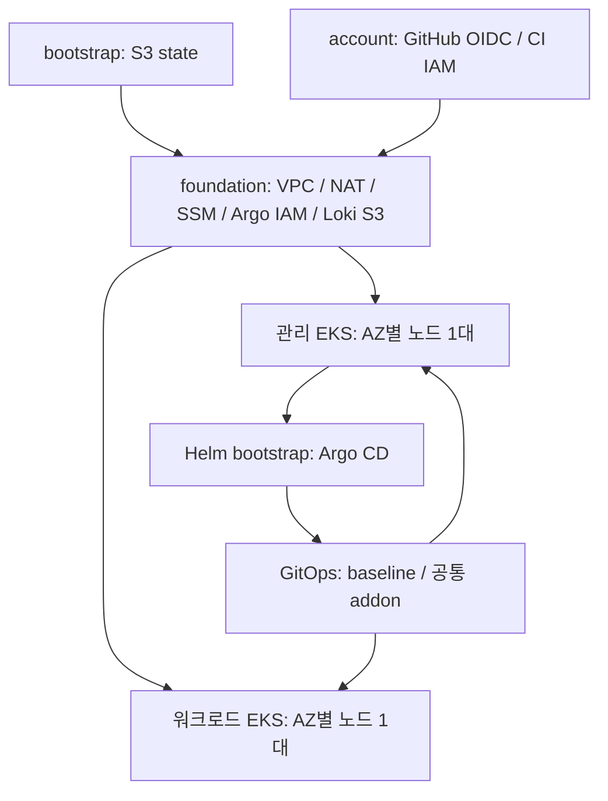

# Charlie Infra

## 팀 공용 Headlamp

`https://headlamp.hopcharlie.dev`의 한 화면에서 관리 EKS·워크로드 EKS·GKE를 전환합니다. EKS는 기존 개인 Cognito 로그인을 사용하며 GKE는 Google 로그인과 자동 토큰 갱신을 사용합니다. GKE 권한은 개인 IAM/RBAC를 따릅니다.
통합 Google 로그인은 opt-in이며 [운영 절차](docs/headlamp-gke-google.md)에 따라 적용합니다. 실제 배포·검증 상태는 실행 기록과 구분하며 GitOps의 `headlamp.enabled`는 기본 false입니다.

| 파일 | 설명 |
| --- | --- |
| [docs/headlamp-team.md](docs/headlamp-team.md) | 배포·검증·팀원 등록·비용·정리 절차 |
| [docs/adr/0017-team-headlamp-with-cognito.md](docs/adr/0017-team-headlamp-with-cognito.md) | 인증·권한·배포 구성 제안 |
| [helm/charts/headlamp-team/Chart.yaml](helm/charts/headlamp-team/Chart.yaml) | Headlamp 팀 차트 |
| [helm/charts/headlamp-team/values.yaml](helm/charts/headlamp-team/values.yaml) | 고정 이미지와 기본값 |
| [helm/charts/headlamp-team/templates/web.yaml](helm/charts/headlamp-team/templates/web.yaml) | OIDC 웹 앱·클러스터 설정·HTTPS Ingress |
| [helm/charts/headlamp-team/templates/rbac.yaml](helm/charts/headlamp-team/templates/rbac.yaml) | Secret을 제외한 조회 권한 |
| [helm/charts/headlamp-team/templates/network.yaml](helm/charts/headlamp-team/templates/network.yaml) | Headlamp 네트워크 정책 |
| [clusters/aws-dev-management/values/headlamp-team.yaml](clusters/aws-dev-management/values/headlamp-team.yaml) | 관리 EKS 설정 초안 |
| [clusters/aws-dev-workload/values/headlamp-team.yaml](clusters/aws-dev-workload/values/headlamp-team.yaml) | 워크로드 EKS 조회 권한 설정 |
| [terraform/platform/aws/headlamp/main.tf](terraform/platform/aws/headlamp/main.tf) | Cognito·EKS OIDC·DNS·API 네트워크 |
| [terraform/platform/aws/headlamp/.terraform.lock.hcl](terraform/platform/aws/headlamp/.terraform.lock.hcl) | provider 버전 고정 |
| [terraform/platform/aws/headlamp/tests/main.tftest.hcl](terraform/platform/aws/headlamp/tests/main.tftest.hcl) | 클라우드 연결 없는 Terraform mock 검사 |
| [scripts/prepare-headlamp.py](scripts/prepare-headlamp.py) | 공개 values 생성 및 승인 후 Secret 등록 |
| [scripts/tests/test-headlamp.py](scripts/tests/test-headlamp.py) | 인증 경계·RBAC·GitOps 로컬 렌더링 검사 |
| [docs/headlamp-gke.md](docs/headlamp-gke.md) | 기존 AWS 로그인을 유지하는 GKE 개인 인증 연결 절차와 승인 경계 |
| [docs/adr/0020-add-gke-to-team-headlamp.md](docs/adr/0020-add-gke-to-team-headlamp.md) | GKE 개인 Google 인증 분리 제안 |
| [scripts/register-headlamp-gke.py](scripts/register-headlamp-gke.py) | 오프라인 GKE 연결 미리보기와 승인 후 기존 Secret 갱신 |
| [scripts/tests/test-headlamp-gke.py](scripts/tests/test-headlamp-gke.py) | AWS 설정 보존·무자격 GKE context·적용 경계 회귀 검사 |
| [docs/headlamp-gke-google.md](docs/headlamp-gke-google.md) | GKE 개인 Google 로그인·자동 갱신 준비와 운영 검증 절차 |
| [docs/adr/0027-headlamp-google-auto-refresh.md](docs/adr/0027-headlamp-google-auto-refresh.md) | GKE 인증 프록시와 자동 갱신 제안 |
| [docs/plans/2026-11-03-headlamp-google-refresh.md](docs/plans/2026-11-03-headlamp-google-refresh.md) | Google 자동 갱신 구현·검증 계획 |
| [helm/charts/headlamp-gke-google/Chart.yaml](helm/charts/headlamp-gke-google/Chart.yaml) | GKE Google 인증 전용 Headlamp 차트 |
| [helm/charts/headlamp-gke-google/values.yaml](helm/charts/headlamp-gke-google/values.yaml) | OAuth 프록시 및 GKE 연결 기본값 |
| [helm/charts/headlamp-gke-google/templates/web.yaml](helm/charts/headlamp-gke-google/templates/web.yaml) | GKE 전용 인증 프록시·서비스·Ingress |
| [scripts/tests/test-headlamp-gke-google.py](scripts/tests/test-headlamp-gke-google.py) | Google 인증 프록시와 보안 경계 렌더링 검사 |
| [helm/charts/headlamp-team/templates/google-auth-plugin.yaml](helm/charts/headlamp-team/templates/google-auth-plugin.yaml) | GKE 로그인 화면 플러그인 ConfigMap |
| [helm/charts/headlamp-team/files/google-login.js](helm/charts/headlamp-team/files/google-login.js) | 기존 UI의 GKE 인증 경로만 Google 로그인으로 연결 |
| [helm/charts/headlamp-gke-google/templates/proxy-config.yaml](helm/charts/headlamp-gke-google/templates/proxy-config.yaml) | Google access token 전달과 신뢰 헤더 재생성 설정 |
| [scripts/prepare-headlamp-google.py](scripts/prepare-headlamp-google.py) | Google backend의 실제 GKE context 준비·안전한 기존 별칭 보존 |
| [scripts/tests/test-headlamp-google-config.py](scripts/tests/test-headlamp-google-config.py) | GKE kubeconfig 준비·충돌·무자격 인증 경계 검사 |
| [docs/adr/0028-unify-headlamp-cluster-ui.md](docs/adr/0028-unify-headlamp-cluster-ui.md) | 단일 UI와 클러스터별 인증 경로 결정 |
| [docs/adr/0029-use-unsupervised-updates-for-single-instance-cnpg.md](docs/adr/0029-use-unsupervised-updates-for-single-instance-cnpg.md) | 단일 CNPG 인스턴스의 업데이트 정책과 admission 제약 |
| [docs/plans/2026-11-03-headlamp-unified.md](docs/plans/2026-11-03-headlamp-unified.md) | 세 클러스터 통합 구현·검증·배포 계획 |

2026 SoftBank Hackathon Charlie 프로젝트의 AWS 인프라 저장소입니다. Terraform으로 **AWS 서울 리전의 공유 VPC, 관리용 private EKS, 워크로드용 private EKS**를 구성하고, Helm과 Argo CD로 클러스터 공통 구성과 관측 도구를 관리합니다.

저장소: [2026-Softbank-Hackathon-Charlie/infra](https://github.com/2026-Softbank-Hackathon-Charlie/infra). 아래 명령과 경로는 모두 이 저장소 루트를 기준으로 합니다.

## Agent 지침과 의사결정 기록

| 파일 | 설명 |
| --- | --- |
| [AGENTS.md](AGENTS.md) | 주요 의사결정을 ADR로 기록하는 Agent 지침 |
| [docs/adr/template.md](docs/adr/template.md) | 배경·대안·결정 이유·영향을 기록하는 ADR 템플릿 |
| [docs/adr/0001-record-decisions-as-adrs.md](docs/adr/0001-record-decisions-as-adrs.md) | Agent의 주요 의사결정을 ADR로 기록하기로 한 결정 |
| [docs/adr/0029-add-gcp-app-image-repository.md](docs/adr/0029-add-gcp-app-image-repository.md) | 기존 GCP bootstrap의 앱 이미지 저장소와 노드 읽기 권한 재사용 제안 |
| [docs/adr/0030-publish-moimroom-to-aws-and-gcp.md](docs/adr/0030-publish-moimroom-to-aws-and-gcp.md) | 모임룸의 AWS·GCP 이미지 게시와 Terraform 권한 관리 |
| [docs/adr/0031-reproduce-cnpg-poc-on-gke.md](docs/adr/0031-reproduce-cnpg-poc-on-gke.md) | AWS PostgreSQL PoC의 GKE 동등 구성·GCS 백업·키 없는 인증 |
| [docs/adr/0032-add-gke-capacity-for-cnpg-poc.md](docs/adr/0032-add-gke-capacity-for-cnpg-poc.md) | PostgreSQL PoC용 GKE 2대 증설 이력; 현재 3대 기준은 ADR0068 |
| [docs/adr/0033-platform-admin-accounts-from-ssm.md](docs/adr/0033-platform-admin-accounts-from-ssm.md) | 콘솔 관리자 계정(bcrypt 해시)을 SSM에서 플랫폼 API로 넘기는 결정 |
| [docs/adr/0034-compare-cnpg-admission-defaults-in-argocd.md](docs/adr/0034-compare-cnpg-admission-defaults-in-argocd.md) | AWS CNPG 앱의 admission 기본값·Role 생략 값 비교 정책 |
| [docs/adr/0002-require-approval-for-privileged-operations.md](docs/adr/0002-require-approval-for-privileged-operations.md) | 권한이 필요한 감사·변경 작업의 사전 승인 정책 |
| [docs/plans/argocd-workload-target.md](docs/plans/argocd-workload-target.md) | 실제 조회 결과와 Argo CD workload 등록·private 저장소 접근 점검 계획 |
| [docs/plans/argocd-root-bootstrap.md](docs/plans/argocd-root-bootstrap.md) | Argo CD 수동 Application 등록 계획·실행 결과와 sync 승인 경계 |
| [docs/adr/0017-adopt-existing-helm-resources-in-argocd.md](docs/adr/0017-adopt-existing-helm-resources-in-argocd.md) | 기존 Helm 리소스를 보존하는 단계적 Argo CD 연결 결정 |
| [docs/plans/metrics-and-management-monitoring.md](docs/plans/metrics-and-management-monitoring.md) | metrics-server 양쪽과 관리 Prometheus 스택의 한정 설치 계획·실행 결과 |
| [docs/adr/0018-stage-minimal-management-monitoring.md](docs/adr/0018-stage-minimal-management-monitoring.md) | HyperDX 선택을 유지하는 기본 모니터링 단계적 도입 결정 |
| [docs/adr/0019-use-chart-managed-prometheus-scrape-token.md](docs/adr/0019-use-chart-managed-prometheus-scrape-token.md) | Prometheus scrape용 장기 ServiceAccount 토큰의 추가 승인 경계 |

## 구조와 소유권



- Terraform: S3 state, VPC/SG/IAM, EKS/노드, VPC CNI/CoreDNS/kube-proxy/Pod Identity/EBS CSI. 관리·워크로드 stack은 foundation state만 참조하며 서로의 state는 읽지 않습니다.
- Helm bootstrap: Argo CD 자체. 클러스터 등록 Secret, private 저장소 credential, root Application은 운영자가 준비합니다.
- Argo CD: Namespace/gp3/Quota/LimitRange/NetworkPolicy, AWS LBC, metrics-server, Prometheus/Grafana/Alertmanager, Loki, Sealed Secrets, Argo Rollouts. OTel은 준비 후 활성화합니다. Terraform managed addon을 중복 설치하지 않습니다.
- 애플리케이션 코드·차트·DB·서비스 이미지 배포는 프로젝트 요구에 맞게 별도로 추가합니다.

기본값은 `project=charlie`, `environment=dev`, 클러스터 `charlie-dev-management`/`charlie-dev-workload`입니다. VPC `10.40.0.0/16`, AZ `ap-northeast-2a/c`, AZ별 NAT, 클러스터당 기본 노드 2대입니다. 두 클러스터의 서비스 CIDR은 각각 `172.20.0.0/16`, `172.21.0.0/16`입니다. 기존 네트워크/VPN과 겹치면 배포 전에 CIDR·SG·OTel 허용 범위를 함께 조정하세요.

## 구성 범위

- AWS 기반: Terraform state용 S3, GitHub OIDC와 CI IAM, 공유 VPC·NAT·SSM bridge, 관리·워크로드 EKS와 AZ별 노드를 구성합니다.
- 클러스터 운영: Argo CD, baseline 정책, 공통 애드온, Prometheus/Grafana/Alertmanager, Loki를 관리합니다. OTel은 인증 Secret과 수집 endpoint를 준비한 뒤 활성화합니다.
- 외부 ALB는 기본 비활성화입니다. 도메인·ACM 인증서와 애플리케이션 Ingress·정책을 준비한 뒤 baseline의 `externalAlb`을 켭니다. DNS/ACM 자동 생성은 포함하지 않습니다.
- 애플리케이션, 빌드 파이프라인, 서비스 ECR, RDS는 별도로 구성합니다.
- 실제 tfvars·backend 설정·state·plan·kubeconfig와 비밀값은 Git에 저장하지 않습니다.

## GCP 이전 대상 인프라

GCP 대상 GKE1개·GCS state·GitHub WIF·전용 baseline/workflow를 제공합니다. [GCP 구축·배포 절차](docs/gcp-deployment.md)를 먼저 읽으세요. 코드 검사와 실제 배포·연결 검증을 구분합니다. 기존 AWS 경로와 분리하며 CNPG·cross-cloud 연결은 후속 작업입니다.

## 검증

필요 도구는 `.terraform-version`의 Terraform **1.16.4**, Helm **3.19.1**, Python 3(권장 3.12), PyYAML **6.0.3**, Bash, make입니다. 운영에는 AWS CLI v2, kubectl 1.35, SSM session-manager-plugin이 추가로 필요합니다. provider와 공식 chart 다운로드에 네트워크가 필요합니다.

```bash
python3 -m venv /tmp/charlie-check-venv
/tmp/charlie-check-venv/bin/python -m pip install PyYAML==6.0.3
make check PYTHON=/tmp/charlie-check-venv/bin/python
```

| 명령 | 확인 범위 |
| --- | --- |
| `make tf-check` | fmt + 정제 임시 복사본에서 backend 없는 init/validate. state/AWS 연결 없음 |
| `make tf-verify` | root당 init 한 번 후 validate/mock 실행; CI matrix도 같은 runner 사용 |
| `make config-check` | 공유 프로젝트 JSON의 스키마·명명·네트워크 입력 검사 |
| `make tf-test` | 로컬 state/tfvars/override를 제외한 임시 복사본에서 provider mock test |
| `make ci-test PYTHON=...` | fake AWS/Terraform 실행 순서·계정·state key·삭제 guard·실패 처리, workflow main 자동 apply·수동 실행 조건, shell 구문 |
| `make helm-check PYTHON=...` | 임시 chart dependency, bootstrap/GitOps/두 baseline 및 고정 외부 addon lint/render, AppProject/namespace·이미지 digest 검사 |
| `make inventory-check` | README 파일 목록 누락과 Terraform의 상대 module/file 참조 검사 |

이 검증은 실제 IAM 충분성, 네트워크 연결, 리소스 수용량, 이미지 pull, DNS/TLS 또는 배포 성공을 보장하지 않습니다. Helm 검사는 합성 target fixture를 쓰며 운영 Secret/NLB를 요구하지 않습니다. 기본 GitOps values의 빈 `targets`는 의도적이며 실제 출력 또는 CI fixture를 넣어야 schema 검사를 통과합니다.

## 처음 사용할 때: 입력과 state

아래는 **운영자가 이후 별도로 실행하는 배포 안내**입니다. 예제 값은 그대로 배포하지 마세요. 이 문서의 `apply`, migration, Helm/kubectl 적용은 실제 외부 변경입니다.

1. [config/project.json](config/project.json)을 공유 입력의 기준으로 사용합니다. 현재 `charlie/dev`, 서울, 기존 클러스터명과 state key를 유지합니다. CIDR·AZ·NAT 변경은 이 파일에서 하고 로컬/CI가 함께 사용합니다. 다른 환경·프로젝트로 이름을 바꾸려면 별도 migration 검토가 필요합니다.
2. 계정별 입력은 다음처럼 준비합니다. 이 파일에는 access key·secret·토큰을 넣지 않습니다. 추가 운영자가 없다면 빈 배열을 유지합니다. 초기 bootstrap/account만 실행한다면 `operator_principal_arn`은 생략할 수 있지만 EKS 적용 전에 기존 운영자 IAM role/user ARN을 반드시 넣습니다.

```bash
umask 077
cp config/account.local.json.example config/account.local.json
# account.local.json의 실제 계정 ID와 기존 운영자 ARN 등을 편집
python3 scripts/project-config.py check
```

3. AWS 인증 후 `aws sts get-caller-identity`로 계정을 확인하고 관리자로 기존 GitHub OIDC provider를 조회합니다. provider가 있으면 `github_oidc_provider_arn`에 기존 ARN을 넣어 소유권을 유지합니다. 없는 경우에만 빈 문자열로 신규 생성합니다.

```bash
aws sts get-caller-identity
aws iam list-open-id-connect-providers
aws iam get-open-id-connect-provider --open-id-connect-provider-arn <조회한_ARN>
```

4. GitHub의 실제 subject prefix를 조회합니다. `OWNER/REPO`를 [config/project.json](config/project.json)의 `github_repository`로 바꿉니다.

```bash
gh api repos/OWNER/REPO/actions/oidc/customization/sub --jq .sub_claim_prefix
```

반환된 값을 Git에서 제외한 `config/account.local.json`의 `github_oidc_subject_prefix`에 그대로 넣습니다. 예제의 `repo:OWNER/REPO`는 반드시 교체할 placeholder입니다. `account/aws` 입력 생성은 이 값이 없으면 중단하며 저장소 이름으로 추측하지 않습니다. `use_default=true`여도 prefix에 불변 ID(`@ID`)가 포함될 수 있으므로 위 API의 실제 값을 사용합니다. API가 반환한 기존 `repo:OWNER/REPO` 형식과 `repo:OWNER@ID/REPO@ID` 형식을 모두 지원합니다. `:ref:refs/heads/main`은 입력하지 않습니다. Terraform이 이 suffix를 붙여 main 브랜치만 신뢰합니다. bootstrap/foundation에는 이 입력이 필요하지 않습니다.

현재 이 저장소에서 확인한 prefix는 `repo:2026-Softbank-Hackathon-Charlie@350278309/infra@1442353250`입니다. 예제 placeholder를 그대로 쓰지 말고 API에서 재확인한 값으로 로컬 계정 입력을 설정합니다.

코드 merge만으로 실제 IAM trust는 바뀌지 않습니다. 기존 역할의 trust를 콘솔에서 변경했다면 같은 prefix를 로컬 JSON에 반영하고, **해당 역할을 이미 관리하는 기존 account state와 backend**로 변경 계획을 확인해야 합니다. 새 state로 역할을 다시 만들거나 기존 state를 삭제하지 마세요. 실제 IAM 변경은 별도 승인된 `account/aws` apply로 수행합니다.

기존 `terraform.tfvars`, `terraform.tfvars.json`, `*.auto.tfvars*`, override 및 `backend.hcl`은 wrapper가 거부합니다. 기존 값을 검토해 공유 값은 project.json, 계정 값은 account.local.json으로 수동 이관한 후 해당 입력 파일을 안전하게 별도 보관합니다. state나 `.terraform`를 지워서 충돌을 우회하지 마세요. wrapper는 기존 backend 메타데이터의 bucket/key/region/account/잠금/암호화를 확인하고 다르거나 판독 불가하면 중단합니다. 기본 workspace만 지원하며 외부 `TF_VAR_*`, `TF_CLI_ARGS*`, `TF_DATA_DIR`, `TF_CLI_CONFIG_FILE`도 거부합니다. 자동 state migration/reconfigure는 하지 않습니다.

### S3 state 최초 생성

최초 S3 버킷이 없으므로 bootstrap을 임시 로컬 backend로 실행한 뒤 **생성한 bootstrap state만** 프로젝트의 S3로 이전합니다.

```bash
umask 077
mkdir -p .generated/bootstrap-local .generated/bootstrap-inputs
# 정식 root에 legacy 입력이나 초기화 충돌이 없을 때 공통 입력 생성
python3 scripts/project-config.py prepare --stack bootstrap/aws \
  --output-dir .generated/bootstrap-inputs
# backend.tf 없이 로컬 backend로 최초 생성
cp terraform/bootstrap/aws/main.tf terraform/bootstrap/aws/variables.tf \
   terraform/bootstrap/aws/outputs.tf terraform/bootstrap/aws/providers.tf \
   terraform/bootstrap/aws/versions.tf terraform/bootstrap/aws/.terraform.lock.hcl \
   .generated/bootstrap-local/
terraform -chdir=.generated/bootstrap-local init -lockfile=readonly
terraform -chdir=.generated/bootstrap-local plan \
  -var-file=../bootstrap-inputs/inputs.tfvars.json
terraform -chdir=.generated/bootstrap-local apply \
  -var-file=../bootstrap-inputs/inputs.tfvars.json
# 생성한 bootstrap state만 새 S3로 이전: 별도 승인 후 수동 실행
cp terraform/bootstrap/aws/backend.tf .generated/bootstrap-local/
terraform -chdir=.generated/bootstrap-local init -migrate-state \
  -backend-config=../bootstrap-inputs/backend.json
# 이전 및 원격 리소스 목록 확인 후 정식 root 연결
make tf-init STACK=bootstrap/aws
```

S3 버전 관리·암호화·공개 차단·잠금과 `prevent_destroy`가 적용됩니다. migration 완료 및 원격 state 리소스 목록을 확인하기 전 로컬 state/백업을 삭제하지 마세요. 버킷 이름을 바꾸려면 bootstrap 이름 규칙·account IAM·backend·CI 설정·remote state 참조를 함께 변경해야 합니다.

### 적용 순서

1. 관리자: bootstrap 생성/이전 → `account/aws` init/plan/apply. OIDC provider 및 CI 역할은 관리자 영역입니다. 기존 계정 전역 EKS 서비스 연결 역할은 필요 시 그대로 사용합니다.
2. foundation → management → workload 순서로 init/plan/apply. 두 EKS는 private API이며 운영자 기존 IAM role/user ARN이 필수입니다.

```bash
export AWS_ACCOUNT_ID=<실제12자리계정>
make tf-init STACK=account/aws
make tf-plan STACK=account/aws
make tf-apply STACK=account/aws
# 이후 STACK=aws/dev/foundation, aws/dev/management, aws/dev/workload 순서로 반복
```

로컬과 CI는 같은 `config/project.json` 및 `scripts/project-config.py`로 입력을 생성합니다. 계정 JSON과 GitHub 변수는 계정별 값만 제공합니다. 공통 설정과 AWS_REGION·TF_STATE_BUCKET·역할 ARN이 어긋나면 중단합니다. backend JSON과 변수 파일은 임시 생성 후 정리합니다. `bash scripts/tf-ci.sh`의 기본 동작은 `plan bootstrap`입니다. 전체 검토는 `bash scripts/tf-ci.sh plan all-runtime`으로 명시해야 하며, 미생성 foundation 출력을 예측하지 않으므로 최초 구축의 전체 일괄 dry-run이 아닙니다. 최초 생성은 위 의존 순서로 진행합니다.

AWS workload mode의 canonical 입력은 `config/project.json`의 `workload_network_policy_enforcing_mode`(`standard` 기본, `standard|strict`만 허용)이며 workload에만 전달됩니다. 최초 bootstrap/rollback은 standard 기본값을 유지합니다. strict는 별도 조율·검토·승인 후 이 값을 명시적으로 바꾸어 선택합니다([ADR 0050](docs/adr/0048-keep-workload-network-policy-standard-by-default.md)). CI는 main의 해당 파일을 사용하므로 reviewed 설정 변경이 main에 반영돼야 하며 `TF_VAR_*`로 우회할 수 없습니다. baseline은 main을 automated sync하므로 [ADR 0046의 merge 전 inventory gate](docs/adr/0046-use-strict-network-policy-on-aws-workload.md)를 완료하기 전에는 이 정책 변경을 merge하지 않습니다.


## GitHub Actions 파이프라인

- push/PR: Terraform 6개 root의 validate/mock을 matrix(최대 동시 3개)로 실행하고 Helm·스크립트 검사를 병렬 실행합니다. 모든 검사에 AWS 인증을 부여하지 않습니다. fork PR도 공통 설정 검증을 수행합니다.
- `check`는 모든 검증의 성공만 허용하는 집계 job이며 실패·skip·취소 시 배포하지 않습니다. 기존 필수 검사 이름을 유지합니다. Terraform은 정제된 임시 복사본에서 root당 init 한 번(총 6회)을 수행합니다. OS/아키텍처/CLI/root/lock별 provider 전용 캐시를 사용하고 state·plan·tfvars·전체 `.terraform`는 캐시하지 않습니다. runner별 캐시는 독립적입니다.
- 각 Terraform root의 경과 시간을 로그에 출력합니다. cold/warm 실행 비교는 실제 GitHub 실행 후 확인해야 하며 특정 속도 향상을 보장하지 않습니다. 병렬 runner 사용 분이 증가할 수 있습니다.
- main 머지/push: AWS 배포 입력 경로가 바뀌고 check가 성공한 경우에만 `all-runtime`을 순서대로 plan하고 Terraform 변경이 있는 stack만 자동 apply합니다. GCP 전용 설정·문서·테스트·CI 정의만 바뀌면 배포 job을 생략합니다. 변경이 없으면 apply를 생략하며 별도 dispatch는 필요하지 않습니다([ADR 0069](docs/adr/0069-limit-aws-auto-apply-to-deployment-inputs.md)).
- 수동 실행: main에서 `action=plan|apply`, `stack=bootstrap|foundation|management|workload|all-runtime`을 선택합니다. 기본값은 **`plan + bootstrap`**이며 리소스를 적용하지 않습니다. 기존 `apply` boolean 입력은 이 두 choice 입력으로 대체했습니다.
- 배포 job이 선택되고 check가 성공한 경우에만 OIDC로 인증하고 선택한 stack을 실행합니다. 개별 선택은 의존 stack을 자동 생성하지 않습니다. main 자동 실행과 수동 `all-runtime` 선택은 bootstrap → foundation → management → workload를 순차 실행하며 account는 관리자 로컬 전용입니다. apply는 저장한 plan을 사용하고 foundation의 VPC/subnet/NAT/EIP/Loki 삭제·교체 guard를 유지합니다.
- `bootstrap`은 state S3와 보호 설정만 관리합니다. `foundation` apply는 VPC·NAT·SSM bridge·IAM·Loki S3를, `management`/`workload` apply는 각 EKS를 포함합니다. `all-runtime + apply`는 두 EKS까지 포함합니다.
- PR 및 main 이외 브랜치의 push에서는 AWS 배포를 실행하지 않습니다. main 자동 실행과 수동 plan/apply에는 기존 S3 backend·CI 역할이 필요하며 state 잠금 파일을 일시 생성할 수 있습니다. workflow는 `.github/workflows/terraform-check.yml`에 정의되어 있습니다.

| Repository variable | 설정 값 |
| --- | --- |
| `AWS_ACCOUNT_ID` | 실제 12자리 계정 |
| `AWS_REGION` | 선택 사항. 설정 시 project.json의 리전과 같아야 함 |
| `TF_STATE_BUCKET` | 선택 사항. 설정 시 공통 설정에서 계산한 버킷명과 같아야 함 |
| `TERRAFORM_APPLY_ROLE_ARN` | account 출력 `terraform_apply_role_arn` |
| `EKS_OPERATOR_PRINCIPAL_ARN` | 기존 운영자 IAM role/user ARN |
| `EKS_ADDITIONAL_OPERATOR_PRINCIPAL_ARNS` | 추가 운영자 ARN JSON 배열, 기본 `[]` |

배포 인증 전 실행 저장소/브랜치가 공통 설정과 일치하는지도 확인합니다. OIDC subject는 account의 명시 입력이며 맞춤 subject 설정은 관리자 책임입니다.

동일 apply concurrency group은 취소하지 않고 직렬 실행합니다. CI 역할에는 AWS 관리형 `AdministratorAccess`를 연결합니다. 기존 태그·이름 범위 정책도 남아 있지만 실제 권한의 상한이 아니며 account state·자체 역할·OIDC·다른 프로젝트를 포함한 계정 전체에 관리 권한을 가집니다. OIDC 신뢰는 이 저장소의 main 브랜치와 `sts.amazonaws.com` audience로 유지합니다. branch 보호/저장소 접근 권한은 운영 정책으로 별도 관리하세요.

### 최소 구축과 첫 파이프라인 실행 순서

1. 관리자 로컬 인증으로 S3 bootstrap을 생성하고 그 bootstrap state만 S3로 이전합니다. 위 최초 생성 절차를 사용합니다.
2. 로컬에서 `account/aws` plan을 검토하고 별도 승인 후 apply하여 CI 역할을 생성합니다. 기존 GitHub OIDC provider는 config의 ARN으로 참조합니다.
3. Repository variables를 설정하고 이 workflow 변경을 main에 반영합니다. 코드가 로컬에만 있으면 GitHub의 기존 workflow 동작은 바뀌지 않습니다.
4. Run workflow에서 `action=plan`, `stack=bootstrap`으로 실행해 OIDC·state 연결을 확인합니다. 이 단계에서 EKS는 생성하지 않습니다.
5. 이후 필요할 때만 foundation과 EKS를 각각 검토·적용합니다. EKS에는 운영자 IAM ARN과 선행 foundation state가 필요합니다.

### Self-hosted runner

조직 private 저장소(infra, platform, frontend, cli, rin)의 job은 모두 조직 self-hosted runner(label `hopcharlie`)에서 돈다. GitHub-hosted 사용량이 Free 플랜 한도를 넘어 job이 시작되지 않기 때문이다([ADR 0045](docs/adr/0045-run-actions-on-self-hosted-runner.md)). GCP 호스트의 목표 사양은 프로젝트 `project-b47cdba3-db5b-42a2-9a6`, asia-northeast3-a의 VM 한 대(`hopcharlie-github-runner`, e2-standard-8, 8 vCPU/32 GB/200 GB)와 runner 6개(`hopcharlie-gcp-runner-1`부터 `6`)다([ADR 0067](docs/adr/0067-reduce-gcp-runner-to-double-initial-capacity.md)). 실제 축소 적용·검증은 별도 승인을 받는다. 처음 쓴 AWS EC2 호스트(`Name=hopcharlie-github-runner`, t3.xlarge, runner `hopcharlie-runner-1`부터 `3`)는 GCP runner가 job을 받는 것을 확인한 뒤 지운다. 두 호스트의 label이 같아서 workflow는 바꾸지 않는다. 호스트가 없으면 job은 실패하지 않고 24시간까지 `queued`로 기다린다.

GCP 호스트는 저장소 루트에서 아래 명령으로 올리고 내린다. gcloud에 로그인해 위 프로젝트를 활성 프로젝트로 두고(`gcloud config set project project-b47cdba3-db5b-42a2-9a6`), `admin:org` 권한이 있는 gh를 쓴다. Windows에서는 PowerShell이나 Git Bash에서 Windows용 `python`으로 실행한다. Git Bash의 `python3`(MSYS2)로 실행하면 gcloud가 뜨지 않는다.

```bash
gh auth refresh -h github.com -s admin:org
python scripts/github-runner/gcp_up.py --dry-run   # describe와 조회만 하고 바꿀 것을 출력한다
python scripts/github-runner/gcp_up.py             # 방화벽 규칙과 VM을 만들고 IAP SSH로 runner 6개를 등록한 뒤 조직 runner 상태를 출력한다
python scripts/github-runner/gcp_up.py --resize    # 승인 후, 다른 사양의 기존 VM을 중지·변경·시작한다
# 축소는 유휴 확인·7~9 서비스 중지/비활성화 후 수행하고, 조직 등록은 1~6 복구 확인 후 정리한다(ADR 0067).
python scripts/github-runner/gcp_down.py           # 지울 것만 출력한다
python scripts/github-runner/gcp_down.py --apply   # VM과 디스크, GCP runner 등록, 방화벽 규칙 2개를 지운다
```

AWS 호스트에서 GCP 호스트로 옮기는 순서는 다음과 같다.

1. `python scripts/github-runner/gcp_up.py --dry-run`으로 만들 자원을 확인하고 `python scripts/github-runner/gcp_up.py`를 실행한다.
2. `gh api orgs/2026-Softbank-Hackathon-Charlie/actions/runners --jq '.runners[] | [.name, .status, .busy] | @tsv'`(또는 조직 Settings의 Actions Runners)에서 `hopcharlie-gcp-runner-1`부터 `3`까지 `online`인지 확인한다. 이어서 run의 "Set up job" 로그에서 Runner name이 `hopcharlie-gcp-runner-N`인 job이 성공하는지 보고, docker를 쓰는 job(platform CI, 이미지 게시)도 하나 이상 확인한다.
3. `python scripts/github-runner/down.py`로 지울 AWS 자원을 확인하고 `python scripts/github-runner/down.py --apply`로 지운다. 이때 `hopcharlie-runner-1`부터 `3`까지의 등록도 해제된다. GCP runner는 이름이 달라서 건드리지 않는다. AWS runner가 그 순간 돌리던 job은 실패하므로 다시 실행한다.

`gcp_up.py`와 `up.py`는 다시 실행해도 안전하다. 있는 자원은 그대로 쓰고 이미 등록한 runner는 건너뛴다. AWS 스크립트(`up.py`, `down.py`)는 AWS 프로필 `hopcharlie`(또는 `AWS_PROFILE`)를 쓰고, GCP 호스트에 문제가 생기면 되돌아갈 경로로 남긴다. GCP 호스트 셸은 `gcloud compute ssh hopcharlie-github-runner --zone asia-northeast3-a --tunnel-through-iap`로, AWS 호스트 셸은 `aws ssm start-session --target <instance-id>`로 연다. bootstrap 로그는 두 호스트 모두 `/var/log/github-runner-bootstrap.log`에 있다.

| 파일 | 역할 |
| --- | --- |
| [docs/adr/0045-run-actions-on-self-hosted-runner.md](docs/adr/0045-run-actions-on-self-hosted-runner.md) | private 저장소의 Actions를 조직 self-hosted runner에서 실행하고 호스트를 GCP VM으로 옮기는 결정 |
| [docs/adr/0046-use-strict-network-policy-on-aws-workload.md](docs/adr/0046-use-strict-network-policy-on-aws-workload.md) | workload strict NetworkPolicy와 시스템 정책 선행 적용·bootstrap·rollback 제안 |
| [docs/adr/0048-keep-workload-network-policy-standard-by-default.md](docs/adr/0048-keep-workload-network-policy-standard-by-default.md) | workload standard 기본값 유지와 조율된 strict opt-in 제안 |
| [docs/plans/2026-11-05-eks-strict-network-policy.md](docs/plans/2026-11-05-eks-strict-network-policy.md) | strict NetworkPolicy 구현 범위·로컬 검증·live 적용 경계 |
| [scripts/github-runner/gcp_up.py](scripts/github-runner/gcp_up.py) | GCP 방화벽 규칙과 VM을 찾거나 만들고 IAP SSH로 token 파일과 bootstrap을 보내 실행 |
| [scripts/github-runner/gcp_down.py](scripts/github-runner/gcp_down.py) | GCP runner 등록과 VM, 방화벽 규칙 삭제 |
| [scripts/github-runner/up.py](scripts/github-runner/up.py) | AWS runner 호스트 IAM, 보안 그룹, EC2를 찾거나 만들고 SSM으로 bootstrap을 실행 |
| [scripts/github-runner/bootstrap.sh](scripts/github-runner/bootstrap.sh) | AWS와 GCP 호스트에서 root로 도구, runner 3개, 메타데이터 차단, Docker 정리 타이머를 설치 |
| [scripts/github-runner/down.py](scripts/github-runner/down.py) | AWS runner 등록 해제와 호스트 자원 삭제 |

## Private EKS 접근과 Argo CD 설치

이미 설치한 Argo CD에 접속할 때는 아래 두 명령만 실행합니다. 저장소 루트에서 각각 별도 터미널을 사용합니다.

```bash
# 터미널 A: 관리 EKS API 터널. Session이 시작되면 계속 켜 둡니다.
make aws-tunnel

# 터미널 B: Argo CD 포트포워딩. 이 터미널도 계속 켜 둡니다.
make argo-port-forward
```

브라우저에서 **https://localhost:8080**으로 접속합니다. 기본 Argo CD 자체 서명 인증서를 사용하는 경우 브라우저에 인증서 경고가 표시될 수 있습니다. 각 명령은 foreground로 실행하며 `Ctrl+C`로 해당 프로세스를 종료합니다. Argo 포트포워딩을 종료한 뒤 터널도 종료합니다. 이미 수동으로 열어 둔 터널/포트포워딩이 있으면 해당 터미널에서 먼저 종료하거나 아래처럼 다른 포트를 선택합니다. 명령은 다른 프로세스를 종료하지 않습니다.

준비 사항:

- Python 3, GNU Make, AWS CLI v2, `kubectl`, AWS `session-manager-plugin`이 PATH에 있어야 합니다. macOS의 plugin 설치 예시는 `brew install --cask session-manager-plugin`입니다.
- `config/account.local.json`의 계정과 일치하는 로그인된 AWS 프로필이 필요합니다. 기본값은 `charlie-admin`이며 로그인·토큰 발급은 자동으로 수행하지 않습니다.
- 운영자에게 STS 계정 확인, EKS DescribeCluster, EC2 DescribeInstances, SSM DescribeInstanceInformation 및 지정 bridge/document의 StartSession 권한이 필요합니다. EKS Access Entry 인증과 Kubernetes 서비스/Pod 조회 및 Pod port-forward 권한도 필요합니다. 이 명령은 IAM·클러스터 권한을 추가하지 않습니다.
- 클러스터와 같은 VPC에서 `Project`, `Environment`, `Component=access` 태그를 가진 running bridge가 정확히 하나이고 SSM Online이어야 합니다. 접근 대상은 공유 프로젝트 설정으로 결정합니다.

옵션 예시:

```bash
# 다른 AWS 프로필로 터널 생성
make aws-tunnel AWS_PROFILE=my-operator

# 워크로드 EKS는 기본 11443. 관리 터널(10443)과 별도 터미널에서 병행 가능
make aws-tunnel CLUSTER=workload

# 포트 충돌 시 변경: Argo는 kubeconfig에 저장된 API 포트를 자동 사용
make aws-tunnel EKS_LOCAL_PORT=12443
make argo-port-forward ARGO_LOCAL_PORT=9090

# 터널을 유지한 상태에서 관리 클러스터 확인
kubectl --kubeconfig .generated/access/management.kubeconfig \
  --context charlie-dev-management get nodes
```

포트는 1024~65535만 허용하며 Argo 포트포워딩은 management 전용입니다. 프로필은 `AWS_PROFILE` 환경 변수 또는 Make 인자로 지정할 수 있습니다. 모든 AWS 호출에 `config/project.json`의 region을 명시하며 다른 `AWS_REGION`/`AWS_DEFAULT_REGION` 값은 안내 후 무시합니다. Argo 인증은 **터널 생성 시 저장한 프로필**을 사용합니다. Argo 실행 터미널에 다른 `AWS_PROFILE`이 설정되어 있으면 오류가 나므로, 원하는 프로필로 터널을 다시 생성하거나 해당 환경 변수를 해제합니다.

전용 kubeconfig는 `.generated/access/management.kubeconfig`, `.generated/access/workload.kubeconfig`에 권한 `0600`으로 저장합니다. 기존 `~/.kube/config`, 글로벌 current-context, `KUBECONFIG` 및 수동 생성한 `.generated/charlie.kubeconfig`는 변경하지 않습니다. 이후 Helm/kubectl 명령에는 해당 `--kubeconfig`를 명시하세요. 터널의 server는 loopback 주소로 바꾸고 EKS의 실제 CA와 원래 endpoint의 `tls-server-name`을 유지합니다. `insecure-skip-tls-verify`는 사용하지 않습니다. 이 로컬 주소/포트는 Argo target 등록에 넣지 않습니다.

계정 불일치·bridge 미발견/복수·Offline·포트 충돌은 세션 시작 전에 중단합니다. Argo 명령은 관리 API `/readyz` 확인 후 포트포워딩을 실행하며 인증·RBAC 오류는 그대로 출력합니다. 자격 증명이 만료되면 로그인 후 다시 실행하세요. 자동 재시도나 백그라운드 실행은 하지 않습니다. 실제 클라우드 연결은 명령을 실행할 때 시작됩니다.

아래는 **아직 Argo CD를 설치하지 않은 환경**의 최초 설치·GitOps 연결 절차입니다. 이미 설치했다면 재설치는 필요하지 않습니다.

1. 관리 터널을 켠 상태에서 bootstrap을 설치합니다.

```bash
helm repo add argo https://argoproj.github.io/argo-helm
helm dependency build helm/bootstrap
helm upgrade --install argocd helm/bootstrap --namespace argocd --create-namespace \
  --kubeconfig .generated/access/management.kubeconfig \
  --kube-context charlie-dev-management --wait
```

2. private GitHub 저장소의 read-only credential을 `argocd` namespace의 repository Secret으로 준비합니다. label은 `argocd.argoproj.io/secret-type: repository`, `stringData`는 `type: git`, `url: https://github.com/2026-Softbank-Hackathon-Charlie/infra.git`, `username`, `password`(토큰)입니다. 토큰은 stdin/보호된 로컬 파일로 전달하고 values/Git에는 넣지 않습니다.
3. 두 EKS를 Argo cluster Secret으로 등록합니다. label은 `argocd.argoproj.io/secret-type: cluster`, `stringData.name`은 실제 클러스터명, `server`는 실제 EKS endpoint, `config`는 아래 구조입니다. 값은 해당 stack의 `target` 출력에서 가져옵니다. 이 예시는 저장 형식 설명이며 인증 정보는 포함하지 않습니다.

```json
{
  "awsAuthConfig": {"clusterName": "<target.name>", "roleARN": "<target.argocd_role_arn>"},
  "tlsClientConfig": {"insecure": false, "caData": "<target.ca_data>"}
}
```

관리 Argo SA 3개는 Terraform Pod Identity로 foundation management role을 사용하고, 각 deploy role을 assume하여 두 EKS에 접근합니다. Terraform과 Argo 사이 SG/Access Entry가 이 연결을 허용합니다. 등록 Secret을 Git에 커밋하거나 운영 kubeconfig를 chart에 넣지 않습니다.
4. management의 Loki values 안 `REPLACE_AWS_ACCOUNT_ID` 버킷을 foundation 출력 `loki_bucket_name`으로 교체합니다. 이 비밀값이 아닌 설정을 저장소에 커밋합니다.
5. `helm/root-application.yaml.example`을 보호된 로컬 `.generated/root-application.yaml`로 복사하고 두 target endpoint/name/region/VPC ID를 실제 출력으로 채웁니다. 예제의 `sourceRepos`와 root·GitOps의 `repoURL`은 모두 `https://github.com/2026-Softbank-Hackathon-Charlie/infra.git`으로 설정합니다. root를 관리 context에 적용하면 공통 애드온을 동기화합니다. 합성 `helm/gitops/ci/targets-values.yaml`은 배포하지 않습니다.

```bash
kubectl --kubeconfig .generated/access/management.kubeconfig --context charlie-dev-management apply -f .generated/root-application.yaml
kubectl --kubeconfig .generated/access/management.kubeconfig --context charlie-dev-management -n argocd get applications,appprojects
```

기본 addon 목록은 `helm/gitops/values.yaml`입니다. root 예제의 `valuesObject`는 targets/저장소를 override하며, 운영 addon 목록은 해당 기본값을 사용합니다. root/addon 모두 prune=false이므로 목록에서 제거하는 것만으로 실제 자원이 철거되지는 않습니다. Kubernetes 삭제/ALB·PVC 처리와 Terraform destroy는 별도 계획이 필요합니다.

## OTel 연결: 준비 후 활성화

1. 두 클러스터에 `observability` namespace를 준비합니다. 동일한 write 암호로 양쪽 `otel-write-auth` Secret을 만들고 `WRITE_PASSWORD` 키를 설정합니다. 현재 고정 collector 구성은 gateway inline 평문 htpasswd를 사용하므로 양쪽에 같은 암호를 설정합니다. collector 버전을 변경할 때는 인증 형식과 실제 401/200 응답을 재확인합니다. Secret은 Git·values에 저장하지 않습니다.
2. management OTel values에서 `loadBalancerSourceRanges`를 실제 workload private subnet CIDR에 맞춥니다. 기본은 `10.40.32.0/20`, `10.40.48.0/20`입니다. management addons 목록에 `opentelemetry-collector`를 추가하여 동기화합니다.
3. 관리 클러스터에서 내부 NLB 주소를 조회합니다.

```bash
kubectl --context charlie-dev-management -n observability get svc opentelemetry-collector
```

4. workload OTel values의 `extraEnvs.OTEL_GATEWAY_ENDPOINT`에 `http://<새_NLB_DNS>:4318`을 입력합니다. `REPLACE_MANAGEMENT_NLB_DNS`는 실제 동작 주소가 아닙니다.
5. 수집 namespace 변경 시 `config.receivers.filelog.include`(Pod 로그 경로)와 `extraEnvs.COLLECT_NAMESPACE_PATTERN`(메트릭 필터)을 함께 변경합니다. 선택 라벨 추출은 `config.processors.k8sattributes.extract.labels`, Loki 인덱스 라벨은 management Loki values의 `otlp_config`입니다. 기본은 `charlie/release-id` → `charlie.release_id`입니다. 필요 없으면 둘 다 제거합니다.
6. 새 endpoint/필터를 저장한 후 workload addons 목록에도 `opentelemetry-collector`를 추가하고 동기화합니다. collector auth 오류·Loki 로그·Prometheus 메트릭을 실제로 확인합니다. 내부 NLB와 private API 경로는 별개입니다.

## 영향과 복구

배포하면 EKS 2개, 기본 노드 4대, NAT 2개, bridge EC2, S3/EBS 및 OTel 활성화 시 내부 NLB 비용이 발생합니다. NAT single 모드는 비용/장애 범위가 달라집니다. Argo와 지정 운영자의 EKS 권한은 cluster-admin입니다. Prometheus/Grafana/Alertmanager/Loki와 Argo는 단일 replica·일부 AZ 종속 EBS이므로 전체 서비스 HA를 보장하지 않습니다. 저장소에 고정한 Kubernetes/addon/node image 버전 지원 여부와 계정 quota는 실제 배포 직전에 확인하세요.

GitOps는 검토한 이전 commit SHA로 고정하여 되돌리고, state는 S3 versioning으로 보호합니다. state 삭제나 다른 프로젝트의 state 재사용으로 롤백하지 않습니다. foundation guard가 막는 삭제·교체는 별도 검토 후 명시적인 운영 변경으로 처리합니다. Sealed Secrets를 운영에서 사용하기 전 private key 백업·복구 절차를 별도로 준비하세요.

## 파일별 역할

저장소에 포함된 파일과 각 파일의 역할입니다.

| 파일 | 역할 |
| --- | --- |
| [.github/workflows/terraform-check.yml](.github/workflows/terraform-check.yml) | PR/push 검증과 AWS 입력 변경 시 main 자동 apply·수동 실행 |
| [.github/workflows/cnpg-migration-admission.yml](.github/workflows/cnpg-migration-admission.yml) | 임시 kind에서 세 환경의 실제 CNPG migration admission 검사 |
| [.gitignore](.gitignore) | 로컬 비밀값·state·plan·kubeconfig·다운로드 산출물의 Git 추적 방지 |
| [.terraform-version](.terraform-version) | Terraform CLI 버전 고정 |
| [Makefile](Makefile) | 인프라 검증·로컬 Terraform·SSM 터널·Argo CD 접속 명령 진입점 |
| [README.md](README.md) | 아키텍처·초기 설정·운영 순서·파일별 역할 안내 |
| [clusters/aws-dev-management/cluster.yaml](clusters/aws-dev-management/cluster.yaml) | 클러스터 ID·목적·Terraform 경로·로컬 kube context 메타데이터; Kubernetes manifest 아님 |
| [clusters/aws-dev-management/values/aws-load-balancer-controller.yaml](clusters/aws-dev-management/values/aws-load-balancer-controller.yaml) | LBC 복제/이미지 pin·Pod Identity SA 설정 |
| [clusters/aws-dev-management/values/baseline.yaml](clusters/aws-dev-management/values/baseline.yaml) | 관리 클러스터 namespace·quota, 플랫폼용 공유 ALB와 `*.hopcharlie.dev` 인증서 |
| [clusters/aws-dev-management/values/kube-prometheus-stack.yaml](clusters/aws-dev-management/values/kube-prometheus-stack.yaml) | Prometheus/Grafana/Alertmanager·PVC/retention·고정 이미지 |
| [clusters/aws-dev-management/values/loki.yaml](clusters/aws-dev-management/values/loki.yaml) | 관리 Loki single-binary·S3 버킷 입력·보관 기간·이미지 |
| [clusters/aws-dev-management/values/metrics-server.yaml](clusters/aws-dev-management/values/metrics-server.yaml) | 메트릭 서버 replica·자원·고정 이미지 |
| [clusters/aws-dev-management/values/opentelemetry-collector.yaml](clusters/aws-dev-management/values/opentelemetry-collector.yaml) | 관리 수집 gateway 또는 workload agent·인증 Secret 참조·수집 범위 |
| [clusters/aws-dev-management/values/sealed-secrets.yaml](clusters/aws-dev-management/values/sealed-secrets.yaml) | Sealed Secrets controller 설정·고정 이미지 |
| [clusters/aws-dev-workload/cluster.yaml](clusters/aws-dev-workload/cluster.yaml) | 클러스터 ID·목적·Terraform 경로·로컬 kube context 메타데이터; Kubernetes manifest 아님 |
| [clusters/aws-dev-workload/values/argo-rollouts.yaml](clusters/aws-dev-workload/values/argo-rollouts.yaml) | 워크로드 progressive delivery controller 설정·고정 이미지 |
| [clusters/aws-dev-workload/values/aws-load-balancer-controller.yaml](clusters/aws-dev-workload/values/aws-load-balancer-controller.yaml) | LBC 복제/이미지 pin·Pod Identity SA 설정 |
| [clusters/aws-dev-workload/values/baseline.yaml](clusters/aws-dev-workload/values/baseline.yaml) | 클러스터별 namespace·quota·ALB 비활성화 설정 |
| [clusters/aws-dev-workload/values/kube-prometheus-stack.yaml](clusters/aws-dev-workload/values/kube-prometheus-stack.yaml) | Prometheus/Grafana/Alertmanager·PVC/retention·고정 이미지 |
| [clusters/aws-dev-workload/values/metrics-server.yaml](clusters/aws-dev-workload/values/metrics-server.yaml) | 메트릭 서버 replica·자원·고정 이미지 |
| [clusters/aws-dev-workload/values/opentelemetry-collector.yaml](clusters/aws-dev-workload/values/opentelemetry-collector.yaml) | 관리 수집 gateway 또는 workload agent·인증 Secret 참조·수집 범위 |
| [clusters/aws-dev-workload/values/sealed-secrets.yaml](clusters/aws-dev-workload/values/sealed-secrets.yaml) | Sealed Secrets controller 설정·고정 이미지 |
| [helm/bootstrap/Chart.lock](helm/bootstrap/Chart.lock) | Argo CD dependency 버전과 잠금 digest |
| [helm/bootstrap/Chart.yaml](helm/bootstrap/Chart.yaml) | 고정 argo-cd chart dependency를 선언하는 bootstrap wrapper |
| [helm/bootstrap/values.yaml](helm/bootstrap/values.yaml) | Argo CD replica·SA·자원·ClusterIP·이미지 digest·하위 Application health 설정 |
| [helm/charts/cluster-baseline/Chart.yaml](helm/charts/cluster-baseline/Chart.yaml) | 클러스터 공통 baseline chart 메타데이터 |
| [helm/charts/cluster-baseline/templates/baseline.yaml](helm/charts/cluster-baseline/templates/baseline.yaml) | Namespace·StorageClass·ResourceQuota·LimitRange·NetworkPolicy·선택적 ALB 앵커 |
| [helm/charts/cluster-baseline/values.schema.json](helm/charts/cluster-baseline/values.schema.json) | baseline 입력·선택적 ALB 인증서/그룹 검증 |
| [helm/charts/cluster-baseline/values.yaml](helm/charts/cluster-baseline/values.yaml) | namespace·gp3·quota·NetworkPolicy·선택적 ALB 기본값 |
| [helm/gitops/Chart.yaml](helm/gitops/Chart.yaml) | 공통 AWS addon GitOps chart 메타데이터 |
| [helm/gitops/ci/targets-values.yaml](helm/gitops/ci/targets-values.yaml) | Helm 정적 검사용 합성 두 EKS target; 운영 배포 금지 |
| [helm/gitops/templates/applications.yaml](helm/gitops/templates/applications.yaml) | baseline과 upstream 공통 addon의 Argo Application 생성 |
| [helm/gitops/templates/projects.yaml](helm/gitops/templates/projects.yaml) | 두 클러스터 공통 addon의 저장소·namespace·cluster resource 허용 범위 |
| [helm/gitops/values.schema.json](helm/gitops/values.schema.json) | GitOps target·저장소·addon 목록 입력 검증 |
| [helm/gitops/values.yaml](helm/gitops/values.yaml) | 새 저장소·revision·실제 targets·단계별 addon 선택 기본값 |
| [helm/images.lock.json](helm/images.lock.json) | 공통 chart의 공개 이미지 digest 목록 |
| [helm/root-application.yaml.example](helm/root-application.yaml.example) | 새 저장소·실제 target을 채워 설치하는 GitOps root AppProject/Application 예제 |
| [helm/versions.json](helm/versions.json) | Helm·Kubernetes·공통 upstream chart 버전·repository 목록 |
| [scripts/check-foundation-plan.py](scripts/check-foundation-plan.py) | foundation VPC/subnet/NAT/EIP/Loki 삭제·교체 차단 |
| [scripts/check-helm.py](scripts/check-helm.py) | 공식 chart lint/render와 이미지 pin·AppProject·namespace 계약 검사 |
| [scripts/check-inventory.py](scripts/check-inventory.py) | README 파일 목록 및 Terraform 로컬 module/file 참조 확인 |
| [scripts/common.sh](scripts/common.sh) | 공통 오류 처리·도구 확인·허용 AWS stack 경로 변환 |
| [scripts/eks-access.py](scripts/eks-access.py) | 전용 kubeconfig와 SSM 터널·관리 Argo CD 포트포워딩 |
| [scripts/tests/test-eks-access.py](scripts/tests/test-eks-access.py) | fake CLI로 접속 명령·계정·TLS·프로필·실패 처리 검증 |
| [docs/adr/0014-local-eks-access-commands.md](docs/adr/0014-local-eks-access-commands.md) | foreground Make 명령과 전용 kubeconfig 운영 결정 |
| [scripts/helm-check.sh](scripts/helm-check.sh) | 선택한 Python 환경으로 Helm 검사 실행 |
| [scripts/terraform-check.sh](scripts/terraform-check.sh) | 정제 임시 복사본에서 backend 없는 init/validate |
| [scripts/terraform-test.sh](scripts/terraform-test.sh) | 실제 state·tfvars를 제외한 임시 복사본의 Terraform mock test |
| [scripts/tests/test-tf-ci.py](scripts/tests/test-tf-ci.py) | fake CLI로 순서·state key·계정·실패·삭제 guard·임시 plan 정리 검증 |
| [scripts/tests/test-workflow.py](scripts/tests/test-workflow.py) | 이벤트·AWS 변경 경로·출력 연결·수동 입력별 CI 배포 gate 검증 |
| [scripts/tf-ci.sh](scripts/tf-ci.sh) | CI의 stack 순서·state 분리·saved plan apply·삭제 guard 실행 |
| [scripts/aws-apply-scope.py](scripts/aws-apply-scope.py) | 전체 push의 변경 경로로 AWS 자동 배포 입력 변경 여부 판정 |
| [scripts/tf-stack.sh](scripts/tf-stack.sh) | 계정 확인을 포함한 로컬 init/plan/apply; apply 대화형 승인 유지 |
| [terraform/account/aws/.terraform.lock.hcl](terraform/account/aws/.terraform.lock.hcl) | 고정 provider 버전과 플랫폼별 package checksum |
| [terraform/account/aws/backend.hcl.example](terraform/account/aws/backend.hcl.example) | 공통 JSON backend 입력으로 이관하는 안내 |
| [terraform/account/aws/backend.tf](terraform/account/aws/backend.tf) | 부분 S3 backend 선언; 실제 bucket/key는 로컬 설정 또는 CI 입력 |
| [terraform/account/aws/ci-access.tf](terraform/account/aws/ci-access.tf) | 태그 제한 compute 권한 및 SSM bridge 실행 권한 |
| [terraform/account/aws/ci-eks.tf](terraform/account/aws/ci-eks.tf) | CI의 EKS·runtime IAM·PassRole·서비스 연결 역할 관리 범위 |
| [terraform/account/aws/ci-foundation.tf](terraform/account/aws/ci-foundation.tf) | CI의 Loki 저장 버킷 관리 권한 |
| [terraform/account/aws/ci-network.tf](terraform/account/aws/ci-network.tf) | 태그·리전 제한이 있는 CI 네트워크 관리 권한 |
| [terraform/account/aws/main.tf](terraform/account/aws/main.tf) | 선택적 GitHub OIDC 생성/기존 ARN 참조, main trust, CI 역할과 state 권한 |
| [terraform/account/aws/outputs.tf](terraform/account/aws/outputs.tf) | 후속 stack 또는 운영자에게 전달하는 비밀값 없는 리소스/target 출력 |
| [terraform/account/aws/providers.tf](terraform/account/aws/providers.tf) | 리전·허용 계정·공통 리소스 태그 |
| [terraform/account/aws/terraform.tfvars.example](terraform/account/aws/terraform.tfvars.example) | 공통 프로젝트/계정 JSON 입력으로 이관하는 안내 |
| [terraform/account/aws/tests/eks-ci.tftest.hcl](terraform/account/aws/tests/eks-ci.tftest.hcl) | CI 세션·runtime IAM·EKS cluster 생성 보안 경계 mock 검사 |
| [terraform/account/aws/tests/github-ci.tftest.hcl](terraform/account/aws/tests/github-ci.tftest.hcl) | 신규/기존 OIDC 두 경로·main trust·state/Loki 권한·잘못된 계정 거부 mock 검사 |
| [terraform/account/aws/tests/network-ci.tftest.hcl](terraform/account/aws/tests/network-ci.tftest.hcl) | CI의 태그·리전·네트워크 IAM 경계 mock 검사 |
| [terraform/account/aws/variables.tf](terraform/account/aws/variables.tf) | stack/module 입력값·기본값·유효성 검사 |
| [terraform/account/aws/versions.tf](terraform/account/aws/versions.tf) | Terraform 및 provider 버전 조건 |
| [terraform/bootstrap/aws/.terraform.lock.hcl](terraform/bootstrap/aws/.terraform.lock.hcl) | 고정 provider 버전과 플랫폼별 package checksum |
| [terraform/bootstrap/aws/backend.hcl.example](terraform/bootstrap/aws/backend.hcl.example) | 공통 JSON backend 입력으로 이관하는 안내 |
| [terraform/bootstrap/aws/backend.tf](terraform/bootstrap/aws/backend.tf) | 부분 S3 backend 선언; 실제 bucket/key는 로컬 설정 또는 CI 입력 |
| [terraform/bootstrap/aws/main.tf](terraform/bootstrap/aws/main.tf) | state S3 버킷·versioning·암호화·공개 차단·전송 보안·삭제 보호 |
| [terraform/bootstrap/aws/outputs.tf](terraform/bootstrap/aws/outputs.tf) | 후속 stack 또는 운영자에게 전달하는 비밀값 없는 리소스/target 출력 |
| [terraform/bootstrap/aws/providers.tf](terraform/bootstrap/aws/providers.tf) | 리전·허용 계정·공통 리소스 태그 |
| [terraform/bootstrap/aws/terraform.tfvars.example](terraform/bootstrap/aws/terraform.tfvars.example) | 공통 프로젝트/계정 JSON 입력으로 이관하는 안내 |
| [terraform/bootstrap/aws/variables.tf](terraform/bootstrap/aws/variables.tf) | stack/module 입력값·기본값·유효성 검사 |
| [terraform/bootstrap/aws/versions.tf](terraform/bootstrap/aws/versions.tf) | Terraform 및 provider 버전 조건 |
| [terraform/config/aws-load-balancer-controller-policy.json](terraform/config/aws-load-balancer-controller-policy.json) | EKS 모듈이 읽는 AWS Load Balancer Controller IAM 정책 문서 |
| [terraform/environments/aws/dev/foundation/.terraform.lock.hcl](terraform/environments/aws/dev/foundation/.terraform.lock.hcl) | 고정 provider 버전과 플랫폼별 package checksum |
| [terraform/environments/aws/dev/foundation/access.tf](terraform/environments/aws/dev/foundation/access.tf) | 공인 IP/인바운드 없는 SSM bridge EC2·IAM·SG |
| [terraform/environments/aws/dev/foundation/argocd.tf](terraform/environments/aws/dev/foundation/argocd.tf) | 관리 Argo Pod Identity 역할과 두 EKS deploy 역할·assume 관계 |
| [terraform/environments/aws/dev/foundation/backend.hcl.example](terraform/environments/aws/dev/foundation/backend.hcl.example) | 공통 JSON backend 입력으로 이관하는 안내 |
| [terraform/environments/aws/dev/foundation/backend.tf](terraform/environments/aws/dev/foundation/backend.tf) | 부분 S3 backend 선언; 실제 bucket/key는 로컬 설정 또는 CI 입력 |
| [terraform/environments/aws/dev/foundation/main.tf](terraform/environments/aws/dev/foundation/main.tf) | 공유 인프라 기능별 파일 안내 |
| [terraform/environments/aws/dev/foundation/network.tf](terraform/environments/aws/dev/foundation/network.tf) | 공유 VPC, public/private subnet, IGW, NAT, route, 관리에서 workload API로 가는 SG, S3 Gateway endpoint |
| [docs/adr/0054-route-vpc-s3-traffic-through-gateway-endpoint.md](docs/adr/0054-route-vpc-s3-traffic-through-gateway-endpoint.md) | 사설 subnet의 S3 요청을 NAT 대신 Gateway endpoint로 보내는 결정 |
| [terraform/environments/aws/dev/foundation/observability.tf](terraform/environments/aws/dev/foundation/observability.tf) | Loki S3·암호화·버킷 정책·Loki Pod Identity IAM |
| [terraform/environments/aws/dev/foundation/outputs.tf](terraform/environments/aws/dev/foundation/outputs.tf) | 후속 stack 또는 운영자에게 전달하는 비밀값 없는 리소스/target 출력 |
| [terraform/environments/aws/dev/foundation/providers.tf](terraform/environments/aws/dev/foundation/providers.tf) | 리전·허용 계정·공통 리소스 태그 |
| [terraform/environments/aws/dev/foundation/terraform.tfvars.example](terraform/environments/aws/dev/foundation/terraform.tfvars.example) | 공통 프로젝트/계정 JSON 입력으로 이관하는 안내 |
| [terraform/environments/aws/dev/foundation/tests/access.tftest.hcl](terraform/environments/aws/dev/foundation/tests/access.tftest.hcl) | private SSM bridge와 Argo assume-role 경계 mock 검사 |
| [terraform/environments/aws/dev/foundation/tests/network.tftest.hcl](terraform/environments/aws/dev/foundation/tests/network.tftest.hcl) | 공유 subnet/AZ/CIDR/NAT·잘못된 네트워크 입력 mock 검사 |
| [terraform/environments/aws/dev/foundation/tests/observability.tftest.hcl](terraform/environments/aws/dev/foundation/tests/observability.tftest.hcl) | Loki 버킷 이름/삭제 보호·SA trust·S3 범위 mock 검사 |
| [terraform/environments/aws/dev/foundation/variables.tf](terraform/environments/aws/dev/foundation/variables.tf) | stack/module 입력값·기본값·유효성 검사 |
| [terraform/environments/aws/dev/foundation/versions.tf](terraform/environments/aws/dev/foundation/versions.tf) | Terraform 및 provider 버전 조건 |
| [terraform/environments/aws/dev/management/.terraform.lock.hcl](terraform/environments/aws/dev/management/.terraform.lock.hcl) | 고정 provider 버전과 플랫폼별 package checksum |
| [terraform/environments/aws/dev/management/backend.hcl.example](terraform/environments/aws/dev/management/backend.hcl.example) | 공통 JSON backend 입력으로 이관하는 안내 |
| [terraform/environments/aws/dev/management/backend.tf](terraform/environments/aws/dev/management/backend.tf) | 부분 S3 backend 선언; 실제 bucket/key는 로컬 설정 또는 CI 입력 |
| [terraform/environments/aws/dev/management/identity.tf](terraform/environments/aws/dev/management/identity.tf) | 관리 Argo SA 3개와 Loki SA의 Pod Identity 연결 |
| [terraform/environments/aws/dev/management/main.tf](terraform/environments/aws/dev/management/main.tf) | foundation remote state를 읽고 관리 EKS 모듈 연결 |
| [terraform/environments/aws/dev/management/outputs.tf](terraform/environments/aws/dev/management/outputs.tf) | 후속 stack 또는 운영자에게 전달하는 비밀값 없는 리소스/target 출력 |
| [terraform/environments/aws/dev/management/providers.tf](terraform/environments/aws/dev/management/providers.tf) | 리전·허용 계정·공통 리소스 태그 |
| [terraform/environments/aws/dev/management/terraform.tfvars.example](terraform/environments/aws/dev/management/terraform.tfvars.example) | 공통 프로젝트/계정 JSON 입력으로 이관하는 안내 |
| [terraform/environments/aws/dev/management/tests/eks.tftest.hcl](terraform/environments/aws/dev/management/tests/eks.tftest.hcl) | foundation 출력만 소비하는 해당 EKS target 계약 mock 검사 |
| [terraform/environments/aws/dev/management/variables.tf](terraform/environments/aws/dev/management/variables.tf) | stack/module 입력값·기본값·유효성 검사 |
| [terraform/environments/aws/dev/management/versions.tf](terraform/environments/aws/dev/management/versions.tf) | Terraform 및 provider 버전 조건 |
| [terraform/environments/aws/dev/workload/.terraform.lock.hcl](terraform/environments/aws/dev/workload/.terraform.lock.hcl) | 고정 provider 버전과 플랫폼별 package checksum |
| [terraform/environments/aws/dev/workload/backend.hcl.example](terraform/environments/aws/dev/workload/backend.hcl.example) | 공통 JSON backend 입력으로 이관하는 안내 |
| [terraform/environments/aws/dev/workload/backend.tf](terraform/environments/aws/dev/workload/backend.tf) | 부분 S3 backend 선언; 실제 bucket/key는 로컬 설정 또는 CI 입력 |
| [terraform/environments/aws/dev/workload/main.tf](terraform/environments/aws/dev/workload/main.tf) | foundation remote state를 읽고 워크로드 EKS 모듈 연결 |
| [terraform/environments/aws/dev/workload/outputs.tf](terraform/environments/aws/dev/workload/outputs.tf) | 후속 stack 또는 운영자에게 전달하는 비밀값 없는 리소스/target 출력 |
| [terraform/environments/aws/dev/workload/providers.tf](terraform/environments/aws/dev/workload/providers.tf) | 리전·허용 계정·공통 리소스 태그 |
| [terraform/environments/aws/dev/workload/terraform.tfvars.example](terraform/environments/aws/dev/workload/terraform.tfvars.example) | 공통 프로젝트/계정 JSON 입력으로 이관하는 안내 |
| [terraform/environments/aws/dev/workload/tests/eks.tftest.hcl](terraform/environments/aws/dev/workload/tests/eks.tftest.hcl) | foundation 출력만 소비하는 해당 EKS target 계약 mock 검사 |
| [terraform/environments/aws/dev/workload/variables.tf](terraform/environments/aws/dev/workload/variables.tf) | stack/module 입력값·기본값·유효성 검사 |
| [terraform/environments/aws/dev/workload/versions.tf](terraform/environments/aws/dev/workload/versions.tf) | Terraform 및 provider 버전 조건 |
| [terraform/modules/eks/.terraform.lock.hcl](terraform/modules/eks/.terraform.lock.hcl) | 고정 provider 버전과 플랫폼별 package checksum |
| [terraform/modules/eks/main.tf](terraform/modules/eks/main.tf) | private EKS·AZ별 노드·SG·IAM·CNI/CSI/addon·Access Entry 생성 |
| [terraform/modules/eks/outputs.tf](terraform/modules/eks/outputs.tf) | 후속 stack 또는 운영자에게 전달하는 비밀값 없는 리소스/target 출력 |
| [terraform/modules/eks/tests/eks.tftest.hcl](terraform/modules/eks/tests/eks.tftest.hcl) | EKS 모듈 private API·노드·addon·운영자 경계 mock 검사 |
| [terraform/modules/eks/variables.tf](terraform/modules/eks/variables.tf) | stack/module 입력값·기본값·유효성 검사 |
| [terraform/modules/eks/versions.tf](terraform/modules/eks/versions.tf) | Terraform 및 provider 버전 조건 |

## 공통 설정·병렬 검증 추가 파일

| 파일 | 설명 |
| --- | --- |
| [config/project.json](config/project.json) | 로컬/CI 공통 프로젝트·네트워크 입력 |
| [config/account.local.json.example](config/account.local.json.example) | Git 제외 계정 입력 예제; 자격 증명 저장 금지 |
| [scripts/project-config.py](scripts/project-config.py) | 공통 입력 생성·충돌·backend 대상 검증 |
| [scripts/terraform-verify.py](scripts/terraform-verify.py) | 정제 복사본의 통합 validate/mock runner |
| [scripts/tests/test-project-config.py](scripts/tests/test-project-config.py) | 공통 설정·계정·backend·숨은 입력 회귀 테스트 |
| [scripts/tests/test-terraform-verify.py](scripts/tests/test-terraform-verify.py) | 검증 정제 복사·init 재사용·캐시 경로 테스트 |
| [docs/adr/0003-share-project-inputs-between-local-and-ci.md](docs/adr/0003-share-project-inputs-between-local-and-ci.md) | 로컬/CI 공통 설정 결정 |
| [docs/adr/0004-parallelize-infrastructure-checks.md](docs/adr/0004-parallelize-infrastructure-checks.md) | CI 병렬화·provider 캐시 결정 |
| [docs/adr/0007-register-account-github-oidc-provider.md](docs/adr/0007-register-account-github-oidc-provider.md) | 계정 공용 GitHub OIDC provider 등록과 Terraform의 기존 ARN 참조 결정 |
| [docs/adr/0008-select-terraform-stack-and-action.md](docs/adr/0008-select-terraform-stack-and-action.md) | 기존 main 자동 apply·수동 stack 선택 이력; 현재 범위는 ADR0069 |
| [docs/adr/0069-limit-aws-auto-apply-to-deployment-inputs.md](docs/adr/0069-limit-aws-auto-apply-to-deployment-inputs.md) | CI 검증을 유지하고 AWS 배포 입력 변경 때만 main 자동 apply |
| [terraform/account/aws/ci-administrator.tf](terraform/account/aws/ci-administrator.tf) | main OIDC Terraform 역할의 계정 전체 AdministratorAccess 연결 |
| [docs/adr/0009-grant-ci-terraform-administrator-access.md](docs/adr/0009-grant-ci-terraform-administrator-access.md) | CI에 계정 전체 관리자 권한을 부여하는 결정 |
| [docs/adr/0010-grant-eks-operator-access.md](docs/adr/0010-grant-eks-operator-access.md) | 기존 IAM 사용자의 두 EKS 관리자 접근 결정 |
| [docs/adr/0011-require-explicit-github-oidc-subject-prefix.md](docs/adr/0011-require-explicit-github-oidc-subject-prefix.md) | account 입력의 실제 GitHub OIDC subject prefix 명시 결정 |
| [docs/adr/0012-match-github-immutable-oidc-subject.md](docs/adr/0012-match-github-immutable-oidc-subject.md) | 실제 GitHub immutable subject와 main 신뢰 조건 일치 결정 |


### GCP 추가 파일

| 파일 | 역할 |
|---|---|
| [.github/workflows/terraform-gcp.yml](.github/workflows/terraform-gcp.yml) | GCP: 독립 검증·main 수동 배포 workflow |
| [docs/adr/0013-add-gcp-workload.md](docs/adr/0013-add-gcp-workload.md) | GCP: 구성·검토 문서 |
| [helm/charts/gcp-baseline/Chart.yaml](helm/charts/gcp-baseline/Chart.yaml) | GCP: 구성·검토 문서 |
| [helm/charts/gcp-baseline/templates/baseline.yaml](helm/charts/gcp-baseline/templates/baseline.yaml) | GCP: 구성·검토 문서 |
| [helm/charts/gcp-baseline/values.schema.json](helm/charts/gcp-baseline/values.schema.json) | GCP: 구성·검토 문서 |
| [helm/charts/gcp-baseline/values.yaml](helm/charts/gcp-baseline/values.yaml) | GCP: 구성·검토 문서 |
| [scripts/tests/test-gcp-workflow.py](scripts/tests/test-gcp-workflow.py) | GCP: 배포 게이트·baseline 회귀시험 |
| [terraform/bootstrap/gcp/main.tf](terraform/bootstrap/gcp/main.tf) | GCP: 클라우드 리소스 정의 |
| [terraform/bootstrap/gcp/outputs.tf](terraform/bootstrap/gcp/outputs.tf) | GCP: 후속 배포용 출력 |
| [terraform/bootstrap/gcp/terraform.tfvars.example](terraform/bootstrap/gcp/terraform.tfvars.example) | GCP: 계정별 입력 예제 |
| [terraform/bootstrap/gcp/variables.tf](terraform/bootstrap/gcp/variables.tf) | GCP: 필수 입력·유효성 검사 |
| [terraform/bootstrap/gcp/versions.tf](terraform/bootstrap/gcp/versions.tf) | GCP: provider·backend 정의 |
| [terraform/environments/gcp/dev/workload/backend.hcl.example](terraform/environments/gcp/dev/workload/backend.hcl.example) | GCP: GCS backend 입력 예제 |
| [terraform/environments/gcp/dev/workload/main.tf](terraform/environments/gcp/dev/workload/main.tf) | GCP: 클라우드 리소스 정의 |
| [terraform/environments/gcp/dev/workload/outputs.tf](terraform/environments/gcp/dev/workload/outputs.tf) | GCP: 후속 배포용 출력 |
| [terraform/environments/gcp/dev/workload/terraform.tfvars.example](terraform/environments/gcp/dev/workload/terraform.tfvars.example) | GCP: 계정별 입력 예제 |
| [terraform/environments/gcp/dev/workload/variables.tf](terraform/environments/gcp/dev/workload/variables.tf) | GCP: 필수 입력·유효성 검사 |
| [terraform/environments/gcp/dev/workload/versions.tf](terraform/environments/gcp/dev/workload/versions.tf) | GCP: provider·backend 정의 |

| [terraform/bootstrap/gcp/.terraform.lock.hcl](terraform/bootstrap/gcp/.terraform.lock.hcl) | GCP: provider 버전·Linux/Windows checksum 고정 |
| [terraform/bootstrap/gcp/tests/bootstrap.tftest.hcl](terraform/bootstrap/gcp/tests/bootstrap.tftest.hcl) | GCP: backend 없는 신뢰·스토리지·클러스터 회귀시험 |
| [terraform/bootstrap/gcp/cnpg-poc-backup.tf](terraform/bootstrap/gcp/cnpg-poc-backup.tf) | 선택적 PoC 백업 GCS·전용 계정·버킷 한정 Workload Identity |
| [terraform/bootstrap/gcp/tests/cnpg-poc-backup.tftest.hcl](terraform/bootstrap/gcp/tests/cnpg-poc-backup.tftest.hcl) | PoC 백업의 비활성 기본값·정확한 KSA·버킷 권한 검사 |
| [clusters/gcp-dev-workload/namespaces.yaml](clusters/gcp-dev-workload/namespaces.yaml) | GCP DB·인증서 컨트롤러 전용 namespace와 기본 Pod 보안 |
| [clusters/gcp-dev-workload/values/cnpg-poc.yaml](clusters/gcp-dev-workload/values/cnpg-poc.yaml) | 공통 PoC 차트의 GCP 디스크·operator·네트워크·백업 값 |
| [clusters/gcp-dev-workload/values/plugin-barman-cloud.yaml](clusters/gcp-dev-workload/values/plugin-barman-cloud.yaml) | AWS와 같은 고정 Barman 컨트롤러·sidecar 이미지 |
| [clusters/gcp-dev-workload/values/cert-manager.yaml](clusters/gcp-dev-workload/values/cert-manager.yaml) | AWS와 같은 고정 cert-manager 이미지·CRD 설정 |
| [clusters/gcp-dev-workload/values/sealed-secrets.yaml](clusters/gcp-dev-workload/values/sealed-secrets.yaml) | GKE sealed-secrets 실제 설치 값(모든 namespace, 키 갱신 끔, ADR 0043) |
| [terraform/environments/gcp/dev/workload/.terraform.lock.hcl](terraform/environments/gcp/dev/workload/.terraform.lock.hcl) | GCP: provider 버전·Linux/Windows checksum 고정 |
| [terraform/environments/gcp/dev/workload/tests/workload.tftest.hcl](terraform/environments/gcp/dev/workload/tests/workload.tftest.hcl) | GCP: backend 없는 신뢰·스토리지·클러스터 회귀시험 |

## HopCharlie 플랫폼

관리 클러스터의 `charlie-platform` namespace에서 플랫폼 API, 트래픽 게이트웨이, 콘솔, PostgreSQL이 돕니다. Argo CD Application `charlie-management-hopcharlie-platform`이 배포합니다. 비밀값은 SSM `/hopcharlie/*`에만 있고, 각 pod의 init 컨테이너가 Pod Identity로 읽습니다. Pod Identity 역할과 연결, ECR, SSM 파라미터는 이 레포의 `terraform/platform/aws`가 관리하고, ACM 인증서와 Cloudflare 레코드는 별도 root인 `terraform/platform/aws/dns`가 관리합니다. 결정 이유와 적용 순서는 [ADR 0016](docs/adr/0016-run-hopcharlie-platform-on-management-cluster.md)에 있습니다.

플랫폼과 콘솔 이미지는 platform, frontend 저장소의 workflow가 main push마다 게시하고, values의 이미지와 [helm/images.lock.json](helm/images.lock.json)의 digest를 함께 바꾸는 커밋을 이 저장소 main에 바로 넣습니다([ADR 0025](docs/adr/0025-pin-images-on-infra-main.md)). 다른 이미지는 지금처럼 두 곳을 함께 바꾸는 PR을 올립니다.

GitHub에서 앱을 등록하고 배포하는 설정(`appDomain`, `github`, `deploy`)은 [ADR 0021](docs/adr/0021-configure-platform-github-app-deploy.md)을 따릅니다. GitHub App의 private key와 webhook secret은 SSM에 먼저 넣어야 합니다([절차](terraform/platform/aws/README.md#설정-바꾸기)).

콘솔 관리자 계정은 SSM `/hopcharlie/platform-admins`에 bcrypt 해시로 두고 API의 `PLATFORM_ADMINS`로 넘깁니다([ADR 0033](docs/adr/0033-platform-admin-accounts-from-ssm.md)). 이 파라미터도 차트보다 먼저 만들어야 합니다.

앱 버킷과 앱 시크릿(platform ADR 0016, 0019)을 위해 플랫폼 pod 역할이 `hopcharlie-eks-*` 버킷과 `/hopcharlie-apps/` IAM 사용자를 관리하고, API가 SSM `/hopcharlie/app-secrets-key`와 클러스터마다의 Sealed Secrets 공개 인증서(`/hopcharlie/sealed-secrets/<환경>`)를 읽습니다([ADR 0035](docs/adr/0035-app-storage-and-secrets-infra.md)). 이 변경, 플랫폼 이미지, envs.yaml 변경(별도 PR) 순서로 적용하며 자세한 단계는 [절차](terraform/platform/aws/README.md#앱-버킷과-시크릿)를 따릅니다.

| 파일 | 역할 |
| --- | --- |
| [docs/adr/0016-run-hopcharlie-platform-on-management-cluster.md](docs/adr/0016-run-hopcharlie-platform-on-management-cluster.md) | 플랫폼을 관리 클러스터에서 운영하는 결정 |
| [docs/adr/0021-configure-platform-github-app-deploy.md](docs/adr/0021-configure-platform-github-app-deploy.md) | 플랫폼 차트에 GitHub 앱 배포 설정을 넣는 결정 |
| [docs/adr/0033-platform-admin-accounts-from-ssm.md](docs/adr/0033-platform-admin-accounts-from-ssm.md) | 콘솔 관리자 계정을 SSM에서 플랫폼 API로 넘기는 결정 |
| [clusters/aws-dev-management/values/hopcharlie-platform.yaml](clusters/aws-dev-management/values/hopcharlie-platform.yaml) | 이미지 digest, 게이트웨이 백엔드, CORS, 도메인, ALB 연결 여부 |
| [helm/charts/hopcharlie-platform/Chart.yaml](helm/charts/hopcharlie-platform/Chart.yaml) | 플랫폼 chart 메타데이터 |
| [helm/charts/hopcharlie-platform/values.yaml](helm/charts/hopcharlie-platform/values.yaml) | SSM 경로, 저장소 크기, egress 포트 기본값 |
| [helm/charts/hopcharlie-platform/templates/_helpers.tpl](helm/charts/hopcharlie-platform/templates/_helpers.tpl) | 공통 label, 보안 설정, SSM을 읽는 init 컨테이너 |
| [helm/charts/hopcharlie-platform/templates/settings.yaml](helm/charts/hopcharlie-platform/templates/settings.yaml) | Pod Identity용 ServiceAccount와 SSM을 읽는 스크립트 |
| [helm/charts/hopcharlie-platform/templates/postgres.yaml](helm/charts/hopcharlie-platform/templates/postgres.yaml) | 플랫폼 PostgreSQL StatefulSet과 Service |
| [helm/charts/hopcharlie-platform/templates/api.yaml](helm/charts/hopcharlie-platform/templates/api.yaml) | 플랫폼 API Deployment, run 상태 PVC, Service |
| [helm/charts/hopcharlie-platform/templates/gateway.yaml](helm/charts/hopcharlie-platform/templates/gateway.yaml) | 트래픽 게이트웨이 Deployment, 상태 PVC, Service |
| [helm/charts/hopcharlie-platform/templates/console.yaml](helm/charts/hopcharlie-platform/templates/console.yaml) | 콘솔 정적 파일 Deployment와 Service |
| [helm/charts/hopcharlie-platform/templates/network.yaml](helm/charts/hopcharlie-platform/templates/network.yaml) | egress 허용, ALB에서 오는 트래픽 허용, 공유 ALB Ingress와 앱 와일드카드 Ingress |
| [helm/charts/hopcharlie-platform/templates/hopai.yaml](helm/charts/hopcharlie-platform/templates/hopai.yaml) | 콘솔에서 띄우는 AI 실행기(hopai) Job 템플릿, 설정을 SSM에서 받는 스크립트, API의 Job 생성 Role (`hopai.enabled`) |

### GitHub에서 배포하는 앱

플랫폼은 GitHub 저장소로 등록한 앱을 빌드하고 gitops 저장소에 `apps/<app>/<env>.yaml`을 커밋합니다. Argo CD Application `charlie-management-hopcharlie-apps`가 그리는 ApplicationSet이 파일마다 Application `<app>-<env>`를 만들고, `hopcharlie-app` 차트로 워크로드 클러스터의 `<app>` 네임스페이스에 배포합니다. 결정 이유와 남은 작업은 [ADR 0023](docs/adr/0023-deploy-github-apps-with-applicationset.md)에 있습니다.

앱 주소 `https://<instance>.hopcharlie.dev`는 와일드카드 DNS와 ALB 규칙이 게이트웨이로 보내고, 게이트웨이는 플랫폼이 워크로드 kubeconfig로 찾은 내부 NLB로 보냅니다. root를 sync하지 않고 앱 ApplicationSet만 등록하는 방법, gitops 저장소 자격 증명, kubeconfig 권한, 네트워크 근거는 [ADR 0036](docs/adr/0036-app-routing-and-argo-apps.md), 단계별 명령은 [실행 순서](docs/runbooks/app-routing.md)에 있습니다.

| 파일 | 역할 |
| --- | --- |
| [docs/adr/0023-deploy-github-apps-with-applicationset.md](docs/adr/0023-deploy-github-apps-with-applicationset.md) | 앱 차트와 ApplicationSet을 infra에서 관리하는 결정 |
| [docs/adr/0035-app-storage-and-secrets-infra.md](docs/adr/0035-app-storage-and-secrets-infra.md) | 앱 버킷과 앱 시크릿에 필요한 역할 권한, boundary, 시크릿 키, 인증서, 차트 변경 제안 |
| [docs/adr/0036-app-routing-and-argo-apps.md](docs/adr/0036-app-routing-and-argo-apps.md) | 앱 ApplicationSet 개별 등록, gitops 자격 증명, 와일드카드 DNS와 ALB 규칙, 워크로드 kubeconfig, 네트워크 근거 제안 |
| [docs/adr/0037-connect-aws-gateway-to-gke-apps-with-tailscale-routers.md](docs/adr/0037-connect-aws-gateway-to-gke-apps-with-tailscale-routers.md) | AWS 게이트웨이와 GKE 앱 사이 Tailscale 서브넷 라우터 제안 |
| [docs/adr/0038-limit-argocd-to-owned-gke-app-namespaces.md](docs/adr/0038-limit-argocd-to-owned-gke-app-namespaces.md) | GKE 동적 앱 namespace의 제한된 Argo 권한·소유권 보호 제안 |
| [docs/adr/0039-add-gke-app-environment.md](docs/adr/0039-add-gke-app-environment.md) | 앱 ApplicationSet의 GKE 환경과 내부 로드밸런서 제안 |
| [docs/adr/0040-use-gcs-for-gke-app-buckets.md](docs/adr/0040-use-gcs-for-gke-app-buckets.md) | GKE 앱 파일 저장소를 GCS의 S3 호환 API로 쓰는 제안 |
| [docs/adr/0041-keyless-gcp-access-for-platform-app-storage.md](docs/adr/0041-keyless-gcp-access-for-platform-app-storage.md) | 플랫폼 gcs 드라이버의 키 없는 GCP 권한 제안 |
| [docs/adr/0042-copy-app-images-to-artifact-registry-for-gke.md](docs/adr/0042-copy-app-images-to-artifact-registry-for-gke.md) | 플랫폼 앱 이미지를 AR에도 올려 GKE가 받게 하는 제안 |
| [docs/adr/0043-manage-gke-sealed-secrets-with-pinned-values.md](docs/adr/0043-manage-gke-sealed-secrets-with-pinned-values.md) | GKE sealed-secrets 값 파일·수동 적용·키 백업 절차 |
| [docs/adr/0044-platform-reads-gke-with-token-kubeconfig.md](docs/adr/0044-platform-reads-gke-with-token-kubeconfig.md) | 플랫폼 API의 GKE 읽기 전용 토큰 kubeconfig 제안 |
| [docs/adr/0056-render-app-service-contract-in-chart.md](docs/adr/0056-render-app-service-contract-in-chart.md) | 앱 차트의 워커 서비스, 서비스별 메모리와 CPU, DB 연결 변수, Postgres 파드 resources 제안 |
| [docs/runbooks/app-routing.md](docs/runbooks/app-routing.md) | 앱 주소를 여는 운영 작업의 실행 순서와 확인 명령 |
| [scripts/register-hopcharlie-apps.py](scripts/register-hopcharlie-apps.py) | root sync 없이 앱 AppProject와 Application만 미리 보기, 생성, sync하고 gitops 저장소 Secret 등록 |
| [docs/adr/0058-share-one-app-entry-per-workload-cluster.md](docs/adr/0058-share-one-app-entry-per-workload-cluster.md) | 워크로드 EKS의 앱 진입점을 Traefik과 내부 NLB 하나로 모으는 제안, GKE 후속 작업 |
| [docs/runbooks/app-entry.md](docs/runbooks/app-entry.md) | 앱 진입점 등록, 롤링 재시작 시험, 전환, 앱 NLB 정리, NLB 재생성과 되돌리기 |
| [scripts/register-traefik.py](scripts/register-traefik.py) | root sync 없이 워크로드 AppProject 변경과 Traefik Application만 미리 보기, 생성, sync. AppProject가 Traefik 저장소와 대상 말고 바뀌면 멈춤 |
| [scripts/tests/test-register-traefik.py](scripts/tests/test-register-traefik.py) | 위 스크립트의 AppProject 변경 검사 오프라인 테스트 |
| [terraform/environments/aws/dev/workload/apps-dns.tf](terraform/environments/aws/dev/workload/apps-dns.tf) | 앱 진입점 내부 이름: VPC에 연결한 private zone `hopcharlie.internal`과 Traefik NLB를 가리키는 `*.eks.hopcharlie.internal`(NLB가 없으면 레코드 없이 plan) |
| [clusters/aws-dev-workload/values/traefik.yaml](clusters/aws-dev-workload/values/traefik.yaml) | 워크로드 Traefik: 고정 이미지, 내부 NLB annotation, 무중단 종료, 헤더 신뢰 범위 |
| [scripts/put-platform-kubeconfig.py](scripts/put-platform-kubeconfig.py) | 워크로드(EKS·GKE) RBAC 적용, 토큰 kubeconfig 생성과 권한 확인, SSM `/hopcharlie/kube/<env>` 저장 |
| [scripts/tests/test-app-routing.py](scripts/tests/test-app-routing.py) | 두 스크립트의 계정 확인, 덮어쓰기 거부, 토큰 비노출 오프라인 검사 |
| [clusters/aws-dev-workload/hopcharlie-platform-access.yaml](clusters/aws-dev-workload/hopcharlie-platform-access.yaml) | 플랫폼 API가 워크로드에서 쓰는 ServiceAccount, 토큰, 읽기 전용 ClusterRole, VAP로 좁힌 CNPG 이전 권한(ADR 0063) |
| [clusters/gcp-dev-workload/hopcharlie-platform-access.yaml](clusters/gcp-dev-workload/hopcharlie-platform-access.yaml) | 플랫폼 API가 GKE에서 쓰는 ServiceAccount, 토큰, 읽기 전용 ClusterRole(ADR 0044), VAP로 좁힌 CNPG 이전 권한(ADR 0063) |
| [clusters/onprem-dev-workload/hopcharlie-platform-access.yaml](clusters/onprem-dev-workload/hopcharlie-platform-access.yaml) | 플랫폼 API가 onprem(노트북 WSL k3s)에서 쓰는 ServiceAccount, 토큰, 읽기 전용 ClusterRole, VAP로 좁힌 CNPG 이전 권한(GKE와 같은 규칙) |
| [clusters/aws-dev-management/values/hopcharlie-apps.yaml](clusters/aws-dev-management/values/hopcharlie-apps.yaml) | 환경 `eks`, `gke`의 프로필: 내부 로드밸런서 80 포트, CNPG와 Postgres 파드 resources, S3, quota, NetworkPolicy |
| [helm/charts/hopcharlie-apps/Chart.yaml](helm/charts/hopcharlie-apps/Chart.yaml) | 앱 ApplicationSet chart 메타데이터 |
| [helm/charts/hopcharlie-apps/values.yaml](helm/charts/hopcharlie-apps/values.yaml) | gitops 저장소, 앱 차트 위치, 막는 네임스페이스, 플랫폼 ServiceAccount |
| [helm/charts/hopcharlie-apps/templates/applicationset.yaml](helm/charts/hopcharlie-apps/templates/applicationset.yaml) | gitops 파일마다 Application을 만드는 ApplicationSet, 상위 Application의 cascade 삭제에서 제외 |
| [helm/charts/hopcharlie-apps/templates/appproject.yaml](helm/charts/hopcharlie-apps/templates/appproject.yaml) | 앱이 쓸 수 있는 클러스터, 네임스페이스, 객체를 정하는 AppProject |
| [helm/charts/hopcharlie-apps/templates/platform-rbac.yaml](helm/charts/hopcharlie-apps/templates/platform-rbac.yaml) | 플랫폼 API의 Application refresh 권한과 그 범위를 막는 ValidatingAdmissionPolicy |
| [helm/charts/hopcharlie-apps/templates/ai-runner-policy.yaml](helm/charts/hopcharlie-apps/templates/ai-runner-policy.yaml) | 플랫폼 API가 만드는 Job을 AI 실행기(라벨, ServiceAccount, 이미지, 볼륨)로 한정하는 ValidatingAdmissionPolicy (`platform.aiRunner.enabled`) |
| [helm/charts/hopcharlie-app/README.md](helm/charts/hopcharlie-app/README.md) | 앱 차트가 그리는 객체와 값 설명 |
| [helm/charts/hopcharlie-app/Chart.yaml](helm/charts/hopcharlie-app/Chart.yaml) | 앱 chart 메타데이터 |
| [helm/charts/hopcharlie-app/values.yaml](helm/charts/hopcharlie-app/values.yaml) | gitops 파일 형식과 환경 프로필 기본값 |
| [helm/charts/hopcharlie-app/values.schema.json](helm/charts/hopcharlie-app/values.schema.json) | gitops 파일과 프로필 검증 |
| [helm/charts/hopcharlie-app/ci/stateful-values.yaml](helm/charts/hopcharlie-app/ci/stateful-values.yaml) | DB와 버킷이 있는 앱의 검사용 값 |
| [helm/charts/hopcharlie-app/ci/stateless-values.yaml](helm/charts/hopcharlie-app/ci/stateless-values.yaml) | 상태 없는 앱의 검사용 값 |
| [helm/charts/hopcharlie-app/templates/_helpers.tpl](helm/charts/hopcharlie-app/templates/_helpers.tpl) | label, 플랫폼이 넣는 환경 변수, 값 검사 |
| [helm/charts/hopcharlie-app/templates/namespace.yaml](helm/charts/hopcharlie-app/templates/namespace.yaml) | 앱 네임스페이스와 Pod Security label |
| [helm/charts/hopcharlie-app/templates/deployment.yaml](helm/charts/hopcharlie-app/templates/deployment.yaml) | 서비스마다 Deployment |
| [helm/charts/hopcharlie-app/templates/service.yaml](helm/charts/hopcharlie-app/templates/service.yaml) | 서비스마다 Service, 공개 서비스는 환경의 load balancer |
| [helm/charts/hopcharlie-app/templates/ingress.yaml](helm/charts/hopcharlie-app/templates/ingress.yaml) | 공개 서비스의 공용 진입점 Ingress, 호스트 `<instance>.<hostSuffix>`(ADR 0058) |
| [helm/charts/hopcharlie-app/templates/postgres.yaml](helm/charts/hopcharlie-app/templates/postgres.yaml) | postgres 리소스의 CNPG Cluster |
| [helm/charts/hopcharlie-app/templates/dbnetwork.yaml](helm/charts/hopcharlie-app/templates/dbnetwork.yaml) | 두 환경 앱 DB의 Tailscale ingress, egress Service와 복제 NetworkPolicy(ADR 0063) |
| [helm/charts/hopcharlie-app/templates/sealedsecrets.yaml](helm/charts/hopcharlie-app/templates/sealedsecrets.yaml) | 플랫폼이 봉인한 버킷 키와 앱 시크릿의 SealedSecret `app-s3`, `app-secrets` |
| [helm/charts/hopcharlie-app/templates/guardrails.yaml](helm/charts/hopcharlie-app/templates/guardrails.yaml) | 네임스페이스의 ResourceQuota, LimitRange, NetworkPolicy |
| [scripts/put-sealed-secrets-cert.sh](scripts/put-sealed-secrets-cert.sh) | 워크로드 클러스터의 Sealed Secrets 공개 인증서를 SSM `/hopcharlie/sealed-secrets/eks`에 넣는 스크립트 |


## 플랫폼 Terraform 이관

기존 platform의 관리 EC2·ECR·IAM·SSM 및 state 버킷은 [terraform/platform/aws](terraform/platform/aws/README.md)의 독립 root 세 개로 관리합니다. 기존 hopcharlie S3 backend와 resource 주소를 유지하며, 기존 AWS `all-runtime` 및 charlie 입력 생성기에 포함하지 않습니다. [이관 가이드](docs/platform-terraform-migration.md)의 linked PR 순서·운영 입력 인수 절차를 확인하세요. 별도 검증은 AWS 인증 없이 backend-disabled 임시 복사본에서만 수행합니다.

### 플랫폼 이관 추가 파일

| 파일 | 역할 |
|---|---|
| [.github/workflows/platform-terraform.yml](.github/workflows/platform-terraform.yml) | AWS 인증 없는 두 root 전용 검증 workflow |
| [docs/adr/0022-platform-app-build.md](docs/adr/0022-platform-app-build.md) | 앱 CodeBuild 및 제한된 IAM 제안 |
| [docs/adr/0055-cache-app-build-layers-and-allow-four-builds.md](docs/adr/0055-cache-app-build-layers-and-allow-four-builds.md) | 앱 CodeBuild의 로컬 Docker layer 캐시와 동시 빌드 4개 결정 |
| [docs/plans/2026-11-03-app-deploy-infra-spec.md](docs/plans/2026-11-03-app-deploy-infra-spec.md) | 앱 배포 인프라 명세 및 실제 완료 조건 |
| [docs/plans/2026-11-03-app-deploy-infra.md](docs/plans/2026-11-03-app-deploy-infra.md) | 앱 배포 인프라 순차 실행 계획 |
| [terraform/platform/aws/app-build.tf](terraform/platform/aws/app-build.tf) | 전용 CodeBuild 프로젝트와 최소 IAM 정책 |
| [terraform/platform/aws/tests/app-build.tftest.hcl](terraform/platform/aws/tests/app-build.tftest.hcl) | 빌드 설정·IAM 범위 mock 계약 검사 |
| [docs/adr/0024-publish-images-from-github-actions.md](docs/adr/0024-publish-images-from-github-actions.md) | 플랫폼과 콘솔 이미지를 각 저장소 GitHub Actions로 게시하는 결정 |
| [docs/adr/0025-pin-images-on-infra-main.md](docs/adr/0025-pin-images-on-infra-main.md) | 게시한 이미지를 PR 없이 infra main에 바로 고정하는 결정 |
| [docs/adr/0026-retire-platform-ec2-host.md](docs/adr/0026-retire-platform-ec2-host.md) | 플랫폼 EC2 관리 호스트를 철거하는 결정 |
| [terraform/platform/aws/image-publish.tf](terraform/platform/aws/image-publish.tf) | platform·frontend 각 저장소 main만 신뢰하는 ECR 게시 OIDC 역할 |
| [terraform/platform/aws/tests/image-publish.tftest.hcl](terraform/platform/aws/tests/image-publish.tftest.hcl) | 게시 역할의 신뢰 조건과 ECR 범위 mock 계약 검사 |
| [terraform/platform/aws/onboarding/inspect.sh](terraform/platform/aws/onboarding/inspect.sh) | 기존 compose 앱 VM을 읽기만 하는 조사 스크립트(platform ADR 0042, SSM 문서 HopCharlie-Inspect) |
| [terraform/platform/aws/onboarding/connect.sh](terraform/platform/aws/onboarding/connect.sh) | 승인 뒤 원본 DB 준비와 tailnet 연결 스크립트(HopCharlie-Connect) |
| [terraform/platform/aws/onboarding/disconnect.sh](terraform/platform/aws/onboarding/disconnect.sh) | connect.sh가 더한 것을 되돌리는 스크립트(HopCharlie-Disconnect) |
| [terraform/platform/aws/onboarding/.gitattributes](terraform/platform/aws/onboarding/.gitattributes) | VM에서 도는 스크립트의 줄바꿈을 LF로 고정 |
| [terraform/platform/aws/onboarding/test/run.sh](terraform/platform/aws/onboarding/test/run.sh) | 로컬 docker compose 대역에서 세 스크립트를 SSM 없이 시험 |
| [terraform/platform/aws/onboarding/test/checks.sh](terraform/platform/aws/onboarding/test/checks.sh) | 시험 결과 확인 함수 |
| [terraform/platform/aws/onboarding/test/compose.yaml](terraform/platform/aws/onboarding/test/compose.yaml) | 시험용 compose 대역(postgres, 앱, 프록시) |
| [terraform/platform/aws/app-storage.tf](terraform/platform/aws/app-storage.tf) | 플랫폼 pod 역할의 앱 버킷과 IAM 사용자 권한, permissions boundary, 앱 시크릿 키 |
| [terraform/platform/aws/tests/app-storage.tftest.hcl](terraform/platform/aws/tests/app-storage.tftest.hcl) | 앱 버킷 권한, boundary, 시크릿 키, envs.yaml의 mock 계약 검사 |
| [terraform/platform/aws/onboarding.tf](terraform/platform/aws/onboarding.tf) | compose 앱 가져오기의 SSM 문서 세 개(두 리전)와 플랫폼 역할의 EC2 조회, 문서 실행, 태그, 중지 권한(ADR 0082) |
| [terraform/platform/aws/tests/onboarding.tftest.hcl](terraform/platform/aws/tests/onboarding.tftest.hcl) | 온보딩 문서 매개변수와 권한의 mock 계약 검사 |
| [docs/adr/0015-centralize-platform-terraform-ownership.md](docs/adr/0015-centralize-platform-terraform-ownership.md) | 독립 root·기존 state 보존 및 소유권 결정 |
| [docs/platform-terraform-migration.md](docs/platform-terraform-migration.md) | 두 저장소 이관·인수·동시 PR 처리 절차 |
| [scripts/check-platform-terraform.py](scripts/check-platform-terraform.py) | 허용 자산만 복사한 backend-disabled 검증 |
| [scripts/test-platform-terraform.py](scripts/test-platform-terraform.py) | 자격/로컬 artifact 제외·검증 명령 경계 회귀시험 |
| [terraform/platform/aws/.terraform.lock.hcl](terraform/platform/aws/.terraform.lock.hcl) | 기존 provider 버전과 checksum 보존 |
| [terraform/platform/aws/README.md](terraform/platform/aws/README.md) | 관리 호스트 운영·앱 helper 연결 안내 |
| [terraform/platform/aws/backend.tf](terraform/platform/aws/backend.tf) | 기존 관리 호스트 root·리소스/입력/출력 계약 |
| [terraform/platform/aws/host/envs.yaml](terraform/platform/aws/host/envs.yaml) | 기존 SSM 호스트 payload·운영 기본 설정 보존 |
| [terraform/platform/aws/main.tf](terraform/platform/aws/main.tf) | 기존 관리 호스트 root·리소스/입력/출력 계약 |
| [terraform/platform/aws/outputs.tf](terraform/platform/aws/outputs.tf) | 기존 관리 호스트 root·리소스/입력/출력 계약 |
| [terraform/platform/aws/state/.terraform.lock.hcl](terraform/platform/aws/state/.terraform.lock.hcl) | 기존 provider 버전과 checksum 보존 |
| [terraform/platform/aws/state/backend.tf](terraform/platform/aws/state/backend.tf) | 별도 state 버킷 root·기존 backend 보존 |
| [terraform/platform/aws/state/main.tf](terraform/platform/aws/state/main.tf) | 별도 state 버킷 root·기존 backend 보존 |
| [terraform/platform/aws/tf.sh](terraform/platform/aws/tf.sh) | 기존 계정 guard·Docker Terraform1.17.1 실행 입구 |
| [terraform/platform/aws/variables.tf](terraform/platform/aws/variables.tf) | 기존 관리 호스트 root·리소스/입력/출력 계약 |
| [terraform/platform/aws/versions.tf](terraform/platform/aws/versions.tf) | 기존 관리 호스트 root·리소스/입력/출력 계약 |
| [terraform/platform/aws/dns/.terraform.lock.hcl](terraform/platform/aws/dns/.terraform.lock.hcl) | 최신 platform main의 Pod Identity·DNS·provider lock 보존 |
| [terraform/platform/aws/dns/backend.tf](terraform/platform/aws/dns/backend.tf) | 최신 platform main의 Pod Identity·DNS·provider lock 보존 |
| [terraform/platform/aws/dns/main.tf](terraform/platform/aws/dns/main.tf) | 최신 platform main의 Pod Identity·DNS·provider lock 보존 |
| [terraform/platform/aws/eks.tf](terraform/platform/aws/eks.tf) | 최신 platform main의 Pod Identity·DNS·provider lock 보존 |

## AWS CNPG PoC — 구축 상태와 접속

단일 PostgreSQL과 서비스 A/B DB·Role, 전용 S3 백업·수동 복구 구성을 제공합니다.
[접속 가이드](docs/runbooks/cnpg-access.md), [승인된 계획](docs/plans/cnpg-aws-poc.md), [실행 runbook](docs/runbooks/cnpg-poc.md)을 따릅니다.
2026-11-04 확인에서 DB Ready1/1·DB2/Role4 적용·Argo Synced/Healthy였으며 SQL 접속·migration/grant·실제 복원/RPO/RTO는 아직 미검증입니다.
새 Argo 앱은 수동 상태이며 root 전체 sync·관리 플랫폼 DB 변경은 하지 않습니다.
실제 백업 버킷 입력이 없으면 DB 차트 렌더링은 실패합니다. 코드·로컬 검사 성공은 배포나 RPO/RTO 달성 증명이 아닙니다.

| 파일 | 설명 |
| --- | --- |
| [clusters/aws-dev-workload/values/cert-manager.yaml](clusters/aws-dev-workload/values/cert-manager.yaml) | CNPG 구현·검증·운영 기록 |
| [clusters/aws-dev-workload/values/cloudnative-pg.yaml](clusters/aws-dev-workload/values/cloudnative-pg.yaml) | CNPG 구현·검증·운영 기록 |
| [clusters/aws-dev-workload/values/cnpg-poc.yaml](clusters/aws-dev-workload/values/cnpg-poc.yaml) | CNPG 구현·검증·운영 기록 |
| [clusters/aws-dev-workload/values/plugin-barman-cloud.yaml](clusters/aws-dev-workload/values/plugin-barman-cloud.yaml) | CNPG 구현·검증·운영 기록 |
| [docs/adr/0005-scope-aws-cnpg-poc.md](docs/adr/0005-scope-aws-cnpg-poc.md) | CNPG 구현·검증·운영 기록 |
| [docs/adr/0006-back-up-cnpg-poc-with-barman.md](docs/adr/0006-back-up-cnpg-poc-with-barman.md) | CNPG 구현·검증·운영 기록 |
| [docs/plans/cnpg-aws-poc.md](docs/plans/cnpg-aws-poc.md) | CNPG 구현·검증·운영 기록 |
| [docs/runbooks/cnpg-poc.md](docs/runbooks/cnpg-poc.md) | CNPG 구현·검증·운영 기록 |
| [docs/runbooks/cnpg-access.md](docs/runbooks/cnpg-access.md) | DB 접속 정보·SSM/port-forward·TLS·앱 설정·오류 확인 안내 |
| [examples/cnpg-initial-backup.yaml.example](examples/cnpg-initial-backup.yaml.example) | CNPG 수동 검증·복원 fixture |
| [examples/cnpg-poc/Chart.yaml](examples/cnpg-poc/Chart.yaml) | CNPG 수동 검증·복원 fixture |
| [examples/cnpg-poc/files/fingerprint.sql](examples/cnpg-poc/files/fingerprint.sql) | CNPG 수동 검증·복원 fixture |
| [examples/cnpg-poc/files/grants.sql](examples/cnpg-poc/files/grants.sql) | CNPG 수동 검증·복원 fixture |
| [examples/cnpg-poc/files/marker.sql](examples/cnpg-poc/files/marker.sql) | CNPG 수동 검증·복원 fixture |
| [examples/cnpg-poc/files/migrate.sql](examples/cnpg-poc/files/migrate.sql) | CNPG 수동 검증·복원 fixture |
| [examples/cnpg-poc/files/run.sh](examples/cnpg-poc/files/run.sh) | CNPG 수동 검증·복원 fixture |
| [examples/cnpg-poc/files/verify.sql](examples/cnpg-poc/files/verify.sql) | CNPG 수동 검증·복원 fixture |
| [examples/cnpg-poc/templates/job.yaml](examples/cnpg-poc/templates/job.yaml) | CNPG 수동 검증·복원 fixture |
| [examples/cnpg-poc/values.schema.json](examples/cnpg-poc/values.schema.json) | CNPG 수동 검증·복원 fixture |
| [examples/cnpg-poc/values.yaml](examples/cnpg-poc/values.yaml) | CNPG 수동 검증·복원 fixture |
| [examples/cnpg-restore/Chart.yaml](examples/cnpg-restore/Chart.yaml) | CNPG 수동 검증·복원 fixture |
| [examples/cnpg-restore/templates/restore.yaml](examples/cnpg-restore/templates/restore.yaml) | CNPG 수동 검증·복원 fixture |
| [examples/cnpg-restore/values.schema.json](examples/cnpg-restore/values.schema.json) | CNPG 수동 검증·복원 fixture |
| [examples/cnpg-restore/values.yaml](examples/cnpg-restore/values.yaml) | CNPG 수동 검증·복원 fixture |
| [helm/charts/cnpg-poc/Chart.yaml](helm/charts/cnpg-poc/Chart.yaml) | CNPG 구현·검증·운영 기록 |
| [helm/charts/cnpg-poc/templates/_helpers.tpl](helm/charts/cnpg-poc/templates/_helpers.tpl) | CNPG 구현·검증·운영 기록 |
| [helm/charts/cnpg-poc/templates/backups.yaml](helm/charts/cnpg-poc/templates/backups.yaml) | CNPG 구현·검증·운영 기록 |
| [helm/charts/cnpg-poc/templates/cluster.yaml](helm/charts/cnpg-poc/templates/cluster.yaml) | CNPG 구현·검증·운영 기록 |
| [helm/charts/cnpg-poc/templates/databases.yaml](helm/charts/cnpg-poc/templates/databases.yaml) | CNPG 구현·검증·운영 기록 |
| [helm/charts/cnpg-poc/templates/network.yaml](helm/charts/cnpg-poc/templates/network.yaml) | CNPG 구현·검증·운영 기록 |
| [helm/charts/cnpg-poc/templates/resources.yaml](helm/charts/cnpg-poc/templates/resources.yaml) | CNPG 구현·검증·운영 기록 |
| [helm/charts/cnpg-poc/values.schema.json](helm/charts/cnpg-poc/values.schema.json) | CNPG 구현·검증·운영 기록 |
| [helm/charts/cnpg-poc/values.yaml](helm/charts/cnpg-poc/values.yaml) | CNPG 구현·검증·운영 기록 |
| [helm/cnpg-poc-applications.yaml.example](helm/cnpg-poc-applications.yaml.example) | CNPG 구현·검증·운영 기록 |
| [scripts/check-cnpg.py](scripts/check-cnpg.py) | CNPG 구현·검증·운영 기록 |
| [scripts/cnpg-freeze-archive.py](scripts/cnpg-freeze-archive.py) | CNPG 구현·검증·운영 기록 |
| [scripts/tests/test-cnpg-freeze.py](scripts/tests/test-cnpg-freeze.py) | CNPG 구현·검증·운영 기록 |
| [scripts/test-cnpg-migration-admission.py](scripts/test-cnpg-migration-admission.py) | AWS·GCP·onprem 정책 동등성 및 실제 RBAC/CEL 허용·거절 회귀 |
| [scripts/tests/test-cnpg-jobs.py](scripts/tests/test-cnpg-jobs.py) | CNPG 구현·검증·운영 기록 |
| [terraform/environments/aws/dev/foundation/cnpg.tf](terraform/environments/aws/dev/foundation/cnpg.tf) | CNPG 구현·검증·운영 기록 |
| [terraform/environments/aws/dev/foundation/tests/cnpg.tftest.hcl](terraform/environments/aws/dev/foundation/tests/cnpg.tftest.hcl) | CNPG 구현·검증·운영 기록 |
| [terraform/environments/aws/dev/workload/identity.tf](terraform/environments/aws/dev/workload/identity.tf) | CNPG 구현·검증·운영 기록 |

## GKE 운영 접근 준비

EKS ServiceAccount OIDC와 별도 Google WIF를 이용하는 Argo CD 연결 준비다. 실제 적용과 권한 검증은 별도 승인 후 진행하며, 기존 AWS 연결·GitHub WIF는 유지한다.

| 파일 | 역할 |
|---|---|
| [helm/charts/gcp-argocd-access/Chart.yaml](helm/charts/gcp-argocd-access/Chart.yaml) | 키 없는 GKE 인증·범위 제한·오프라인 준비 및 검증 |
| [helm/charts/gcp-argocd-access/values.yaml](helm/charts/gcp-argocd-access/values.yaml) | 키 없는 GKE 인증·범위 제한·오프라인 준비 및 검증 |
| [helm/charts/gcp-argocd-access/values.schema.json](helm/charts/gcp-argocd-access/values.schema.json) | 키 없는 GKE 인증·범위 제한·오프라인 준비 및 검증 |
| [helm/charts/gcp-argocd-access/templates/rbac.yaml](helm/charts/gcp-argocd-access/templates/rbac.yaml) | 키 없는 GKE 인증·범위 제한·오프라인 준비 및 검증 |
| [helm/charts/gcp-argocd-access/templates/dynamic-apps.yaml](helm/charts/gcp-argocd-access/templates/dynamic-apps.yaml) | 소유 GKE 앱 namespace만 관리하는 Argo 권한·admission |
| [scripts/prepare-argocd-gcp.py](scripts/prepare-argocd-gcp.py) | 키 없는 GKE 인증·범위 제한·오프라인 준비 및 검증 |
| [scripts/tests/test-argocd-gcp.py](scripts/tests/test-argocd-gcp.py) | 키 없는 GKE 인증·범위 제한·오프라인 준비 및 검증 |
| [docs/gcp-operational-access.md](docs/gcp-operational-access.md) | 키 없는 GKE 인증·범위 제한·오프라인 준비 및 검증 |
| [docs/adr/0021-keyless-argocd-gke-access.md](docs/adr/0021-keyless-argocd-gke-access.md) | 키 없는 GKE 인증·범위 제한·오프라인 준비 및 검증 |
| [terraform/integrations/gcp/argocd/.terraform.lock.hcl](terraform/integrations/gcp/argocd/.terraform.lock.hcl) | 키 없는 GKE 인증·범위 제한·오프라인 준비 및 검증 |
| [terraform/integrations/gcp/argocd/backend.hcl.example](terraform/integrations/gcp/argocd/backend.hcl.example) | 키 없는 GKE 인증·범위 제한·오프라인 준비 및 검증 |
| [terraform/integrations/gcp/argocd/main.tf](terraform/integrations/gcp/argocd/main.tf) | 키 없는 GKE 인증·범위 제한·오프라인 준비 및 검증 |
| [terraform/integrations/gcp/argocd/outputs.tf](terraform/integrations/gcp/argocd/outputs.tf) | 키 없는 GKE 인증·범위 제한·오프라인 준비 및 검증 |
| [terraform/integrations/gcp/argocd/terraform.tfvars.example](terraform/integrations/gcp/argocd/terraform.tfvars.example) | 키 없는 GKE 인증·범위 제한·오프라인 준비 및 검증 |
| [terraform/integrations/gcp/argocd/variables.tf](terraform/integrations/gcp/argocd/variables.tf) | 키 없는 GKE 인증·범위 제한·오프라인 준비 및 검증 |
| [terraform/integrations/gcp/argocd/versions.tf](terraform/integrations/gcp/argocd/versions.tf) | 키 없는 GKE 인증·범위 제한·오프라인 준비 및 검증 |
| [terraform/integrations/gcp/argocd/tests/federation.tftest.hcl](terraform/integrations/gcp/argocd/tests/federation.tftest.hcl) | 키 없는 GKE 인증·범위 제한·오프라인 준비 및 검증 |
| [terraform/integrations/gcp/platform-storage/.terraform.lock.hcl](terraform/integrations/gcp/platform-storage/.terraform.lock.hcl) | 플랫폼 GKE 앱 버킷용 키 없는 GCP 권한(ADR 0041) |
| [terraform/integrations/gcp/platform-storage/backend.hcl.example](terraform/integrations/gcp/platform-storage/backend.hcl.example) | 플랫폼 GKE 앱 버킷용 키 없는 GCP 권한(ADR 0041) |
| [terraform/integrations/gcp/platform-storage/main.tf](terraform/integrations/gcp/platform-storage/main.tf) | 플랫폼 GKE 앱 버킷용 키 없는 GCP 권한(ADR 0041) |
| [terraform/integrations/gcp/platform-storage/security-findings.tf](terraform/integrations/gcp/platform-storage/security-findings.tf) | SCC API 활성화와 플랫폼 계정의 SCC 결과 읽기 권한(ADR 0066) |
| [terraform/integrations/gcp/platform-storage/onboarding.tf](terraform/integrations/gcp/platform-storage/onboarding.tf) | 플랫폼 계정의 VM 인스턴스와 주소 조회 권한(ADR 0082) |
| [terraform/integrations/gcp/platform-storage/outputs.tf](terraform/integrations/gcp/platform-storage/outputs.tf) | 플랫폼 GKE 앱 버킷용 키 없는 GCP 권한(ADR 0041) |
| [terraform/integrations/gcp/platform-storage/terraform.tfvars.example](terraform/integrations/gcp/platform-storage/terraform.tfvars.example) | 플랫폼 GKE 앱 버킷용 키 없는 GCP 권한(ADR 0041) |
| [terraform/integrations/gcp/platform-storage/variables.tf](terraform/integrations/gcp/platform-storage/variables.tf) | 플랫폼 GKE 앱 버킷용 키 없는 GCP 권한(ADR 0041) |
| [terraform/integrations/gcp/platform-storage/versions.tf](terraform/integrations/gcp/platform-storage/versions.tf) | 플랫폼 GKE 앱 버킷용 키 없는 GCP 권한(ADR 0041) |
| [terraform/integrations/gcp/platform-storage/tests/access.tftest.hcl](terraform/integrations/gcp/platform-storage/tests/access.tftest.hcl) | 플랫폼 GKE 앱 버킷용 키 없는 GCP 권한(ADR 0041) |
| [terraform/integrations/gcp/app-images/.terraform.lock.hcl](terraform/integrations/gcp/app-images/.terraform.lock.hcl) | GKE용 앱 이미지 AR 저장소와 CodeBuild 키 없는 push 권한(ADR 0042) |
| [terraform/integrations/gcp/app-images/backend.hcl.example](terraform/integrations/gcp/app-images/backend.hcl.example) | GKE용 앱 이미지 AR 저장소와 CodeBuild 키 없는 push 권한(ADR 0042) |
| [terraform/integrations/gcp/app-images/main.tf](terraform/integrations/gcp/app-images/main.tf) | GKE용 앱 이미지 AR 저장소와 CodeBuild 키 없는 push 권한(ADR 0042) |
| [terraform/integrations/gcp/app-images/image-scan.tf](terraform/integrations/gcp/app-images/image-scan.tf) | 이미지 스캐너의 GitHub OIDC 신뢰와 AR 저장소 읽기 권한(ADR 0065) |
| [terraform/integrations/gcp/app-images/outputs.tf](terraform/integrations/gcp/app-images/outputs.tf) | GKE용 앱 이미지 AR 저장소와 CodeBuild 키 없는 push 권한(ADR 0042) |
| [terraform/integrations/gcp/app-images/terraform.tfvars.example](terraform/integrations/gcp/app-images/terraform.tfvars.example) | GKE용 앱 이미지 AR 저장소와 CodeBuild 키 없는 push 권한(ADR 0042) |
| [terraform/integrations/gcp/app-images/variables.tf](terraform/integrations/gcp/app-images/variables.tf) | GKE용 앱 이미지 AR 저장소와 CodeBuild 키 없는 push 권한(ADR 0042) |
| [terraform/integrations/gcp/app-images/versions.tf](terraform/integrations/gcp/app-images/versions.tf) | GKE용 앱 이미지 AR 저장소와 CodeBuild 키 없는 push 권한(ADR 0042) |
| [terraform/integrations/gcp/app-images/tests/access.tftest.hcl](terraform/integrations/gcp/app-images/tests/access.tftest.hcl) | GKE용 앱 이미지 AR 저장소와 CodeBuild 키 없는 push 권한(ADR 0042) |
| [terraform/integrations/gcp/app-db-backup/.terraform.lock.hcl](terraform/integrations/gcp/app-db-backup/.terraform.lock.hcl) | GKE 앱 DB 백업 버킷과 Workload Identity 계정(ADR 0057) |
| [terraform/integrations/gcp/app-db-backup/backend.hcl.example](terraform/integrations/gcp/app-db-backup/backend.hcl.example) | GKE 앱 DB 백업 버킷과 Workload Identity 계정(ADR 0057) |
| [terraform/integrations/gcp/app-db-backup/main.tf](terraform/integrations/gcp/app-db-backup/main.tf) | GKE 앱 DB 백업 버킷과 Workload Identity 계정(ADR 0057) |
| [terraform/integrations/gcp/app-db-backup/outputs.tf](terraform/integrations/gcp/app-db-backup/outputs.tf) | GKE 앱 DB 백업 버킷과 Workload Identity 계정(ADR 0057) |
| [terraform/integrations/gcp/app-db-backup/terraform.tfvars.example](terraform/integrations/gcp/app-db-backup/terraform.tfvars.example) | GKE 앱 DB 백업 버킷과 Workload Identity 계정(ADR 0057) |
| [terraform/integrations/gcp/app-db-backup/variables.tf](terraform/integrations/gcp/app-db-backup/variables.tf) | GKE 앱 DB 백업 버킷과 Workload Identity 계정(ADR 0057) |
| [terraform/integrations/gcp/app-db-backup/versions.tf](terraform/integrations/gcp/app-db-backup/versions.tf) | GKE 앱 DB 백업 버킷과 Workload Identity 계정(ADR 0057) |
| [terraform/integrations/gcp/app-db-backup/tests/access.tftest.hcl](terraform/integrations/gcp/app-db-backup/tests/access.tftest.hcl) | GKE 앱 DB 백업 버킷과 Workload Identity 계정(ADR 0057) |

## AWS↔GKE 앱 사설 경로 (Tailscale)

관리 EKS 게이트웨이가 GKE 앱의 내부 로드밸런서로 가는 경로다([ADR 0037](docs/adr/0037-connect-aws-gateway-to-gke-apps-with-tailscale-routers.md)). 양쪽 라우터 VM, 라우트, 방화벽만 만들고 tailnet 정책은 바꾸지 않는다. CI는 backend 없는 validate와 mock test만 하며, 실제 apply와 tailnet 등록은 별도 승인 후 진행한다.

### 실행 순서

state는 기존 GCP state 버킷의 `aws-gcp/dev/tailscale`에 둔다. 실제 입력값과 적용 결과는 커밋하지 않는다(`.gitignore`). 팀 노션의 적용 기록을 본다.

1. `backend.hcl.example`, `terraform.tfvars.example`을 복사해 기존 값으로 채운다. 이미지는 공식 이미지 ID로 고정한다.
2. AWS 프로필과 GCP ADC로 `terraform init -backend-config=backend.hcl`, `terraform plan -out=router.tfplan`을 실행하고, 생성만 있는지 확인한 뒤 승인받아 `terraform apply router.tfplan`한다.
3. 라우터 등록: AWS는 SSM 포트 포워딩, GCP는 IAP 터널로 라우터의 `5252` 포트에 접속해 tailnet 소유자 계정으로 로그인한다. 인증 키는 쓰지 않는다.
4. tailnet 정책: `terraform output -raw tailscale_policy_candidate`를 기존 정책에 **합친다**. 통째로 덮어쓰지 않는다.
5. 회수: 같은 설정으로 `terraform destroy` 후 tailnet에서 두 기기를 지운다.

| 파일 | 역할 |
|---|---|
| [terraform/integrations/aws-gcp/tailscale/.terraform.lock.hcl](terraform/integrations/aws-gcp/tailscale/.terraform.lock.hcl) | GKE 앱 대역과 관리 게이트웨이 대역을 잇는 라우터·경로·검증 |
| [terraform/integrations/aws-gcp/tailscale/backend.hcl.example](terraform/integrations/aws-gcp/tailscale/backend.hcl.example) | state 버킷 입력 예시(prefix는 코드에 고정) |
| [terraform/integrations/aws-gcp/tailscale/terraform.tfvars.example](terraform/integrations/aws-gcp/tailscale/terraform.tfvars.example) | 기존 VPC·서브넷·고정 이미지 입력 예시 |
| [terraform/integrations/aws-gcp/tailscale/versions.tf](terraform/integrations/aws-gcp/tailscale/versions.tf) | GKE 앱 대역과 관리 게이트웨이 대역을 잇는 라우터·경로·검증 |
| [terraform/integrations/aws-gcp/tailscale/variables.tf](terraform/integrations/aws-gcp/tailscale/variables.tf) | GKE 앱 대역과 관리 게이트웨이 대역을 잇는 라우터·경로·검증 |
| [terraform/integrations/aws-gcp/tailscale/main.tf](terraform/integrations/aws-gcp/tailscale/main.tf) | GKE 앱 대역과 관리 게이트웨이 대역을 잇는 라우터·경로·검증 |
| [terraform/integrations/aws-gcp/tailscale/outputs.tf](terraform/integrations/aws-gcp/tailscale/outputs.tf) | GKE 앱 대역과 관리 게이트웨이 대역을 잇는 라우터·경로·검증 |
| [terraform/integrations/aws-gcp/tailscale/router-bootstrap.sh.tftpl](terraform/integrations/aws-gcp/tailscale/router-bootstrap.sh.tftpl) | GKE 앱 대역과 관리 게이트웨이 대역을 잇는 라우터·경로·검증 |
| [terraform/integrations/aws-gcp/tailscale/policy.json.tftpl](terraform/integrations/aws-gcp/tailscale/policy.json.tftpl) | GKE 앱 대역과 관리 게이트웨이 대역을 잇는 라우터·경로·검증 |
| [terraform/integrations/aws-gcp/tailscale/tests/network.tftest.hcl](terraform/integrations/aws-gcp/tailscale/tests/network.tftest.hcl) | GKE 앱 대역과 관리 게이트웨이 대역을 잇는 라우터·경로·검증 |
| [terraform/integrations/aws-gcp/tailscale/tests/test_router_assets.py](terraform/integrations/aws-gcp/tailscale/tests/test_router_assets.py) | GKE 앱 대역과 관리 게이트웨이 대역을 잇는 라우터·경로·검증 |

## 관리 EKS 노드 추가 CI

`management-scaleout`은 관리 2a 노드 그룹 1→2대 증설만 허용하는 일회성 수동 선택이다. 기본 배포 동작은 바꾸지 않는다. main의 승인 merge SHA를 `expected_sha`로 지정해야 하며, 자세한 실행 순서는 아래 계획을 따른다.

| 파일 | 역할 |
| --- | --- |
| [docs/adr/0047-run-management-scaleout-through-ci.md](docs/adr/0047-run-management-scaleout-through-ci.md) | 노드 증설의 CI 실행 결정 |
| [docs/adr/0049-allow-platform-gcs-bucket-discovery.md](docs/adr/0049-allow-platform-gcs-bucket-discovery.md) | 플랫폼 GCS 소유 확인을 위한 프로젝트 버킷 목록 권한 보완안 |
| [docs/plans/management-capacity-ci.md](docs/plans/management-capacity-ci.md) | 계획·검증 및 머지 후 수동 실행 안내 |
| [scripts/check-management-scaleout-plan.py](scripts/check-management-scaleout-plan.py) | 지정 증설과 승인된 refresh 차이 검사 |
| [scripts/tests/test-management-scaleout-plan.py](scripts/tests/test-management-scaleout-plan.py) | plan guard 경계 검증 |

## ClickStack 관측 구성

해커톤 구현 기준과 실제 배포 전 검토는 ADR0050과 배포 검토 문서를 따른다. 기본 활성화는 꺼져 있으며 실제 클러스터 변경을 포함하지 않는다.

| 파일 | 역할 |
| --- | --- |
| [clusters/aws-dev-management/values/clickstack-operators.yaml](clusters/aws-dev-management/values/clickstack-operators.yaml) | ClickStack 수집·검증·의사결정/배포 검토 |
| [clusters/aws-dev-management/values/clickstack.yaml](clusters/aws-dev-management/values/clickstack.yaml) | ClickStack 수집·검증·의사결정/배포 검토 |
| [clusters/aws-dev-management/values/otel-gateway.yaml](clusters/aws-dev-management/values/otel-gateway.yaml) | ClickStack 수집·검증·의사결정/배포 검토 |
| [clusters/aws-dev-workload/values/otel-gateway.yaml](clusters/aws-dev-workload/values/otel-gateway.yaml) | ClickStack 수집·검증·의사결정/배포 검토 |
| [docs/adr/0050-adopt-clickstack-for-hackathon-observability.md](docs/adr/0050-adopt-clickstack-for-hackathon-observability.md) | ClickStack 수집·검증·의사결정/배포 검토 |
| [docs/clickstack-architecture.md](docs/clickstack-architecture.md) | ClickStack 수집·검증·의사결정/배포 검토 |
| [docs/clickstack-deployment-review.md](docs/clickstack-deployment-review.md) | ClickStack 수집·검증·의사결정/배포 검토 |
| [docs/adr/0061-private-otlp-ingress-for-aws-workload.md](docs/adr/0061-private-otlp-ingress-for-aws-workload.md) | AWS workload 관측 전송·조회 사설 경로 제안 |
| [docs/adr/0062-automatically-observe-platform-workloads.md](docs/adr/0062-automatically-observe-platform-workloads.md) | 신규 앱·CNPG·플랫폼 작업의 관측 자동 연결 제안 |
| [docs/adr/0063-born-paired-app-databases-for-two-environment-apps.md](docs/adr/0063-born-paired-app-databases-for-two-environment-apps.md) | 두 환경 앱 DB를 처음부터 CNPG 분산 토폴로지 짝으로 만들고 플랫폼 계정에 좁은 이전 권한을 주는 제안 |
| [docs/adr/0064-platform-creates-management-app-db-routes.md](docs/adr/0064-platform-creates-management-app-db-routes.md) | 관리 EKS의 등록 앱 DB egress Service를 플랫폼이 만들고(별도 릴리스의 Role, VAP) 앱 파일을 플랫폼 신원으로 옮기는 제안 |
| [docs/adr/0074-born-paired-app-database-before-its-peer-exists.md](docs/adr/0074-born-paired-app-database-before-its-peer-exists.md) | 한 환경 앱 DB도 짝의 primary로 태어나고(`dbTopology.peerPresent: false`) 상대를 더할 때 tailnet 객체만 생기게 하는 제안 |
| [docs/plans/workload-observability-expansion.md](docs/plans/workload-observability-expansion.md) | 플랫폼 workload 자동 관측 계획·검증·승인 경계 |
| [docs/plans/clickstack-implementation.md](docs/plans/clickstack-implementation.md) | ClickStack 수집·검증·의사결정/배포 검토 |
| [helm/charts/clickstack/Chart.yaml](helm/charts/clickstack/Chart.yaml) | ClickStack 로컬 배포·Secret 참조 템플릿 |
| [helm/charts/clickstack/LICENSE](helm/charts/clickstack/LICENSE) | ClickStack 로컬 배포·Secret 참조 템플릿 |
| [helm/charts/clickstack/UPSTREAM.md](helm/charts/clickstack/UPSTREAM.md) | ClickStack 로컬 배포·Secret 참조 템플릿 |
| [helm/charts/clickstack/ci/connections.json](helm/charts/clickstack/ci/connections.json) | ClickStack 로컬 배포·Secret 참조 템플릿 |
| [helm/charts/clickstack/ci/sources.json](helm/charts/clickstack/ci/sources.json) | ClickStack 로컬 배포·Secret 참조 템플릿 |
| [helm/charts/clickstack/templates/NOTES.txt](helm/charts/clickstack/templates/NOTES.txt) | ClickStack 로컬 배포·Secret 참조 템플릿 |
| [helm/charts/clickstack/templates/_helpers.tpl](helm/charts/clickstack/templates/_helpers.tpl) | ClickStack 로컬 배포·Secret 참조 템플릿 |
| [helm/charts/clickstack/templates/additional-manifests.yaml](helm/charts/clickstack/templates/additional-manifests.yaml) | ClickStack 로컬 배포·Secret 참조 템플릿 |
| [helm/charts/clickstack/templates/clickhouse/cluster.yaml](helm/charts/clickstack/templates/clickhouse/cluster.yaml) | ClickStack 로컬 배포·Secret 참조 템플릿 |
| [helm/charts/clickstack/templates/clickhouse/keeper.yaml](helm/charts/clickstack/templates/clickhouse/keeper.yaml) | ClickStack 로컬 배포·Secret 참조 템플릿 |
| [helm/charts/clickstack/templates/hyperdx/configmap.yaml](helm/charts/clickstack/templates/hyperdx/configmap.yaml) | ClickStack 로컬 배포·Secret 참조 템플릿 |
| [helm/charts/clickstack/templates/hyperdx/cronjob-check-alerts.yaml](helm/charts/clickstack/templates/hyperdx/cronjob-check-alerts.yaml) | ClickStack 로컬 배포·Secret 참조 템플릿 |
| [helm/charts/clickstack/templates/hyperdx/dashboard-configmap.yaml](helm/charts/clickstack/templates/hyperdx/dashboard-configmap.yaml) | ClickStack 로컬 배포·Secret 참조 템플릿 |
| [helm/charts/clickstack/templates/hyperdx/dashboard-provisioner-rbac.yaml](helm/charts/clickstack/templates/hyperdx/dashboard-provisioner-rbac.yaml) | ClickStack 로컬 배포·Secret 참조 템플릿 |
| [helm/charts/clickstack/templates/hyperdx/deployment.yaml](helm/charts/clickstack/templates/hyperdx/deployment.yaml) | ClickStack 로컬 배포·Secret 참조 템플릿 |
| [helm/charts/clickstack/templates/hyperdx/hpa.yaml](helm/charts/clickstack/templates/hyperdx/hpa.yaml) | ClickStack 로컬 배포·Secret 참조 템플릿 |
| [helm/charts/clickstack/templates/hyperdx/ingress.yaml](helm/charts/clickstack/templates/hyperdx/ingress.yaml) | ClickStack 로컬 배포·Secret 참조 템플릿 |
| [helm/charts/clickstack/templates/hyperdx/networkpolicy.yaml](helm/charts/clickstack/templates/hyperdx/networkpolicy.yaml) | ClickStack 로컬 배포·Secret 참조 템플릿 |
| [helm/charts/clickstack/templates/hyperdx/pdb.yaml](helm/charts/clickstack/templates/hyperdx/pdb.yaml) | ClickStack 로컬 배포·Secret 참조 템플릿 |
| [helm/charts/clickstack/templates/hyperdx/service.yaml](helm/charts/clickstack/templates/hyperdx/service.yaml) | ClickStack 로컬 배포·Secret 참조 템플릿 |
| [helm/charts/clickstack/templates/hyperdx/serviceaccount.yaml](helm/charts/clickstack/templates/hyperdx/serviceaccount.yaml) | ClickStack 로컬 배포·Secret 참조 템플릿 |
| [helm/charts/clickstack/templates/mongodb/community.yaml](helm/charts/clickstack/templates/mongodb/community.yaml) | ClickStack 로컬 배포·Secret 참조 템플릿 |
| [helm/charts/clickstack/templates/otel-collector/custom-config.yaml](helm/charts/clickstack/templates/otel-collector/custom-config.yaml) | ClickStack 로컬 배포·Secret 참조 템플릿 |
| [helm/charts/clickstack/templates/otel-collector/deployment.yaml](helm/charts/clickstack/templates/otel-collector/deployment.yaml) | ClickStack 로컬 배포·Secret 참조 템플릿 |
| [helm/charts/clickstack/templates/queue.yaml](helm/charts/clickstack/templates/queue.yaml) | ClickStack 로컬 배포·Secret 참조 템플릿 |
| [helm/charts/clickstack/templates/validate.yaml](helm/charts/clickstack/templates/validate.yaml) | ClickStack 로컬 배포·Secret 참조 템플릿 |
| [helm/charts/clickstack/values.schema.json](helm/charts/clickstack/values.schema.json) | ClickStack 로컬 배포·Secret 참조 템플릿 |
| [helm/charts/clickstack/values.yaml](helm/charts/clickstack/values.yaml) | ClickStack 로컬 배포·Secret 참조 템플릿 |
| [helm/gitops/templates/observability.yaml](helm/gitops/templates/observability.yaml) | ClickStack 수집·검증·의사결정/배포 검토 |
| [scripts/check-clickstack.py](scripts/check-clickstack.py) | ClickStack 수집·검증·의사결정/배포 검토 |
| [scripts/observability-smoke.py](scripts/observability-smoke.py) | ClickStack 수집·검증·의사결정/배포 검토 |
| [scripts/tests/test-clickstack.py](scripts/tests/test-clickstack.py) | ClickStack 수집·검증·의사결정/배포 검토 |

## AWS-GCP DB migration preparation

DB network and temporary-access code; disabled examples require separate deployment approval.

- [docs/adr/0048-connect-cloud-databases-with-scoped-migration-access.md](docs/adr/0048-connect-cloud-databases-with-scoped-migration-access.md)
- [docs/adr/0050-let-migrations-own-app-database-topology.md](docs/adr/0050-let-migrations-own-app-database-topology.md)
- [docs/adr/0052-allow-db-network-dns-through-node-local-cache.md](docs/adr/0052-allow-db-network-dns-through-node-local-cache.md)
- [docs/adr/0053-migrate-gke-moimroom-into-new-standby.md](docs/adr/0053-migrate-gke-moimroom-into-new-standby.md)
- [docs/adr/0057-back-up-gke-moimroom-db-with-workload-identity.md](docs/adr/0057-back-up-gke-moimroom-db-with-workload-identity.md)
- [docs/adr/0060-allow-live-moimroom-db-in-protected-namespace-for-migration-access.md](docs/adr/0060-allow-live-moimroom-db-in-protected-namespace-for-migration-access.md)
- [docs/runbooks/aws-gcp-db-migration.md](docs/runbooks/aws-gcp-db-migration.md)
- [helm/charts/hopcharlie-db-network/Chart.yaml](helm/charts/hopcharlie-db-network/Chart.yaml)
- [helm/charts/hopcharlie-db-network/templates/_helpers.tpl](helm/charts/hopcharlie-db-network/templates/_helpers.tpl)
- [helm/charts/hopcharlie-db-network/templates/management-app-routes.yaml](helm/charts/hopcharlie-db-network/templates/management-app-routes.yaml)
- [helm/charts/hopcharlie-db-network/templates/network.yaml](helm/charts/hopcharlie-db-network/templates/network.yaml)
- [helm/charts/hopcharlie-db-network/templates/platform-apps.yaml](helm/charts/hopcharlie-db-network/templates/platform-apps.yaml)
- [helm/charts/hopcharlie-db-network/templates/proxyclass.yaml](helm/charts/hopcharlie-db-network/templates/proxyclass.yaml)
- [helm/charts/hopcharlie-db-network/templates/services.yaml](helm/charts/hopcharlie-db-network/templates/services.yaml)
- [helm/charts/hopcharlie-db-network/templates/validate.yaml](helm/charts/hopcharlie-db-network/templates/validate.yaml)
- [helm/charts/hopcharlie-db-network/values.schema.json](helm/charts/hopcharlie-db-network/values.schema.json)
- [helm/charts/hopcharlie-db-network/values.yaml](helm/charts/hopcharlie-db-network/values.yaml)
- [helm/db-network/apps.yaml.example](helm/db-network/apps.yaml.example)
- [helm/db-network/eks.yaml.example](helm/db-network/eks.yaml.example)
- [helm/db-network/gke.yaml.example](helm/db-network/gke.yaml.example)
- [helm/db-network/management.yaml.example](helm/db-network/management.yaml.example)
- [helm/db-network/management.yaml](helm/db-network/management.yaml)
- [helm/db-network/management-app-routes.yaml](helm/db-network/management-app-routes.yaml)
- [helm/db-network/onprem.yaml](helm/db-network/onprem.yaml)
- [helm/db-network/operator-values.yaml](helm/db-network/operator-values.yaml)
- [helm/db-network/platform-values.yaml.example](helm/db-network/platform-values.yaml.example)
- [helm/db-network/policy-fragment.json.example](helm/db-network/policy-fragment.json.example)
- [scripts/db-migration-access.py](scripts/db-migration-access.py)
- [scripts/tests/test-db-migration-access.py](scripts/tests/test-db-migration-access.py)
- [scripts/tests/test-db-network-assets.py](scripts/tests/test-db-network-assets.py)
- [scripts/tests/test-db-network.py](scripts/tests/test-db-network.py)
- [docs/plans/2026-11-06-management-db-connectivity.md](docs/plans/2026-11-06-management-db-connectivity.md)

## rin 전용 GCP 이전

로컬 코드·검증 단계이며 실제 cloud 생성/전환과 Git 발행은 별도 승인이 필요합니다. [운영 계약](docs/rin-gcp-host.md)을 확인합니다.

| 파일 | 설명 |
|---|---|
| [docs/rin-gcp-host.md](docs/rin-gcp-host.md) | rin 전용 GCP 호스트·CI 접근과 검증(ADR0059) |
| [docs/adr/0059-isolate-rin-gcp-host-and-ci-access.md](docs/adr/0059-isolate-rin-gcp-host-and-ci-access.md) | rin 전용 GCP 호스트·CI 접근과 검증(ADR0059) |
| [docs/adr/0065-image-scanner-reads-artifact-registry.md](docs/adr/0065-image-scanner-reads-artifact-registry.md) | 이미지 스캐너에 GitHub OIDC로 AR 읽기 권한만 부여 |
| [docs/adr/0066-platform-reads-scc-findings.md](docs/adr/0066-platform-reads-scc-findings.md) | 플랫폼 API가 SCC Standard 결과를 읽기 전용으로 읽음 |
| [docs/adr/0067-reduce-gcp-runner-to-double-initial-capacity.md](docs/adr/0067-reduce-gcp-runner-to-double-initial-capacity.md) | GCP runner 호스트를 최초의 2배인 8 vCPU/32 GB·동시 6개로 축소하고 디스크는 보존 |
| [docs/adr/0068-record-three-node-gke-workload-capacity.md](docs/adr/0068-record-three-node-gke-workload-capacity.md) | 이미 적용된 GKE workload 3대 기준을 Terraform 기본값·예제·검사에 기록 |
| [docs/adr/0070-declare-gke-control-plane-patch-target.md](docs/adr/0070-declare-gke-control-plane-patch-target.md) | GKE 제어 영역 최소 버전 목표와 노드 보존·실제 plan 검토·별도 적용 승인 범위 |
| [docs/adr/0075-remove-moimroom-static-catalog-and-image-publishing.md](docs/adr/0075-remove-moimroom-static-catalog-and-image-publishing.md) | 지운 moimroom의 앱 목록 파일과 AWS·GCP 이미지 게시 자원 제거, 적용 순서 |
| [terraform/environments/gcp/dev/rin/.terraform.lock.hcl](terraform/environments/gcp/dev/rin/.terraform.lock.hcl) | rin 전용 GCP 호스트·CI 접근과 검증(ADR0059) |
| [terraform/environments/gcp/dev/rin/backend.hcl.example](terraform/environments/gcp/dev/rin/backend.hcl.example) | rin 전용 GCP 호스트·CI 접근과 검증(ADR0059) |
| [terraform/environments/gcp/dev/rin/main.tf](terraform/environments/gcp/dev/rin/main.tf) | rin 전용 GCP 호스트·CI 접근과 검증(ADR0059) |
| [terraform/environments/gcp/dev/rin/outputs.tf](terraform/environments/gcp/dev/rin/outputs.tf) | rin 전용 GCP 호스트·CI 접근과 검증(ADR0059) |
| [terraform/environments/gcp/dev/rin/startup.sh](terraform/environments/gcp/dev/rin/startup.sh) | rin 전용 GCP 호스트·CI 접근과 검증(ADR0059) |
| [terraform/environments/gcp/dev/rin/terraform.tfvars.example](terraform/environments/gcp/dev/rin/terraform.tfvars.example) | rin 전용 GCP 호스트·CI 접근과 검증(ADR0059) |
| [terraform/environments/gcp/dev/rin/tests/host.tftest.hcl](terraform/environments/gcp/dev/rin/tests/host.tftest.hcl) | rin 전용 GCP 호스트·CI 접근과 검증(ADR0059) |
| [terraform/environments/gcp/dev/rin/tests/test_bootstrap.py](terraform/environments/gcp/dev/rin/tests/test_bootstrap.py) | rin 전용 GCP 호스트·CI 접근과 검증(ADR0059) |
| [terraform/environments/gcp/dev/rin/variables.tf](terraform/environments/gcp/dev/rin/variables.tf) | rin 전용 GCP 호스트·CI 접근과 검증(ADR0059) |
| [terraform/environments/gcp/dev/rin/versions.tf](terraform/environments/gcp/dev/rin/versions.tf) | rin 전용 GCP 호스트·CI 접근과 검증(ADR0059) |

### 자동 워크로드 관측 준비 파일

- [clusters/aws-dev-management/values/alloy.yaml](clusters/aws-dev-management/values/alloy.yaml)
- [clusters/aws-dev-management/values/observability-boundary.yaml](clusters/aws-dev-management/values/observability-boundary.yaml)
- [clusters/aws-dev-management/values/otel-gateway-automatic.yaml](clusters/aws-dev-management/values/otel-gateway-automatic.yaml)
- [clusters/aws-dev-workload/values/alloy.yaml](clusters/aws-dev-workload/values/alloy.yaml)
- [clusters/aws-dev-workload/values/cnpg-prometheus.yaml](clusters/aws-dev-workload/values/cnpg-prometheus.yaml)
- [clusters/aws-dev-workload/values/observability-boundary.yaml](clusters/aws-dev-workload/values/observability-boundary.yaml)
- [clusters/aws-dev-workload/values/otel-gateway-automatic.yaml](clusters/aws-dev-workload/values/otel-gateway-automatic.yaml)
- [docs/operations/automatic-workload-observability.md](docs/operations/automatic-workload-observability.md)
- [helm/charts/clickstack/templates/otel-collector/private-service.yaml](helm/charts/clickstack/templates/otel-collector/private-service.yaml)
- [helm/charts/hopcharlie-app/templates/observability.yaml](helm/charts/hopcharlie-app/templates/observability.yaml)
- [helm/charts/observability-boundary/Chart.yaml](helm/charts/observability-boundary/Chart.yaml)
- [helm/charts/observability-boundary/templates/gateway-policy.yaml](helm/charts/observability-boundary/templates/gateway-policy.yaml)
- [helm/charts/observability-boundary/templates/metadata-rbac.yaml](helm/charts/observability-boundary/templates/metadata-rbac.yaml)
- [helm/charts/observability-boundary/templates/metrics-query.yaml](helm/charts/observability-boundary/templates/metrics-query.yaml)
- [helm/charts/observability-boundary/templates/metrics-rbac.yaml](helm/charts/observability-boundary/templates/metrics-rbac.yaml)
- [helm/charts/observability-boundary/values.schema.json](helm/charts/observability-boundary/values.schema.json)
- [helm/charts/observability-boundary/values.yaml](helm/charts/observability-boundary/values.yaml)
- [scripts/tests/proof-alloy-discovery.py](scripts/tests/proof-alloy-discovery.py)
- [scripts/tests/proof-metrics-query.py](scripts/tests/proof-metrics-query.py)
- [scripts/tests/test-automatic-observability.py](scripts/tests/test-automatic-observability.py)

- [docs/plans/workload-observability-activation.md](docs/plans/workload-observability-activation.md) — AWS 자동 관측 활성화 실행 계획·승인 범위
- [EKS 자동 관측 최종 활성화 C3](docs/plans/workload-observability-c3.md)
- [docs/adr/0063-rotate-observability-tls-with-public-ca-bundles.md](docs/adr/0063-rotate-observability-tls-with-public-ca-bundles.md) — 관측 TLS 수명·CA bundle 갱신 제안
- [clusters/aws-dev-management/values/observability-activation.yaml](clusters/aws-dev-management/values/observability-activation.yaml)
- [clusters/aws-dev-management/values/clickstack-workload.yaml](clusters/aws-dev-management/values/clickstack-workload.yaml)
- [clusters/aws-dev-workload/values/baseline-observability.yaml](clusters/aws-dev-workload/values/baseline-observability.yaml)
- [scripts/render-observability-activation.py](scripts/render-observability-activation.py)
- [docs/operations/workload-observability-activation.md](docs/operations/workload-observability-activation.md)

- [helm/charts/observability-boundary/templates/_helpers.tpl](helm/charts/observability-boundary/templates/_helpers.tpl) — query 설정과 Pod checksum 공유

### HyperDX Prometheus 인증 수정 준비

- [images/hyperdx-prometheus-auth/Dockerfile](images/hyperdx-prometheus-auth/Dockerfile)
- [images/hyperdx-prometheus-auth/patch-prometheus-auth.cjs](images/hyperdx-prometheus-auth/patch-prometheus-auth.cjs)
- [images/hyperdx-prometheus-auth/render-buildspec.py](images/hyperdx-prometheus-auth/render-buildspec.py)
- [images/hyperdx-prometheus-auth/README.md](images/hyperdx-prometheus-auth/README.md)
- [images/hyperdx-prometheus-auth/tests/test-prometheus-auth.cjs](images/hyperdx-prometheus-auth/tests/test-prometheus-auth.cjs)
- [docs/adr/0071-patch-hyperdx-prometheus-basic-auth.md](docs/adr/0071-patch-hyperdx-prometheus-basic-auth.md)
- [docs/adr/0072-add-onprem-as-paired-database-environment.md](docs/adr/0072-add-onprem-as-paired-database-environment.md)

- [images/hyperdx-prometheus-auth/publish-image.py](images/hyperdx-prometheus-auth/publish-image.py) — 승인 후 기존 CodeBuild 안에서만 패치 이미지 게시

### 운영 환경 동등성 검사

- [docs/adr/0076-enable-platform-parity-audit.md](docs/adr/0076-enable-platform-parity-audit.md) — 감사 모드 활성화와 검증 범위
- [helm/charts/hopcharlie-platform/templates/parity.yaml](helm/charts/hopcharlie-platform/templates/parity.yaml) — 비밀값 없는 검사 설정
- [scripts/tests/test-platform-parity.py](scripts/tests/test-platform-parity.py) — API 한정 활성화·설정 교체·안전 모드 검사

### hopai 활동 조회 (콘솔 이주 지도)

- [docs/adr/0077-platform-reads-hopai-activity-from-clickhouse.md](docs/adr/0077-platform-reads-hopai-activity-from-clickhouse.md) — API가 관측 ClickHouse에서 hopai 호출을 읽는다 (제안)
- [docs/adr/0078-manage-three-member-db-paths-with-gitops.md](docs/adr/0078-manage-three-member-db-paths-with-gitops.md) — 세 멤버 DB 경로의 GitOps 소유권과 primary source 준비의 최소 권한 (제안)
- [docs/adr/0079-platform-reads-written-record-tokens-from-ssm.md](docs/adr/0079-platform-reads-written-record-tokens-from-ssm.md) — API가 쓰기 기록 토큰을 SSM에서 선택적으로 읽는다 (제안)
- [docs/adr/0080-fetch-optional-residency-policy-from-ssm.md](docs/adr/0080-fetch-optional-residency-policy-from-ssm.md) — API가 레지던시 정책을 SSM에서 선택적으로 읽어 시작 전 검사를 켠다 (제안)
- [docs/adr/0081-onprem-minio-storage-and-platform-image-flavor.md](docs/adr/0081-onprem-minio-storage-and-platform-image-flavor.md) — onprem 앱 저장소를 노트북 MinIO로 두고 관리 플랫폼에 MinIO 이미지를 고정 (제안)
- [docs/adr/0082-onboard-existing-compose-apps-infra.md](docs/adr/0082-onboard-existing-compose-apps-infra.md) — compose로 돌던 앱 가져오기의 차트, Argo, 승인 정책, 플랫폼 권한 (제안)
- [scripts/put-clickhouse-read-password.sh](scripts/put-clickhouse-read-password.sh) — 읽기 전용 비밀번호를 관측 Secret에서 SSM으로 옮긴다 (사용자가 직접 실행)

- [scripts/tests/test-platform-written-tokens.py](scripts/tests/test-platform-written-tokens.py) — 실제 설정 스크립트와 API entrypoint의 미설정·전달·접근 거부·리터럴 값 보존 검사

## GKE 중앙 관측 연결 준비

[ADR0082](docs/adr/0082-connect-gke-to-central-observability.md)의 코드 준비안입니다. gate는 off이며 실제 설치·GKE 앱 rollout·Secret·tailnet ACL 변경은 별도 실행 범위입니다. 온프레미스는 제외합니다. [운영·검증·복구 순서](docs/operations/gke-observability.md)를 따릅니다.

| 파일 | 용도 |
| --- | --- |
| [clusters/aws-dev-management/values/clickstack-gke.yaml](clusters/aws-dev-management/values/clickstack-gke.yaml) | GKE 관측 코드·준비 설정·검증 |
| [clusters/aws-dev-management/values/observability-transport.yaml](clusters/aws-dev-management/values/observability-transport.yaml) | GKE 관측 코드·준비 설정·검증 |
| [clusters/gcp-dev-workload/observability-contract.json](clusters/gcp-dev-workload/observability-contract.json) | GKE 관측 코드·준비 설정·검증 |
| [clusters/gcp-dev-workload/values/alloy.yaml](clusters/gcp-dev-workload/values/alloy.yaml) | GKE 관측 코드·준비 설정·검증 |
| [clusters/gcp-dev-workload/values/app-observability.yaml](clusters/gcp-dev-workload/values/app-observability.yaml) | GKE 관측 코드·준비 설정·검증 |
| [clusters/gcp-dev-workload/values/kube-prometheus-stack.yaml](clusters/gcp-dev-workload/values/kube-prometheus-stack.yaml) | GKE 관측 코드·준비 설정·검증 |
| [clusters/gcp-dev-workload/values/observability-activation.yaml](clusters/gcp-dev-workload/values/observability-activation.yaml) | GKE 관측 코드·준비 설정·검증 |
| [clusters/gcp-dev-workload/values/observability-boundary.yaml](clusters/gcp-dev-workload/values/observability-boundary.yaml) | GKE 관측 코드·준비 설정·검증 |
| [clusters/gcp-dev-workload/values/observability-transport.yaml](clusters/gcp-dev-workload/values/observability-transport.yaml) | GKE 관측 코드·준비 설정·검증 |
| [clusters/gcp-dev-workload/values/otel-gateway-automatic.yaml](clusters/gcp-dev-workload/values/otel-gateway-automatic.yaml) | GKE 관측 코드·준비 설정·검증 |
| [helm/charts/observability-boundary/templates/gke-metrics-rbac.yaml](helm/charts/observability-boundary/templates/gke-metrics-rbac.yaml) | GKE 관측 코드·준비 설정·검증 |
| [helm/charts/observability-transport/Chart.yaml](helm/charts/observability-transport/Chart.yaml) | GKE 관측 코드·준비 설정·검증 |
| [helm/charts/observability-transport/templates/routes.yaml](helm/charts/observability-transport/templates/routes.yaml) | GKE 관측 코드·준비 설정·검증 |
| [helm/charts/observability-transport/values.schema.json](helm/charts/observability-transport/values.schema.json) | GKE 관측 코드·준비 설정·검증 |
| [helm/charts/observability-transport/values.yaml](helm/charts/observability-transport/values.yaml) | GKE 관측 코드·준비 설정·검증 |
| [helm/gitops/templates/observability-external.yaml](helm/gitops/templates/observability-external.yaml) | GKE 관측 코드·준비 설정·검증 |
| [scripts/tests/test-gke-observability.py](scripts/tests/test-gke-observability.py) | GKE 관측 코드·준비 설정·검증 |
| [clusters/gcp-dev-workload/observability-namespace.yaml](clusters/gcp-dev-workload/observability-namespace.yaml) | 노드 로그·지표 agent용 namespace의 명시적 실행 준비 |
| [terraform/environments/aws/dev/foundation/langfuse.tf](terraform/environments/aws/dev/foundation/langfuse.tf) | Langfuse 전용 cloud 리소스의 지속 소유권·검사 |
| [terraform/environments/aws/dev/management/langfuse.tf](terraform/environments/aws/dev/management/langfuse.tf) | Langfuse 전용 cloud 리소스의 지속 소유권·검사 |
| [terraform/environments/aws/dev/foundation/tests/langfuse.tftest.hcl](terraform/environments/aws/dev/foundation/tests/langfuse.tftest.hcl) | Langfuse 전용 cloud 리소스의 지속 소유권·검사 |
| [terraform/environments/aws/dev/management/tests/langfuse.tftest.hcl](terraform/environments/aws/dev/management/tests/langfuse.tftest.hcl) | Langfuse 전용 cloud 리소스의 지속 소유권·검사 |
| [docs/adr/0086-persist-langfuse-cloud-resource-ownership.md](docs/adr/0086-persist-langfuse-cloud-resource-ownership.md) | Langfuse 전용 cloud 리소스의 지속 소유권·검사 |
| [docs/adr/0088-align-onprem-source-rewire-admission.md](docs/adr/0088-align-onprem-source-rewire-admission.md) | 온프레미스 source 준비 권한 동등성·실제 admission 회귀 (제안) |

- [docs/adr/0087-bound-gke-observability-argocd-writes.md](docs/adr/0087-bound-gke-observability-argocd-writes.md) — GKE 관측 Argo의 단계별 admission·권한 위임과 실효 권한 (채택)
- [helm/charts/gcp-argocd-access/templates/observability.yaml](helm/charts/gcp-argocd-access/templates/observability.yaml) — 기본 off인 관측 guard·namespace Role·단계별 binding
- [helm/charts/gcp-argocd-access/files/observability-resources.json](helm/charts/gcp-argocd-access/files/observability-resources.json) — 관측 Argo 쓰기 고정 이름 목록
- [clusters/gcp-dev-workload/values/argocd-observability-access.yaml](clusters/gcp-dev-workload/values/argocd-observability-access.yaml) — 관측 권한의 수동 관리자 적용 입력
