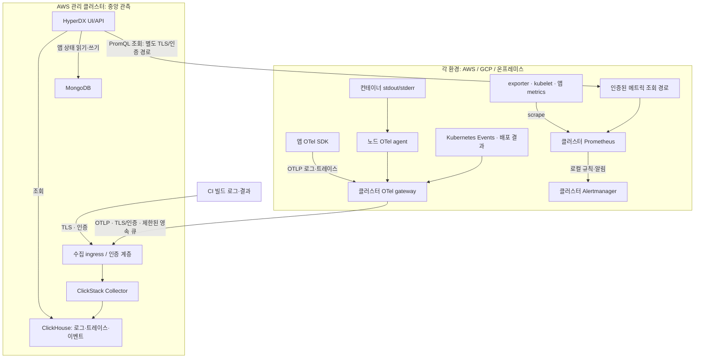

# ClickStack 멀티클라우드 관측 아키텍처 제안

- 날짜: 2026-11-04
- 관련 결정: [ADR 0040](adr/0040-adopt-clickstack-for-hackathon-observability.md)
- 상태: 문서 제안. 실제 조회·설치·네트워크·자격 증명 변경 미실행.
- 목적: 이번 주 배포·실행 오류 조사 데모 완성. 비교 PoC 대신 ClickStack을 개발 기준으로 사용.

구체적인 변경 파일·승인 단위·검증·복구는 [구현·배포 계획](plans/clickstack-implementation.md)에 기록한다. 공식 chart 조사에서 Secret 대체와 접속 URI 노출 제약을 확인했으므로, 중앙 앱은 공식 구조를 기준으로 Secret 참조를 보완한 로컬 chart를 제안한다. DB operator는 별도 고정 공식 chart를 사용하며 실제 호환성을 로컬 구현 단계에서 먼저 검증한다.

## 1. 구성과 소유권

| 구성 | 책임 | 이번 주 경계 |
| --- | --- | --- |
| HyperDX UI/API | 로그·트레이스 조사, 외부 Prometheus 차트 | 주 콘솔. 실험적 외부 조회는 고정 버전 검증 |
| ClickHouse | 로그·트레이스·빌드/배포 이벤트 | 중앙 AWS 관리 클러스터. 메트릭 중복 저장·WAN 복제 제외 |
| MongoDB | HyperDX 사용자·대시보드·알림 설정 | 별도 영속 볼륨. 관측 원문 저장소 아님 |
| 노드 OTel agent | 컨테이너 로그 수집 | namespace 허용 목록, 노드 측 filelog 체크포인트 |
| 클러스터 OTel gateway | 앱 OTLP 수신·정규화·필터·전송 | 중앙 전송 exporter에 영속 큐·재시도 |
| 중앙 ClickStack Collector | 표준 로그·트레이스 수신·DB 적재 | 공식 배포판과 호환 스키마 우선 |
| 클러스터 Prometheus/Alertmanager | 메트릭·규칙·알림 | 기존 관리 설치부터 사용. 신규 클러스터 설치는 별도 준비·승인 |
| 기존 Grafana | 개발 중 메트릭 확인 | 제거하지 않으며 새 기능 중복 구현 제외 |

DB와 HyperDX·중앙 Collector는 중앙에 두며 각 클라우드에 DB를 설치하지 않는다. 초기에는 단일 논리 인스턴스를 기본으로 검토하지만 chart가 추가하는 operator·Keeper·Mongo replica 구성까지 포함한 실제 Pod/PVC 수는 렌더링 후 확정한다. DB 두 개가 Pod 두 개라는 뜻은 아니다. 공식 Helm v2는 operator/CRD와 앱 설치가 나뉘므로 소유권·업그레이드 순서를 구현 계획에 포함한다.

## 2. 전체 구조

Q는 논리적인 조회 경계다. 같은 클러스터에서는 ClusterIP와 접근 제한을 사용하고, 다른 환경은 기존 사설 연결을 우선 재사용한다. 그림은 신규 VPN·공개 endpoint 생성을 승인하지 않는다.

### 서로 다른 네트워크 경로

1. **관측 전송:** 클러스터 gateway → 중앙 수집 endpoint. 외부 환경은 outbound OTLP/HTTPS를 사용하며 인증서 검증·클러스터별 자격 증명을 적용한다.
2. **메트릭 조회:** 중앙 HyperDX API → 각 환경의 Prometheus API. OTLP outbound만으로 이 경로가 생기지 않는다. 고정 버전의 인증 지원과 사설 라우팅 또는 인증된 TLS query gateway를 검증한 뒤 노출 범위를 정한다. 무인증 Prometheus 공개 노출·Kubernetes API 토큰 재사용은 하지 않는다.
3. **사용자 접근:** 인증된 HyperDX에 접근한다. 로컬 확인에는 port-forward를 사용할 수 있지만 다른 클라우드의 상시 수집 경로로 쓰지 않는다. 공개 UI가 필요하면 TLS·접근 범위·등록 정책을 별도로 확정한다.

이번 주 신규 클라우드 간 네트워크 플랫폼 구축은 기본 범위가 아니다. 기존 연결이 없는 대상은 필요한 최소 경로를 구현 계획에 명시적으로 추가한다. 연결 전에는 해당 환경 수집/메트릭 조회를 완료로 보고하지 않는다.

## 3. 신호별 처리

### 로그와 트레이스

- 기본 컨테이너 로그는 agent, 트레이스는 SDK OTLP로 수집한다. 같은 앱 로그를 stdout과 SDK 양쪽에서 중복 적재하지 않는다.
- SDK 호출 간 trace context를 전파하고 trace_id/span_id가 있는 로그의 HyperDX 연계를 검증한다. 같은 DB에 넣는 것만으로 연결되지 않는다.
- 로컬 gateway의 중앙 전송 exporter에 bounded persistent queue를 둔다. 중앙 Collector의 DB exporter도 필요 큐 용량을 검토한다. agent filelog 체크포인트와 exporter 큐는 다른 기능이며, 실제 배포판에서 영속 경로·재시도 지원을 확인한다.
- 버퍼는 측정 유입량과 허용 중단 시간으로 산정한다. 큐 초과·로그 회전·노드 유실 시 손실과 재전송 중복이 가능하다. 무손실·exactly-once를 주장하지 않는다.

### 빌드·배포 결과

| 실패 | 필요한 근거 | 연결 키 |
| --- | --- | --- |
| 빌드 실패 | CI 결과·실패 단계·필요 로그 | build_id, commit SHA, 서비스 |
| Argo sync 실패 | 배포 결과·revision·리소스 오류 | deployment_id, revision, cluster |
| 이미지/스케줄링 실패 | Kubernetes Events·Pod 상태 | cluster, namespace, workload, 이미지 digest |
| 런타임 API/DB 오류 | 앱 로그·호출 트레이스 | service.name, trace_id, 배포·실행 ID |

CI/Argo의 실제 전송 방법은 구현에서 정한다. 미수집 결과를 구현된 것으로 표시하지 않는다. Pod가 뜨지 않는 장애에는 앱 trace_id가 없으므로 별도 배포 ID가 필요하다. Kubernetes audit 로그 전체 조회는 기본 수집 범위에 포함하지 않는다.

### 메트릭과 알림

- 각 Prometheus가 해당 클러스터의 kubelet·node-exporter·kube-state-metrics와 필요한 앱 endpoint를 수집한다. OTel kubeletstats/hostmetrics와 같은 지표를 중복 수집하지 않는다.
- 앱 메트릭은 우선 Prometheus scrape endpoint를 사용한다. 앱이 OTLP metrics만 지원하면 Collector 연결의 temporality·histogram·replica 동작을 별도 설계한다. 현재 설정을 그대로 쓸 수 있다고 가정하지 않는다.
- HyperDX는 external Prometheus source별로 조회한다. ClickHouse 복제·자체 PromQL 실행이 아니다. 클러스터별 source/차트에서 시작하며 전 클라우드 합산 쿼리는 제외한다.
- API의 ENABLE_PROMQL 및 앱의 NEXT_PUBLIC_ENABLE_PROMQL은 고정 이미지에서 적용 방법을 확인한다. build-time 변수라면 chart env만으로 활성화된다고 가정하지 않는다. 인증·대표 PromQL·차트·재시작 후 source 유지를 검증한다.
- 규칙은 Prometheus/Alertmanager에 둔다. 중앙 HyperDX/ClickHouse 중단이 로컬 규칙·알림 전송을 막지 않도록 한다. 새 외부 수신처 등록은 별도 승인 대상이다.
- HyperDX 연동 실패 시 기존 Grafana를 개발용으로 쓰되 통합 미완료로 보고한다. 이를 이유로 메트릭 저장소를 자동 이전하지 않는다.

## 4. 공통 데이터 계약

| 필드 | 목적 |
| --- | --- |
| cloud.provider / cloud.region | 실제 provider·region. 온프레미스는 없는 cloud 속성을 억지로 채우지 않음 |
| k8s.cluster.name / k8s.namespace.name | 클러스터·namespace 구분 |
| service.name / service.version | 서비스·버전 |
| deployment.environment.name | dev/demo 등 환경 |
| deployment_id / build_id / run_id | 프로젝트 상관관계 키. 적용 가능한 이벤트에만 부여 |
| image digest / commit SHA | 배포 산출물 확인 |
| trace_id / span_id | 앱 호출·로그 연결. 빌드/배포에는 없을 수 있음 |

정확한 내부 필드명·타입·ClickHouse 컬럼/Map 매핑은 구현에서 고정한다. source timestamp와 수집 시점을 구분하고 시간 동기화를 확인한다. 인증된 클러스터 자격과 서버 측 속성 매핑으로 cluster 식별자 위조를 제한한다. 키 통일이 데이터 인가를 대신하지 않는다. 여러 Prometheus의 메트릭·알림에도 일관된 cluster 식별자를 붙인다.

## 5. 저장·보안·장애 경계

- 보존 제안: 로그/이벤트 7일, 트레이스 3일. Prometheus는 기존 7일을 기준으로 한다. TTL 삭제 지연과 디스크 여유를 확인한다. 실제 PVC·자원·비용은 실행 계획에서 확정한다.
- ClickHouse와 MongoDB는 각각 영속 저장을 사용하고 데이터·UI 설정의 재시작 유지를 검증한다. 단일 인스턴스는 노드·AZ 장애 HA가 아니다.
- ingest 쓰기와 조회 권한을 구분한다. API key·비밀번호·session secret·TLS private key는 Git/로그/ADR에 기록하지 않는다. 기존 Prometheus SA 토큰은 Kubernetes scrape 전용이며 HyperDX query credential로 쓰지 않는다.
- 팀 내부 데모 접근이 기본 범위다. OSS 세밀한 UI RBAC 제약을 수용하더라도 무인증 공개하지 않는다. 프로젝트별 격리가 필수라면 DB 데이터 권한까지 검증한다. 운영 고객 데이터·민감정보는 기본 수집 대상이 아니며 로컬에서 민감 필드 제거 후 전송한다.
- AI MCP는 후속 기능이다. 조회 도구만 허용하고 SQL 시간·행 수·데이터 범위를 제한한다. 기본 MCP가 읽기 전용이라고 가정하지 않는다. 로그 문자열은 명령이 아닌 분석 데이터이며 자동 배포·수정은 제외한다.
- 중앙 관리 클러스터 중단은 중앙 조회·적재와 원격 메트릭 UI에 영향을 준다. 다른 클러스터의 메트릭 수집·규칙·알림은 독립 유지한다. 버퍼 시간 초과 후 로그/트레이스 손실이 가능하다.
- 비용은 DB·operator·Collector·PVC·백업과 egress·NAT·연결 비용을 포함한다. 압축률·비용 우위를 실측 없이 단정하지 않는다.

## 6. 이번 주 구현 순서와 완료 기준

아래는 의존 순서이며 실행 승인이나 완성된 배포 계획을 대신하지 않는다.

| 단계 | 목표 | 완료 확인 |
| --- | --- | --- |
| 1 | chart/image/CRD·권한·저장·네트워크 구체화 | 렌더링, 비용·손실 허용·실행 범위 승인 |
| 2 | 중앙 ClickStack 기동 | DB 준비, HyperDX 로그인, 재시작 후 데이터·설정 유지 |
| 3 | AWS 관리 앱 로그·실제 API 호출 트레이스 | 서비스·버전·배포 ID 검색, 같은 요청 로그↔트레이스 이동 |
| 4 | HyperDX에서 관리 Prometheus 조회 | CPU·메모리·Pod 상태 PromQL을 직접 조회 결과와 비교 |
| 5 | 독립 클러스터 추가 및 GCP/온프레미스 연결 | 공통 계약으로 식별·검색. 실제 클라우드가 다를 때 멀티클라우드 완료 |
| 6 | 배포 실패·런타임 오류 데모 | 구현한 Events/CI/Argo 근거와 trace를 구분해 원인 설명 |
| 7 | 제한된 전송 중단·재시작 복구 | 누락·중복·지연 측정, 로컬 메트릭·알림 독립성 |

첫 데이터 측정 후 고정할 값은 최대 유입량·데이터 크기·동시 조회·조회 P95/수집 지연 상한·큐 허용 중단 시간·PVC/자원 상한·비용 한도다. 미확인 숫자를 성능 보장으로 쓰지 않는다. 장기 비교 벤치마크보다 기능과 장애 데모를 우선한다.

GCP/온프레미스가 준비되지 않으면 AWS 관리+워크로드의 멀티클러스터 동작까지만 보고하고 멀티클라우드 미완료를 남긴다. 외부 Prometheus는 도달 가능한 source부터 연결하며 미연결 source는 완료에서 제외한다.

## 7. 후속 변경 후보와 실행 경계

다음은 구현 계획의 변경 후보이며 지금은 수정하지 않았다.

- `helm/addons/` 및 GitOps Application 정의: chart·operator/CRD 버전·소유권·수동 sync 순서.
- `clusters/aws-dev-management/values/`: 중앙 ClickStack·Secret 참조·기존 OTel Loki 출력 전환·Prometheus source.
- `clusters/aws-dev-workload/values/opentelemetry-collector.yaml`: 중앙 주소 placeholder, namespace/속성·trace 경로.
- GCP/온프레미스 수집 설정: 실제 대상과 저장소 소유권 확인 후 공통 계약 적용.
- 앱 저장소: SDK·HTTP context 전파·배포/실행 속성. 인프라 저장소만으로 끝나지 않는 연계 작업.
- CI/배포 결과 전송: 실패 단계·revision과 연결 ID의 실제 원천 확정 후 구현.

실행 계획에는 고정 chart/image digest, CRD/RBAC, Secret 생성·저장, TLS/DNS/네트워크, PVC·비용·검증·rollback을 포함한다. 새 클러스터 조회/설치와 IAM/Secret 작업은 별도 승인 범위를 명시한다. root·다른 addon 일괄 sync·자동화는 켜지 않는다.

실패 시 승인 대상 Application operation/입력만 한정해서 중단·되돌린다. PVC·관측 데이터는 자동 삭제하지 않고 기존 Prometheus/Grafana를 유지한다. Secret 폐기·네트워크 삭제도 실제 승인 범위에 따른다.

## 관련 자료

- [공식 ClickStack 아키텍처](https://clickhouse.com/docs/clickstack/architecture)
- [공식 Helm 구성](https://clickhouse.com/docs/clickstack/deployment/helm)
- [외부 Prometheus source](https://clickhouse.com/blog/whats-new-in-clickstack-june-2026)
- [PromQL 활성화와 지원 범위](https://clickhouse.com/blog/whats-new-in-clickstack-october-2026)
- [OTel 수집](https://clickhouse.com/docs/clickstack/ingesting-data/opentelemetry)
- [UI RBAC](https://clickhouse.com/docs/clickstack/managing/rbac)
- [MCP 기능](https://clickhouse.com/docs/clickstack/mcp)
- [기존 관리 OTel 설정](../clusters/aws-dev-management/values/opentelemetry-collector.yaml)
- [기존 workload OTel 설정](../clusters/aws-dev-workload/values/opentelemetry-collector.yaml)
