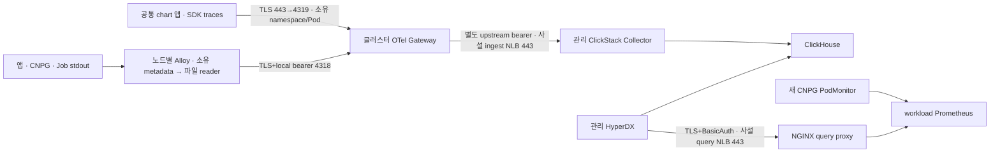

# 플랫폼 워크로드 자동 관측

2026-11-06. 개발 준비 B 결과이며 실제 설치/수집 완료 기록이 아니다. 모든 기존 activation은 false다. 새 CI와 실제 Secret을 만들지 않았다.

## 구성과 자동화 범위



- 지원 환경 profile을 한 번 켜면 임의의 새 앱/서비스/replica에 label·OTLP endpoint·공개 CA가 붙는다. 앱별 token 복사나 수집기 app 목록 수정은 없다. CA 교체 시 checksum이 Pod를 갱신한다.
- DB에는 inherited labels와 PodMonitor, Prometheus→9187 허용 규칙이 붙는다. DB topology/SQL/5432 계약은 그대로다. 메트릭 수집 off 환경에서는 PodMonitor를 만들지 않는다.
- SDK 없는 바이너리는 stdout 로그만 수집한다. 모임룸은 별도 PR로 HTTP SDK/W3C trace context와 slog trace_id/span_id를 구현한다. 요청 body/query/인증 헤더/SQL을 span에 넣지 않는다. DB/client span, eBPF·계측 Operator는 범위 밖이다.
- Hopai Job은 `observability.automaticJobs`로 관측 labels 및 종료 후 최소 1시간 보존을 적용한다. 기존 `hop-migrate`는 한 번 onboarding하는 namespace fallback이다. 미확인 기존 runner를 다른 역할로 단정하지 않는다. 자격 증명을 가져오는 fetch init-container 로그는 제외한다.
- Alloy는 metadata 확정 후 정확한 namespace/Pod UID/container 파일을 처음부터 읽는다. 포트별 discovery label은 제거해 container reader를 중복 생성하지 않는다. 보호 namespace를 먼저 제외한다. 소유 namespace 내부 보안은 팀 신뢰 모델이며 강한 테넌트 인증이 아니다.
- Pod 삭제·노드 유실·kubelet 로그 삭제보다 discovery가 늦으면 파일 자체를 복구할 수 없다. Job 보존·positions·queue는 이 한계를 없애지 않는다. 큐는 at-least-once이며 장애 시 중복 가능성이 있다.

## 고정 구성과 권한

Alloy v1.21.3 / chart1.15.0, Collector contrib0.161.0 / chart0.175.0, kube-prometheus-stack91.8.2 / operator0.94.1, NGINX unprivileged digest `f5116ed…`(이미지 내부 NGINX1.30.6), OTel Go1.47.0. 전체 image digest와 chart checksum은 helm lock 파일을 따른다. Alloy `otelcol.storage.file`은 public-preview이며 `--stability.level=public-preview`를 명시한다.

- agent/gateway ClusterRole: pods/namespaces get/list/watch. Secret API와 pods/log API 권한은 없다. Pod 객체 조회에는 inline env가 포함될 수 있다. gateway는 app listener에서 connection IP로 metadata를 연결한다. app이 보낸 resource 속성 전체를 신뢰할 수 있는 인증 정보로 취급하지 않는다.
- Prometheus server: pod/service/endpoint/namespace discovery 읽기. Secret API 직접 조회 권한은 없다.
- Operator: monitoring CR과 일부 cluster metadata 권한, observability namespace 안의 Secret/ConfigMap/StatefulSet 등 controller 권한. instance namespace를 observability로 제한하고 object-reference의 모든 namespace watch를 끈다. 앱 namespace의 monitoring CR을 발견하는 권한은 유지한다.
- Alloy는 노드 로그 읽기를 위해 root UID(capabilities 전부 drop), /var/log 읽기 mount, /var/lib/charlie-alloy의 positions/queue hostPath를 사용한다. queue에는 수집 로그가 들어간다. PodSecurity/hostPath 허용 여부는 C에서 확인한다.
- workload baseline의 obs compatibility는 gateway-labelled Pod만 제외한다. 전용 정책이 agent4318와 소유 app4319 ingress를 구분한다. gateway의 이전 egress 허용은 보존한다. 다른 obs Pod와 기존 앱/DB 정책을 좁히지 않는다. 관리 클러스터 정책은 실환경 inventory를 별도 확인한다.

## 활성화 입력과 Secret 계약

B merge에는 아래 스위치 변경이 없다. 실제 값과 적용 순서는 C 승인 후 별도 activation PR에 담는다. main 추적 ApplicationSet/selfHeal로 생기는 rollout도 실행 승인 대상이다.

| 입력 | C에서 준비할 값 |
| --- | --- |
| root observability.automatic.enabled | true, agentTargets/gatewayTargets에 승인한 클러스터만 |
| eks profile.observability | enabled=true, metricsEnabled=true, gateway HTTPS endpoint, 공개 PEM CA, clusterName/cloudProvider/region |
| platform observability.automaticJobs | true; 기존 runner namespace 최초 등록 별도 |
| workload baseline networkPolicy.isolateObservabilityGateway | true; 전용 policy 준비와 함께 적용 |
| clickstack privateIngest | enabled=true, 관리 private subnet2개, workload source10.40.32.0/19 |
| clickstack additionalIngestTokenKeys | workload 전용 upstream key를 기존 key에 추가; 기존 management key 보존 |
| hyperdx.queryTrust | enabled=true, 외부 공개 CA ConfigMap 이름 |

| namespace / 이름 | 필요한 key·내용 | 소비자 |
| --- | --- | --- |
| 각 클러스터 observability/observability-client-auth | OTLP_AUTH_TOKEN(local agent bearer) | Alloy, local gateway |
| 각 클러스터 observability/observability-client-ca | ca.crt(local gateway 공개 CA) | Alloy |
| 각 클러스터 observability/observability-gateway-tls | tls.crt/tls.key(서비스 DNS SAN) | local gateway |
| workload observability/observability-upstream-auth | CENTRAL_OTLP_AUTH_TOKEN | workload gateway만 |
| workload observability/observability-upstream-ca | ca.crt(중앙 ingest 공개 CA) | workload gateway만 |
| workload observability/observability-remote-endpoint ConfigMap | endpoint(private ingest NLB HTTPS URL) | workload gateway |
| management observability/clickstack-collector-auth | 기존 key 보존 + workload 전용 ingest token key | 중앙 collector |
| workload observability/observability-metrics-query-auth | htpasswd(BasicAuth hash) | NGINX |
| workload observability/observability-metrics-query-tls | tls.crt/tls.key(실제 query NLB DNS SAN) | NGINX |
| management observability/observability-metrics-query-ca ConfigMap | ca.crt(query 공개 CA) | HyperDX NODE_EXTRA_CA_CERTS |
| 각 앱 namespace/hopcharlie-observability-ca ConfigMap | 환경 profile에서 자동 생성하는 ca.crt | SDK 앱 |

CA private key는 C 발급 중 메모리에서만 사용 후 폐기한다. 인증서 만료/rotation 방식과 concrete key 이름은 C 실행 목록에 확정한다. HyperDX 기존 팀에는 인증 API로 workload Prometheus connection/source를 한 번 등록해야 한다. 초기 DEFAULT_CONNECTIONS Secret만 바꾸어 기존 팀의 연결이 갱신된 것으로 간주하지 않는다. HyperDX Prometheus 연동의 실험적 제약은 기존 ADR0050을 따른다.

## 로컬 검증

`make helm-check`는 기존 검사와 새 `test-automatic-observability.py`를 실행한다. 고정 공식 차트를 받으므로 네트워크가 필요하다. 신규 CI workflow는 없다.

추가 binary proof는 합성 데이터만 쓴다. 신뢰한 공식 버전 바이너리를 임시 경로에 준비하고 다음 명령을 실행한다. Python PyYAML/cryptography가 필요하며 실제 kubeconfig·AWS 로그인이 필요하지 않다.

```sh
ALLOY_BINARY=/path/to/alloy-v1.21.3 python3 scripts/tests/proof-alloy-discovery.py
HELM=/path/to/helm NGINX_BINARY=/path/to/nginx-1.30.6 python3 scripts/tests/proof-metrics-query.py
```

확인 결과: 새 임의 이름/서비스/replica/DB의 공통 설정, CA 교체 checksum, OTEL 충돌 거부, CNPG selector/9187, Job label/최소 TTL, 최소 권한 및 pinned upstream 렌더 통과. 실제 Alloy에서 metadata 지연 중 reader/positions 미생성, 완료 Pod의 첫 로그3개, 포트 중복 방지, native trace/span ID, 파일 회전, SIGKILL 후 queue 복구, 비소유 파일 미등록, 삭제된 Pod 수집 중단 통과. 실제 NGINX1.30.6에서 TLS/BasicAuth 성공·실패, GET/POST query, 인증·Cookie 헤더 제거, 금지 API/method 및 잘못된 CA/hostname 거부 통과. Collector0.161.0의 양쪽 gateway 설정 validate 통과. 모임룸 전체 Go race 검사와 vet 통과.

기존 main875ce37 기준 앱 stateless/stateful, ApplicationSet, platform, 두 baseline, ClickStack, root GitOps의 YAML object 렌더가 모두 같았다. 실제 클러스터 신규 배포/DB scrape/HyperDX 연계 증거는 아직 없다.

## C 실행 전·후 확인

실제 requests/quota/LimitRange/스토리지/PodSecurity와 기존 네트워크 flow를 점검한다. 추가량은 노드당 Alloy100m/256Mi, workload gateway100m/128Mi(queue2Gi), Prometheus100m/512Mi(PVC10Gi), operator100m/128Mi, query50m/64Mi 및 config-reloader 등이다. 차트 sidecar/init/overhead를 포함한 최종 합계를 실제 노드 수와 함께 다시 계산한다. 관리 기존 agent 교체와 중앙/HyperDX rollout 영향도 포함한다. internal NLB2개의 리전별 고정·처리량 비용을 C에 제시한다. 자동 노드 증설은 없다.

CRD/최소 Prometheus→Secret/CA·제한 정책→gateway/query/실제 사설 LB→agent 전환→공통 app/DB/Job→HyperDX connection 순으로 적용한다. 한 번도 등록하지 않은 SDK 앱, 새 service/replica/DB, 즉시 종료 Job을 실제 배포해 첫 로그/trace·CNPG target up·stale target 제거를 확인해야 완료다. metadata가 늦고 노드 로그가 남지 않은 경우까지 무손실을 보장하지 않는다.

장애 시 선택한 앱/관측 revision과 gateway 정책만 이전 승인 입력으로 복구한다. 기존 DB/PVC/Secret을 삭제하지 않는다. 실제 생성된 LB/SG/Secret/PVC 폐기는 별도 승인 범위를 따른다.

## AWS 플랫폼 메트릭 확장 (2026-11-08)

[ADR0098](../adr/0098-expand-aws-workload-platform-metrics.md)에 따라 AWS workload의 기존 cnpg-prometheus.yaml을 확장한다. 기존 CNPG PodMonitor/PVC/보존 설정을 유지하며 KSM과 node-exporter, API server proxy 경유 kubelet/cAdvisor 수집을 추가한다. 선택되는 ServiceMonitor는 monitoring-operator, monitoring-prometheus, monitoring-kube-state-metrics, monitoring-node-exporter 네 개이며 namespace는 observability로 한정한다.

boundary의 awsPlatformMetrics는 기본 false이며 AWS workload만 true다. 새 RBAC 네 개를 먼저 적용하고 exporter/Service/SA/Monitor·추가 scrape Secret·Prometheus CR만 기존 KPS 앱에서 선택 sync한다. scrape Secret에는 YAML과 회전 token 파일 경로만 있고 인증 값은 넣지 않는다. 현재 3노드의 추가 요청은 합계 125m CPU·224MiB다. 배포 직전 노드 요청량과 압박을 다시 확인한다.

HyperDX 메트릭 탐색에서 AWS는 기존 Workload CNPG Metrics Source를 선택한다(이름은 보존). 노드는 `count(kube_node_info)`, CPU는 `sum(rate(container_cpu_usage_seconds_total{container!="",container!="POD"}[5m])) by (namespace,pod)`, 메모리는 `sum(container_memory_working_set_bytes{container!="",container!="POD"}) by (namespace,pod)`로 확인한다. 노드 메모리는 `node_memory_MemAvailable_bytes`, DB는 `cnpg_collector_up{namespace="moimroom-mig"}`다. GKE는 기존 GKE Prometheus connection에 연결한 동일 이름 Source를 사용한다.

배포 결과와 실제 쿼리 검증은 아래 적용 기록을 따른다. HTTP200만으로 수집 성공으로 판단하지 않고, 예상 시계열 존재·최근 sample 시각·range point·기존 CNPG up을 확인한다. 보호된 HyperDX API는 기존 계정의 정상 비노출 로그인으로 검증하며 비밀번호·cookie·연결 credential을 결과 파일에 남기지 않는다.

### 적용·검증 결과

사용자가 최종 계획과 구현·PR 병합·실제 배포·검증·해당 변경 복구 범위를 승인했다. [PR188](https://github.com/2026-Softbank-Hackathon-Charlie/infra/pull/188), 병합 커밋 `124c754e187e2c938aa5b5714121c30cf05fb58a`를 기존 두 Argo 앱에 적용했다. RBAC 4개를 먼저, KPS의 정확한 변경 자원 10개를 뒤에 선택 sync했으며 전체 sync/prune은 수행하지 않았다. 두 앱 모두 Synced/Healthy이고 각 선택 operation은 Succeeded다.

| 확인 대상 | 실제 결과 |
| --- | --- |
| 관리 Prometheus | 27/27 대상 up, 노드 4개, CPU·메모리 집계 및 range 정상 |
| AWS workload | 15/15 대상 up, 노드 3개, CPU·메모리 집계 및 range 정상 |
| GKE | 14/14 대상 up, 노드 3개, CPU·메모리 집계 및 range 정상 |
| 기존 CNPG | AWS/GKE 모두 min(cnpg_collector_up)=1 |
| AWS namespace/pod 메모리 집계 | 50개 Pod 반환 |
| AWS sample freshness | 인증된 HyperDX 조회 시 kube_node_info 약 3.5초 |
| 새 수집기 | KSM 1개, node-exporter 3개 Ready, 재시작 0 |
| 기존 관측 Pod | operator/Prometheus Ready, 재시작 0 |
| Prometheus 저장·자원 | PVC Bound/10Gi 유지, 사용률 약 0.26%, RSS 약 164MiB/제한 1Gi |

동일 HyperDX Pod 네트워크·기존 인증·검증된 CA로 실행한 curl 45건이 통과했다. 사용자 터미널에서 기존 계정으로 정상 로그인한 HyperDX 보호 API의 PromQL instant/range 30건도 모두 HTTP200/status=success였으며 예상 시계열·노드 수·최신 sample·CNPG·range point를 검사했다. 빈 결과가 정상인 관리 클러스터의 moimroom CNPG는 workload/GKE 성공과 구별했다. 실제 보호 GET /sources에서 Logs/Traces 필드와 GKE Source 존재·정확한 connection 연결도 확인했다. UI 화면을 확인했다는 의미는 아니다.

GKE Source는 기존 team/connection에 한 개만 생성했으며 기존 Source 문서 digest가 유지됐다. 비밀번호·cookie·연결 credential은 결과 파일에 저장하지 않았고 정상 로그인 검증 종료 시 로그아웃했다. 기존 DB/앱/IAM/네트워크 정책/인증/스토리지 용량 변경은 없었다. 새 권한의 양성·음성 검사 14개와 실제 자원 14개의 UID/Argo 소유권 기록도 완료했다.

계획 대비 범위·설계 변경은 없다. 독립적인 GKE Source 등록은 AWS CI 대기 중 먼저 처리했다. 일회성 검증 기록은 실행 호스트 `/private/tmp/hyperdx-metrics-check/`의 `authenticated-hyperdx-curl-proof.json`, `backend-curl-proof.json`, `storage-curl-proof.json`, `health-proof.json`, `rbac-proof.json`, `created-resources.json`에 있으며 영구 보존 저장소로 간주하지 않는다. 이후 메트릭은 신규 수집 시작 이후 구간만 존재한다.
