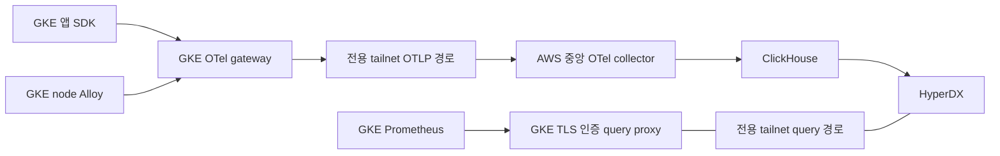

# GKE 관측 연결 준비와 실행 기준

2026-11-07. 코드 준비 단계다. **실제 설치·Secret 발급·tailnet 변경·GKE 앱 활성화를 수행하지 않았다.** 온프레미스는 사용자 지시로 제외한다. 결정은 [ADR0082](../adr/0082-connect-gke-to-central-observability.md)를 따른다.

## 구성과 현재 상태

- GKE: project `project-b47cdba3-db5b-42a2-9a6`, zone `asia-northeast3-a`, cluster `charlie-dev-gcp-workload`, Kubernetes `1.36.4-gke.2377000`.
- Ready 노드 3개, 각 allocatable CPU 1930m/메모리 6170224Ki. 점검 당시 요청량 기준 남은 CPU 562m/1000m/497m이다. 배포 직전 fresh 용량을 다시 계산한다.
- GKE 자체 metrics-server·Google managed 수집기·KSM·Tailscale operator·PD 클래스는 이미 있다. 중앙용 observability namespace와 monitoring.coreos.com CRD는 없었다. 기존 managed 구성은 변경하지 않는다.
- GKE API의 현재 허용 AWS NAT 경로로 strict CA/SNI 읽기를 확인했다. 로컬 IP를 허용 목록에 추가하지 않았다. 이 운영 접근 터널은 수집 경로가 아니다.
- 앱 `gke.profile.observability`는 계속 off다. 준비 파일 [app-observability.yaml](../../clusters/gcp-dev-workload/values/app-observability.yaml)도 off이며 새 CA·endpoint가 확정되기 전에 켜지 않는다.

## 고정 계약과 적용 대상

| 항목 | 계약 |
| --- | --- |
| OTLP exporter 내부 주소 | `https://observability-central.observability.svc:4318` |
| 중앙 TLS 검증 이름 | `clickstack-otel-collector.observability.svc` |
| GKE 앱 수신 주소 | `https://observability-gateway.observability.svc:443` |
| HyperDX GKE Prometheus URL | `https://observability-gke-metrics.observability.svc.cluster.local:443` |
| query leaf SAN | 위 HyperDX hostname 및 공개 계약 파일의 서비스 DNS 이름 |
| 지역/zone | `cloud.region=asia-northeast3`, `cloud.availability_zone=asia-northeast3-a` |
| 저장소 | Alloy node-local hostPath, gateway 2Gi PD PVC, Prometheus 10Gi PD PVC |
| root gate | `observability.externalTargets.gke.enabled=false` |
| 소유권 | 별도 `charlie-observability-gke` Project, 수동 관측 Application 6개 |

root `.targets`에 GKE를 넣지 않는다. 넣으면 기존 AWS baseline 생성 루프와 충돌한다. 기존 AWS Project/Application, root 활성 값, 온프레미스 profile은 변경하지 않는다. management root Helm은 AWS Kubernetes 1.35에서 렌더되고, GKE 하위 chart는 1.36 기준으로 검증한다.

새 Application은 GKE agent/gateway/boundary/KPS 및 management/GKE transport다. Namespace는 후속 실행 승인에서 명시 생성하며 root sync로 임의 생성하지 않는다. transport chart의 ExternalName 초기 `unconfigured.invalid`는 Tailscale operator가 실제 proxy Service로 바꾸기 전의 실패 폐쇄 DNS다. public LoadBalancer/NodePort는 생성하지 않는다.

## 권한·네트워크·자격

agent/gateway는 기존 Pod·namespace metadata 읽기를 재사용한다. KPS Operator의 Secret/ConfigMap 쓰기는 observability namespace로 제한하며 전체 namespace Secret 감시를 끈다. KSM은 명시한 workloads/nodes/namespaces/PV/PVC/services만 list/watch하고 Secret/ConfigMap은 읽지 않는다. Prometheus의 추가 `nodes/proxy` 읽기는 kubelet/cAdvisor의 API proxy를 위한 것이며 권한을 일반 앱에 부여하지 않는다. 추가 scrape configuration Secret에는 공개 YAML과 projected token **경로**만 들어가고 실제 token 값은 없다.

전용 tailnet ACL 후보는 다음 두 통신뿐이다. 기존 정책에 보존 병합해야 하며 코드 준비에서 ACL을 변경하지 않는다.

| 출발 tag | 목적 tag | 허용 포트 |
| --- | --- | --- |
| `tag:hop-observability-gke-export` | `tag:hop-observability-central` | TCP4318 |
| `tag:hop-observability-management-query` | `tag:hop-observability-gke-query` | TCP443 |

전용 proxy는 DNS·HTTPS control/DERP·UDP peer 통신도 필요하다. 해당 통신은 tailnet payload 허용 규칙과 구분한다. 기존 DB tag/ProxyClass/5432 경로는 변경하지 않는다. 실제 tagOwner·operator 발급 권한·현재 ACL 합집합과 NetworkPolicy 합집합을 실행 전에 확인한다.

후속 실행 승인에 필요한 자격 객체는 다음과 같다. 지금은 만들거나 읽지 않는다.

- GKE `observability-client-auth`, `observability-client-ca`, `observability-gateway-tls`: agent bearer와 local gateway TLS/공개 CA. 앱에는 공개 CA만 공급한다.
- GKE `observability-upstream-auth`, `observability-upstream-ca`: 새 GKE 전용 중앙 bearer와 기존 중앙 공개 CA. 기존 AWS bearer는 복사하지 않는다.
- 관리 중앙 collector의 기존 auth Secret에 `GKE_OTLP_AUTH_TOKEN` 키만 보존 추가. 정확한 Secret 이름은 선택 배포안에서 현재 Deployment의 secretKeyRef와 일치시킨다. [중앙 overlay](../../clusters/aws-dev-management/values/clickstack-gke.yaml)는 기존 WORKLOAD 키를 첫 번째로 유지한다. 준비 PR은 이 overlay를 현재 central Application에 연결하지 않는다.
- GKE `observability-metrics-query-auth`, `observability-metrics-query-tls`: 전용 BasicAuth hash와 위 SAN의 leaf. 관리 HyperDX에는 공개 CA bundle과 새 GKE connection을 추가한다. 기존 AWS connection을 덮어쓰지 않는다.

CA365일/leaf90일과 bundle 전환은 ADR0063을 따른다. plaintext·TLS skip·Secret 출력/커밋·장기 SA-token 생성은 하지 않는다. query proxy는 Prometheus query/labels 관련 API만 통과시키고 인증·Cookie는 upstream에서 제거한다.

## 용량과 선행 gate

GKE의 준비 요청량은 Alloy3개300m/768Mi, gateway100m/128Mi, Prometheus100m/512Mi, Operator100m/128Mi, KSM50m/128Mi, node-exporter3개75m/96Mi, query50m/64Mi, Tailscale proxy2개100m/256Mi 및 reloader10m/32Mi로 대략 **885m CPU/2112Mi**다. init container의 max, 실제 chart 결과, system/기존 Pod 요청량과 node별 배치를 최종 manifest에서 다시 합산한다. management proxy2개100m/256Mi도 별도 합산한다. 최댓값이나 실제 사용량 보장은 아니다. 증설은 이 PR에 포함하지 않는다.

Alloy는 node-local `/var/lib/charlie-alloy`에 positions/queue를 보관하며 노드가 교체되면 유실될 수 있다. `otelcol.storage.file`은 public-preview다. gateway와 Prometheus만 각각 PD RWO PVC를 사용하며 DaemonSet이 단일 RWO PVC를 공유하지 않는다.

## 후속 실행 순서와 완료 기준

1. 코드 PR의 기존 Helm·관측·inventory CI 통과 및 사용자 머지.
2. 확정 SHA·대상 identity·용량·소유권·권한·새 Secret/ACL 목록·공개 TLS 이름·선택 sync·복구안을 리뷰하고 실행 승인. 지금 준비 PR의 승인으로 이 단계를 실행하지 않는다.
3. 전용 tag/ACL/TS 경로와 중앙 ingress 정책을 준비하고, [명시 namespace](../../clusters/gcp-dev-workload/observability-namespace.yaml)와 GKE CRD/RBAC·PD PVC를 생성한다. namespace의 PSA enforce=privileged는 node-local 로그·호스트 지표 agent를 위한 것이며 audit/warn은 restricted로 유지한다. 이 권한 경계 역시 실제 실행 승인에 명시한다. 기존 GKE managed 리소스를 인수하지 않는다.
4. gateway·agent·query·KPS 설치, Ready/Bound·TLS/SNI/인증 성공 및 실패를 검증한다. kubelet/cAdvisor는 신뢰한 API proxy와 회전 projected token으로 수집한다.
5. GKE 전용 token 키를 중앙 auth에 추가하고 승인한 중앙 ConfigMap·Deployment만 선택 반영한다. 기존 AWS 키 순서/인증·로그·trace를 보존하는지 검증한다.
6. 실제 공개 CA를 GKE app profile에 넣고 `enabled/metricsEnabled`를 켜는 명시 활성화 변경으로 앱을 한정 rollout한다. 기존 DB topology·자격·데이터는 변경하지 않는다.
7. HyperDX에 위 URL·전용 인증·공개 CA의 GKE Prometheus connection을 추가한다. `node_cpu_seconds_total`, `node_memory_MemAvailable_bytes`, `kube_pod_info`, `container_cpu_usage_seconds_total`과 실제 CNPG 지표를 해당 연결에서 확인한다. 외부 label 설정만으로 모든 로컬 시계열에 cluster label이 붙었다고 주장하지 않는다.
8. 합성 ID의 앱 요청에서 server/DB/스토리지 span과 로그를 연결한다. 새 이름 앱·서비스·DB 및 즉시 완료 Job을 승인 범위로 만들어 자동 등록·첫 로그·target up과 삭제 후 stale target 제거를 확인한다. 일반 업무 로그/데이터는 탐색하지 않는다.

CI 통과는 준비 완료이며 실제 2~8단계 완료 증거가 아니다. 모든 환경을 한 PromQL로 합산하는 구조도 아니다.

## 실패·복구

GKE profile은 기록한 이전 값으로 복구하고 해당 신규 관측 App/서비스만 대상으로 삼는다. 업무 DB/PVC·기존 AWS 수집기·GCP managed 수집기는 삭제하지 않는다. 중앙 문제가 생기면 기존 token 목록·ConfigMap·Deployment 기준점으로 먼저 복구해 AWS 수집을 유지한 뒤 GKE 전용 token/TS 경로를 철회한다. CA 교체는 신뢰 bundle→leaf 순서를 지킨다. 이름/권한/소유권/예상 외 diff가 있으면 전체 sync·prune·allow-all로 우회하지 않는다.

## Argo 권한 선행 적용

[ADR0087](../adr/0087-bound-gke-observability-argocd-writes.md)에 따라 기존 앱용 Argo 정책을 전체 비활성화하지 않는다. `values/argocd-observability-access.yaml`은 수동 관리자 적용용이며 기본 off다. 차트의 flag는 반영 순서를 자동 보장하지 않는다.

1. 승인된 머지 SHA에서 `gcp-argocd-access`를 렌더한다. 기존 Google identity·namespace·원래 정책과 충돌을 확인한다. 신규 namespace·CRD·관측 RBAC 및 ProxyClass는 관리자 소유 목록으로 구분한다.
2. `observability.enabled=true`, 나머지 두 flag=false로 새 VAP·Deny Binding·unbound Role을 먼저 설치한다. 기존 VAP와 binding은 그대로 보존한다. API type-check 확인 후 동일 Argo identity로 잘못된 이름·인증 Secret·subresource 쓰기가 거부되고 DB-network 신규 NP 두 이름의 CREATE도 새 VAP에 의해 거부됨을 dry-run 검증한다. 기존 ClusterRole에 CREATE가 있어도 거부되어야 한다. wildcard type-check만으로 성공을 단정하지 않는다.
3. 새 guard가 작동하는 상태에서 `openExistingPolicy=true`의 **기존 VAP 한 개만** 선택 반영한다. 기존 역할로 허용되는 Service/Deployment/NP의 허용 이름 dry-run 성공과 금지 이름 거부를 확인한다. 기존 정책이 첫 단계의 정상 요청을 거절하는 것은 예상 동작이다.
4. `grantAccess=true`로 관측 RoleBinding2개·cluster-read binding1개만 추가한다. 추가 종류의 허용·거부 검증 후 관측 Application을 설치한다. 실패하면 다음 단계로 진행하지 않는다.
5. CRD10개는 관리자 선행 적용/Established 확인 대상이다. KPS는 skipCrds=true다. GKE boundary의 ClusterRole6·ClusterRoleBinding6·Role1·RoleBinding1과 전용 ProxyClass2개, 관리 ProxyClass2개, 두 클러스터 DB-network namespace의 신규 NP2개씩은 관리자 bootstrap이다. Argo의 boundary/transport sync는 이 목록을 제외한 namespaced 자원만 선택한다. 관리 observability-from-tailnet NP와 transport Services2개는 관리 transport App의 선택 sync 대상이다.
6. Prometheus StatefulSet·설정 Secret·PVC는 Prometheus operator, Tailscale proxy StatefulSet/Pod/Secret은 기존 Tailscale operator가 만든다. 인증 Secret은 승인된 관리자가 생성하며 KPS public scrape-config Secret만 Argo 관리다.

**권한 위험:** observability의 privileged Pod 변경을 맡기면 Argo에 노드 파일·자격 접근의 실효 권한이 생긴다. 고정 이름 목록으로 Pod spec을 격리했다고 표현하지 않는다. Argo는 관측 namespace Secret cache를 읽을 수 있다.

**권한 복구:** 기존 VAP의 관측 예외 철회와 원래 deny 확인 → 추가 binding/Role 철회 → 새 VAP/Binding 제거 순서다. 원래 deny를 복구하기 전 새 제한을 제거하지 않는다.

**자원 gate:** 3개 node 기준 GKE 기본 요청은 885m/2112Mi이며 gateway/Prometheus PVC는 2Gi/10Gi다. 합성 fixture 최대335m/576Mi와 PVC1Gi는 별도다. 관측 rollout과 fixture를 순차 실행하고 기존 앱 활성화도 Deployment 하나씩 진행한다. fresh node별 allocatable·기존 요청·Pod overhead·일반/init/sidecar peak·Pending Pod·taint/affinity·PD topology와 surge까지 계산한다. 기존 워크로드 축소·노드 증설은 이 계획에서 수행하지 않는다.

**합성 검증 제한:** `obs-gke-proof-*` 자원만 생성·UID 기록·정리한다. private ECR image를 GKE 신규 namespace에서 pull할 기존 경로가 없으면 credential 복사·신규 발급·이미지 게시로 우회하지 않는다. 이 경우 공개 pinned nginx로 공통 chart env/CA 주입·로그·replica 수집만 검증하며 합성 SDK 앱은 미검증으로 남긴다. SDK/DB/storage trace는 기존 GKE 모임룸의 nonce SELECT·HEAD probe로 별도 확인한다. 합성 CNPG는 독립1 instance/PVC1Gi이며 실 업무 DB·bucket과 연결하지 않는다. 합성 PVC 삭제 외 운영 PVC는 보존한다.
