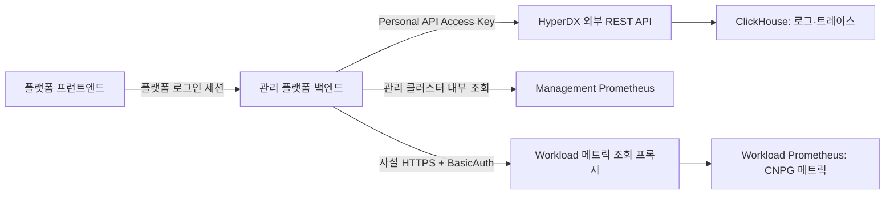

# 관리 플랫폼의 모니터링 데이터 조회 연동

- 날짜: 2026-11-07
- 목적: 관리 플랫폼 백엔드가 관측 시스템에 요청해 데이터를 가져오고, 플랫폼 화면에 표시한다.
- 상태: 조회 아키텍처 문서. 아래 플랫폼 API·자격 증명·접근 정책 연동은 아직 구현하지 않았다. 이 문서가 새 토큰 발급이나 배포 완료를 뜻하지 않는다.
- 결정: [ADR0072](../adr/0072-query-observability-through-management-platform.md).

## 1. 요청 구조



프런트엔드는 관리 플랫폼 API만 호출한다. 백엔드가 사용자 권한·앱 소유권을 확인하고 대상 cluster/namespace/service를 결정한 뒤, 로그·트레이스는 HyperDX 외부 API, 메트릭은 해당 클러스터의 Prometheus API로 조회한다. 결과를 플랫폼 응답 형식으로 정규화해 반환한다.

OTLP Collector와 gateway는 데이터 **수집** 경로다. 화면에서 데이터를 읽는 요청은 Collector의 4318/4319나 ingest NLB로 보내지 않는다. 현재 Kubernetes/CNPG 메트릭은 Prometheus에 저장되어 있으며, HyperDX에서 조회할 수 있다는 사실이 ClickHouse에도 저장된다는 뜻은 아니다.

## 2. 백엔드가 요청할 주소

| 데이터 | 관리 플랫폼 백엔드의 요청 대상 | 인증·주의사항 |
|---|---|---|
| 로그·트레이스 | `http://clickstack.observability.svc:8000/api/v2/...` | HyperDX Personal API Access Key의 Bearer 인증 |
| 관리 클러스터 메트릭 | `http://monitoring-prometheus.observability.svc:9090/api/v1/...` | 관리 클러스터 내부 경로. 플랫폼 Pod의 접근 정책 별도 확인 |
| Workload CNPG 메트릭 | `https://<workload-query-NLB-DNS>/api/v1/...` | 기존 internal NLB TCP443 → TLS/BasicAuth query proxy → Workload Prometheus |

위 `.svc` 주소는 **관리 클러스터 내부** 주소다. 다른 클러스터나 인터넷에서 직접 사용할 공용 URL이 아니다. 플랫폼 백엔드 Pod의 DNS·NetworkPolicy·egress와 대상 ingress 허용 여부를 구현 단계에서 확인한다. 기존 HyperDX Pod의 접근 성공만으로 플랫폼 Pod의 접근도 허용됐다고 판단하지 않는다.

Workload URL은 `observability-metrics-query` Service의 실제 load balancer DNS를 운영 설정으로 주입한다. IP나 로컬 port-forward에 의존하지 않고, 인증서 SAN과 일치하는 DNS와 공개 CA로 검증한다. Workload의 ClusterIP DNS를 관리 클러스터에서 직접 호출하지 않는다.

현재 query proxy는 `/api/v1/query`, `/query_range`, `/query_exemplars`, `/labels`, `/metadata`, `/series`, `/label/<name>/values`의 GET/POST만 허용한다. admin·write·lifecycle API는 차단한다. 설정 근거는 [query proxy 설정](../../helm/charts/observability-boundary/templates/_helpers.tpl)이다.

## 3. 로그·트레이스 조회

### 데이터 소스 확인

백엔드에서 `GET /api/v2/sources`를 호출해 로그/트레이스 소스 ID를 확인한다. 운영 설정에 허용할 source ID를 매핑하고 재시작 때 유효성을 확인한다. 클라이언트가 전달한 임의 source ID를 그대로 사용하지 않는다.

```http
GET /api/v2/sources
Host: clickstack.observability.svc:8000
Authorization: Bearer <PERSONAL_API_ACCESS_KEY>
```

### 검색

백엔드에서 `POST /api/v2/search`를 호출한다. 다음 JSON은 API 형식 예시이며, 실제 요청에는 아래 설명대로 백엔드가 앱 범위 조건을 강제해야 한다.

```http
POST /api/v2/search
Host: clickstack.observability.svc:8000
Authorization: Bearer <PERSONAL_API_ACCESS_KEY>
Content-Type: application/json

{
  "sourceId": "<허용된 로그 source ID>",
  "startTime": "2026-11-07T00:00:00Z",
  "endTime": "2026-11-07T00:15:00Z",
  "where": "SeverityText:ERROR",
  "whereLanguage": "lucene",
  "maxResults": 100
}
```

실제 앱 화면용 조회는 신뢰할 수 있는 앱 배포 정보에서 cluster·namespace·service 범위를 생성해 모든 검색에 적용한다. 정확한 필드 표현은 해당 source의 실제 schema와 OTel resource attribute 저장 방식에 맞춰 매핑한다. 위 예시를 앱 필터 없이 제품 API에 노출하지 않는다.

트레이스도 허용된 trace source ID로 같은 search API를 사용한다. trace ID로 상세 조회하더라도 앱·클러스터 범위와 사용자 권한을 유지한다. 실제 스키마에서 trace ID column 이름을 확인하며, 화면의 임의 SQL·select·sourceId를 그대로 전달하지 않는다.

HyperDX가 반환한 `data` 행을 플랫폼 모델로 변환한다. 수집 데이터가 없는 경우 빈 결과를 반환하되, 수집 미설정·접근 실패·upstream 오류와 구분한다. 기존 UI 내부의 `/clickhouse-proxy`나 세션 전용 `/v1/prometheus`를 제품 연동 계약으로 사용하지 않는다.

## 4. 메트릭 조회

### 현재 값

```http
GET /api/v1/query?query=<백엔드가 생성하고 URL 인코딩한 PromQL>
```

### 차트 시계열

```http
GET /api/v1/query_range?query=<PromQL>&start=<시작시각>&end=<종료시각>&step=<간격>
```

메트릭 이름을 플랫폼의 허용 목록에 매핑하고, 백엔드가 namespace 등 실제 수집 label을 기준으로 PromQL을 생성한다. 예를 들어 앱별 수집 상태는 해당 namespace의 `up`을 조회할 수 있지만, 최종 label/target 대응 관계는 실제 CNPG scrape target을 확인한 뒤 확정한다. 허용하지 않은 임의 PromQL이나 전체 관리 클러스터 지표를 일반 앱 사용자에게 제공하지 않는다.

클러스터 선택은 백엔드의 허용된 target registry로 수행한다. `clusterId → query URL·CA·credential reference`를 매핑하며, 클라이언트가 URL을 지정하게 하지 않는다. 존재하지 않는 클러스터나 미설정 대상은 명시적인 오류로 응답하고 다른 클러스터에 대신 질의하지 않는다. 현재 AWS 경로를 GCP/온프레미스에도 연결 완료했다고 표시하지 않는다.

## 5. 플랫폼 API 설계 예시

아래는 **신규 구현할 route의 예시**이며 기존 endpoint가 아니다. 최종 경로는 플랫폼 router 규칙에 맞춰 확정한다.

| 플랫폼 요청 | 백엔드 처리 |
|---|---|
| `GET /apps/{appId}/observability/logs` | 권한·배포 범위 확인 → 로그 source 검색 |
| `GET /apps/{appId}/observability/traces` | 권한·배포 범위 확인 → trace source 검색 |
| `GET /apps/{appId}/observability/traces/{traceId}` | 동일 앱 범위로 trace 상세 조회 |
| `GET /apps/{appId}/observability/metrics` | 허용 metric + 시간·step 검증 → cluster Prometheus 조회 |

사용자 입력은 기간, 허용된 severity/service/metric, 페이지 크기, trace ID 등 필요한 필터로 제한한다. appId만으로 namespace를 문자열 조합하지 않고 플랫폼이 관리하는 실제 배포 인스턴스와 environment를 조회한다. 앱 이름이 같아도 다른 인스턴스/클러스터 데이터가 섞이지 않게 한다.

로그/트레이스 응답은 시각·본문/이름·severity·service·trace/span ID 등 UI에 필요한 필드로 제한한다. 메트릭은 series label·timestamp/value 배열로 정규화한다. 클라이언트에 upstream credential·connection 객체·원시 오류 stack을 반환하지 않는다.

## 6. 인증·접근 제어

| 자격 증명 | 사용 위치 | 용도 |
|---|---|---|
| 플랫폼 로그인 세션 | 프런트엔드 → 플랫폼 | 앱/운영자 권한 확인 |
| HyperDX Personal API Access Key | 플랫폼 백엔드 → HyperDX | 로그·트레이스 외부 API 조회 |
| Workload query BasicAuth | 플랫폼 백엔드 → query proxy | Workload Prometheus 읽기 요청 |
| 공개 query CA | 플랫폼 백엔드 TLS client | 서버 인증서·hostname 검증 |

Personal API Access Key는 Ingestion API Key 및 gateway의 OTLP Bearer token과 다르다. 로그인 암호나 수집 token을 조회 API에 재사용하지 않는다. API key는 프런트엔드 번들·브라우저 storage·URL·애플리케이션 로그에 넣지 않고, 백엔드에서 Secret reference로 공급한다. 이 문서에서는 발급/저장하지 않았다.

Personal key를 read-only 또는 앱별로 격리된 키라고 가정하지 않는다. 기존 팀의 넓은 데이터·관리 API에 접근할 수 있으므로 플랫폼 adapter는 필요한 조회 endpoint만 호출한다. HyperDX의 팀 경계와 플랫폼의 앱별 사용자 권한은 별개다.

사용자 검색 문자열을 mandatory filter와 단순 이어 붙이지 않는다. 백엔드에서 지원하는 필터만 구조화하고 escape/검증해 생성한다. 필터 우회로 다른 namespace를 읽는 경우를 반드시 테스트한다. source ID, backend URL, PromQL label matcher를 클라이언트가 임의로 바꿀 수 없게 한다.

Workload query credential은 플랫폼용 별도 계정을 준비하는 방향으로 계획한다. 기존 HyperDX용 암호 공유나 MongoDB에서 credential 추출을 전제로 구현하지 않는다. 별도 credential 추가·Secret 공급·NetworkPolicy 변경은 구체적인 구현 계획과 승인을 거쳐야 한다.

## 7. 요청 제한과 오류 처리

구현 시 기간·행 수·시계열 수·step·동시 요청·upstream timeout을 제한한다. 초기값은 구현 단계에서 정하며, 아래는 제안이다.

- 로그 기본 조회 15분·100행, 최대 기간/행 수 제한.
- 메트릭 chart는 기간에 맞는 최소 step과 최대 데이터 포인트 제한.
- 플랫폼 timeout은 기존 query proxy의 read timeout20초보다 짧게 설정하고, 재시도는 횟수를 제한한다.
- 캐시를 사용할 경우 사용자 권한과 cluster/app/instance/source/필터/기간을 cache key에 포함한다.

로그와 메트릭 중 하나만 실패하면 해당 패널의 오류를 구분해 표시한다. 인증/접근 오류를 빈 데이터로 숨기지 않는다. 알림·대시보드 관리 등 쓰기 API를 관측 조회 endpoint에 포함하지 않는다.

## 8. 현재 완료와 추가 구현

### 이미 확인된 기반

- 중앙 ClickHouse의 합성 로그·트레이스 저장.
- HyperDX의 management/workload Prometheus 조회 및 label API HTTP200. [인증 수정 ADR0071](../adr/0071-patch-hyperdx-prometheus-basic-auth.md) 및 PR122 배포 결과에 해당한다.
- 기존 앱의 자동 관측 설정과 CNPG PodMonitor 배포. 이것만으로 모든 앱의 실제 로그·trace·scrape 검증이 완료되는 것은 아니다.

### 관리 플랫폼에서 구현할 항목

1. HyperDX/Prometheus adapter와 환경별 endpoint·source·CA 설정.
2. 백엔드 전용 credential 공급 및 실제 플랫폼 Pod의 네트워크 접근 확인.
3. 사용자/앱/배포 인스턴스 권한 검사와 서버 측 필터·metric 허용 목록.
4. 플랫폼 조회 API·응답 정규화·요청 제한·오류 처리.
5. 로그/트레이스 목록과 메트릭 chart UI.
6. 실제 플랫폼 Pod에서 동일 앱 조회 성공, 타 앱 조회 거절, 잘못된 token/CA 거부, 빈 데이터·upstream 장애 표시 검증.

별도 수집 측 검증으로 앱 stdout의 중앙 유입, CNPG target `up`, 신규 Job 로그, SDK가 배포된 앱의 trace 연결을 확인한다. 이 조회 연동이 SDK 계측이나 데이터 수집 자체를 추가하는 것은 아니다.

ClickHouse SQL 직접 조회는 복잡한 분석이 실제 필요해질 때 별도 adapter·전용 SELECT 계정·리소스 제한을 검토한다. 현재 플랫폼 조회의 기본 경로에는 포함하지 않는다.

## 관련 자료

- [ADR0072: 플랫폼 백엔드의 관측 조회](../adr/0072-query-observability-through-management-platform.md)
- [ADR0061: 사설 전송·조회 경로](../adr/0061-private-otlp-ingress-for-aws-workload.md)
- [자동 수집 구성](automatic-workload-observability.md)
- [현재 query proxy 설정](../../helm/charts/observability-boundary/templates/_helpers.tpl)
- [ClickStack 공식 API·인증 안내](https://clickhouse.com/docs/clickstack/api-reference)
- [사용 중인 HyperDX2.39.1 search API](https://github.com/hyperdxio/hyperdx/blob/6db385c/packages/api/src/routers/external-api/v2/search.ts)
- [Prometheus HTTP API](https://prometheus.io/docs/prometheus/latest/querying/api/)
